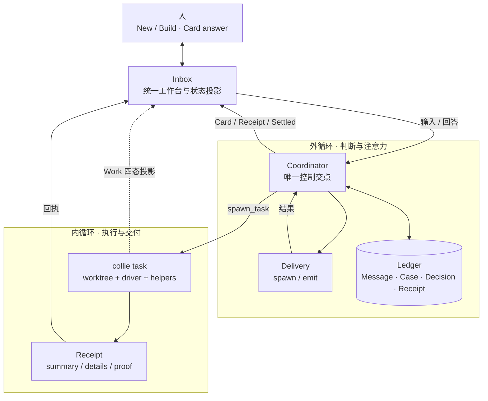

# collie

**herdr 的双循环插件：事件进，判断，行动出。**

```
外部事件 → Ingress → coordinator → collie task → receipt → service（Card | Settled）
人的对话 ─────────────→ coordinator（新建 / steering / 回答）
```

装法、升级、自检与 [shepherdr](https://github.com/eliasstravik/shepherdr) 一致：`./install.sh` → `bin/collie doctor`。

## 状态

Decision 和 Task 是两个持久状态机：Decision 为 `open / waiting / settled`，Task 为 `todo / running / ready / done`。Work 只有四个一级状态，是 `Decision + Task + live agent` 的只读投影，不是第三套状态机。

Work 按优先级取第一个命中的条件：Decision `settled → Settled`，Decision `waiting → Needs you`，live blocked `→ Needs you`，有 live driver / helper `→ Working`；没有以上条件时，Task `ready → Needs you`、`done → Settled`、`running → Working`（不要求 live agent），其余为 `Todo`。因此无 live role 的 `Decision.open + Task.done` 也是 Settled，`Decision.open + Task.ready + live helper` 仍显示 Working。完整判定表见 [`docs/TASK-LIFECYCLE.md`](docs/TASK-LIFECYCLE.md) §2.5。

Driver 只能通过 `ready` 交付 summary / details / proof。公开 `collie task` 子命令只有 `add / list / show / start / status / ready / accept / done`。accept 使 `ready → done`，drop 通过 finalization 使 Task 进入 `done`，rework 对同一 Task 再执行 `start`，也覆盖 terminal 已移除的 stopped-running Task。`failed` 是 Decision / Card 语义，不是 Task 状态；`ack` 不等于 settled。

Ticket 通常由 Decision 驱动。`collie task` 可以产生没有 Decision 的 orphan task；Inbox 会把它投影成 synthetic ticket 以便继续接入，仍可用 `collie ticket adopt` 补上持久 Decision，不会重复 spawn。

## 为什么

现在的做法是「外部事件 → 把一段提示词注入 agent 的对话」，由此有四个病：

1. **打断**——机器事件被当成了用户发言；
2. **语义混淆**——`ack`（读过了）被当成 `settle`（处理过了），队列永远清不空；
3. **无全局**——同一件事被派两次；
4. **判断散落**——有的在规则里，有的在提示词里，有的在人脑里。

## 怎么做

- **一个判断者**：每 space 一个 coordinator；外部事件和人的消息都作为 Message 由它判断，没有第二个 dispatcher。hops / budget 等内核护栏可以直接生成系统 Decision 或 Card。
- **两种消息来源**：外部事件和人的消息都是 Message；来源只决定展示和预算，不改变 Coordinator / Decision 契约。
- **一个队列**：只有 `waiting` 的 Decision 进队列；Todo / Working 是执行投影，不是队列。
- **一个正式出口**：外部机器事件到人的正式决策出口是 Card；worker 的权限/问题 hook 是另一类终端交互，不伪造 Decision。政策由用户定义，coordinator 只能起草不能自改。
- **一个独立界面**：Inbox 是 Collie 自己的工作台；Ticket body 只有 Terminal 与 Artifacts。Terminal 属于 driver，helper 使用独立 Herdr tab，helper-only 不会抢占 driver Terminal。
- **一个判断台账**：Ledger 记录 Message、Case、Decision、Receipt；Task 由独立 task store 维护。Decision 与 Task 都是持久状态机，Work 不是；Card 不是新对象，是 `Decision.state = waiting`。
- **显式产物归属**：Artifact 只通过 `artifact.task` 或 `Task.proof` 绑定 Ticket，不扫描日志，也不按发布时间推断。
- **执行与交付分离**：playbook 决定 review / verify 和 merge / comment / close 等 delivery；它们不是 Task 状态或 accept 前置条件。
- **四道缝**：`source`（进）/ `agent`（干）/ `channel`（问人）/ `delivery`（出）。前三个是可替换接口；当前 `source` adapter 仍需写代码，不能只加配置目录。

## 结构



## 扩展方式

当前扩展点是配置，不是新建 `templates/<domain>/`：

- Role：`~/.config/collie/roles/*.md`
- Playbook：`~/.config/collie/playbooks/*.md`
- Source adapter：仍是代码（`service/sources.ts` 等），不能只加目录。

Role / Playbook 使用 skill 风格 `name` / `description` / `version`；详细规则见 [`docs/SETTINGS.md`](docs/SETTINGS.md)。

## 文档

- [`docs/ARCHITECTURE.md`](docs/ARCHITECTURE.md) — 双循环、Message/Event/Ingress、Coordinator/policy、状态、流程、Inbox
- [`docs/COLLABORATION.md`](docs/COLLABORATION.md) — Coordinator / Driver / Helper 与 playbook 编排边界
- [`docs/TASK-LIFECYCLE.md`](docs/TASK-LIFECYCLE.md) — Decision / Task 状态机、receipt、accept / rework / drop
- [`docs/CLI.md`](docs/CLI.md) — Coordinator、Driver 与运维使用的 `collie` CLI 完整说明
- [`docs/RUNBOOK.md`](docs/RUNBOOK.md) — 安装、排障、回滚
- [`protocol/README.md`](protocol/README.md) — schema 索引

## 依赖

herdr-app（含 herdr-core）、Python 3.10+、bun、git、至少一个已登录的 CLI agent；使用 GitHub/GitLab delivery 时还需要已登录的 `gh` / `glab`。执行层与 artifacts 都由 collie vendored 源码提供（`collie task` / `collie-artifact`），不再需要 shepherdr 的 `tasks` / `chat` / `artifacts` add-on。

Event / Ingress 的机制参照 [agent-autoloop](https://github.com/KKKKhazix/agent-autoloop)：来源自己连进来、`source + key` 去重、同对象归并、hops 熔断。
