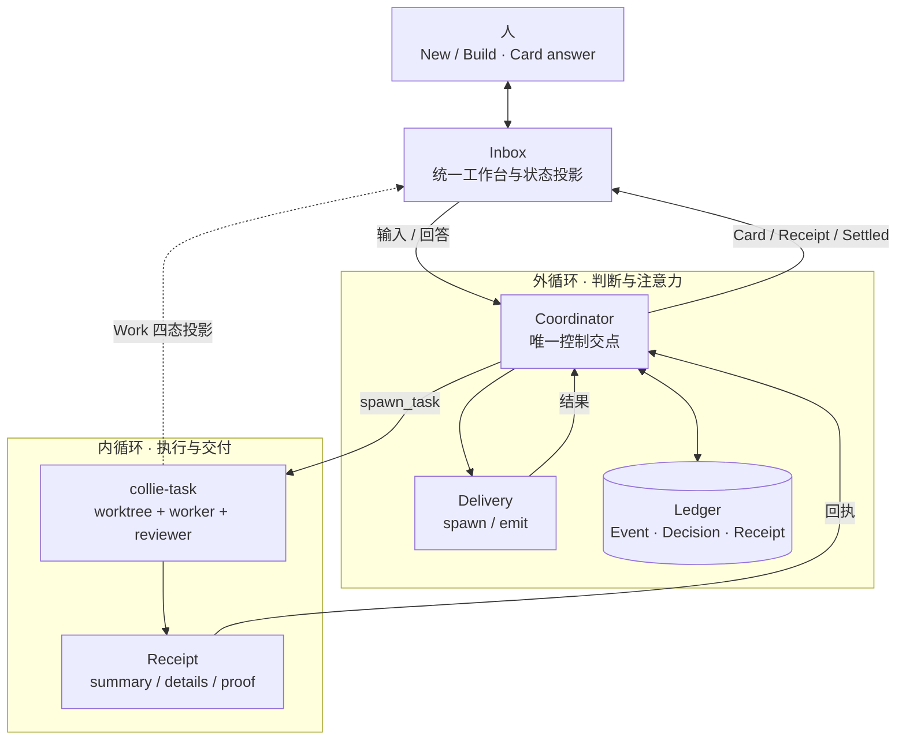

# collie

**herdr 的双循环插件：事件进，判断，行动出。**

```
外部事件 → Ingress → coordinator → collie-task → coordinator →（collie-task | 发外部命令）
人的对话 ─────────────→ coordinator（新建 / steering / 回答）
```

装法、升级、自检与 [shepherdr](https://github.com/eliasstravik/shepherdr) 一致：`./install.sh` → `bin/collie doctor`。

## 状态

Work 只有四个一级状态，它们是 `Decision + Task + Receipt` 的投影，不是第二套状态机：

| 状态 | 含义 |
|:--|:--|
| **Needs you** | 有一张等你处理的 Card：提问、授权、异常、验收；`failed` 的 alert 卡也在这里 |
| **Todo** | 还没有 agent 在跑：待派发、依赖、排队、定时 |
| **Working** | 有 agent 在跑；`kind = build / review / merge` |
| **Settled** | Decision 带 `settled { at, by, outcome }` |

`Queued`、`Scheduled`、`Merging` 是 collie-task 的执行细节，写在 Todo / Working 行的第二行，不单独占一级状态。`failed` 不是 Settled；`ack` 也不等于 settled。

### 投影映射

| Decision | live / task | Ticket |
|:--|:--|:--|
| `settled` | 任意 | **Settled** |
| `waiting` | 任意 | **Needs you** |
| `open` | live blocked | **Needs you** |
| `open` | live worker / reviewer | **Working**（kind 只是行内属性） |
| `open` | task `queued` / `scheduled` / `todo` | **Todo** |
| `open` | task `running` / `ready` / `merging` / `done`，或 task_ref 暂不可读 | **Working** |

Ticket 必须有 Decision。只有 `collie-task`、没有 Decision 的孤儿 task 不进 Inbox；用 `collie-ticket adopt` 补链，不重复 spawn。

## 为什么

现在的做法是「外部事件 → 把一段提示词注入 agent 的对话」，由此有四个病：

1. **打断**——机器事件被当成了用户发言；
2. **语义混淆**——`ack`（读过了）被当成 `settle`（处理过了），队列永远清不空；
3. **无全局**——同一件事被派两次；
4. **判断散落**——有的在规则里，有的在提示词里，有的在人脑里。

## 怎么做

- **一个判断者**：每 space 一个 coordinator；外部事件全部由它判断，没有第二个 dispatcher，也没有 route table。
- **两个输入面**：外部事件走 Ingress 到 coordinator 的 job；人的对话直接进 coordinator 的 chat，用来新建、steering、回答。
- **一个队列**：只有 `waiting` 的 Decision 进队列；Todo / Working 是执行投影，不是队列。
- **一个出口**：机器到人的唯一形态是一张 Card；policy 由用户定义，coordinator 只能起草不能自改。
- **一个独立界面**：Inbox 是 Collie 自己的工作台；Ticket 详情移植 shepherdr 的 task 视图，只留 Terminal 与 Artifacts。
- **一本台账**：只记 Event、Decision、Task；Card 不是新对象，是 `Decision.state = waiting`。
- **四道缝**：`source`（进）/ `agent`（干）/ `channel`（问人）/ `delivery`（出），每个都能换。

## 结构



## 域扩展

双循环是骨架，domain 只填三样：**事件词汇 / 决定词汇 / brief 模板**。加一个域 = 加一个 `templates/<domain>/`，不改代码。

## 文档

- [`docs/ARCHITECTURE.md`](docs/ARCHITECTURE.md) — 双循环、两个输入面、Event/Ingress、Coordinator/policy、状态、流程、Inbox
- [`docs/RUNBOOK.md`](docs/RUNBOOK.md) — 安装、排障、回滚
- [`protocol/README.md`](protocol/README.md) — schema 索引

## 依赖

herdr-app（含 herdr-core）、bun、git、至少一个已登录的 CLI agent。执行层与 artifacts 都由 collie vendored 源码提供（`collie-task` / `collie-artifact`），不再需要 shepherdr 的 `tasks` / `chat` / `artifacts` add-on。

Event / Ingress 的机制参照 [agent-autoloop](https://github.com/KKKKhazix/agent-autoloop)：来源自己连进来、`source + key` 去重、同对象归并、hops 熔断。
