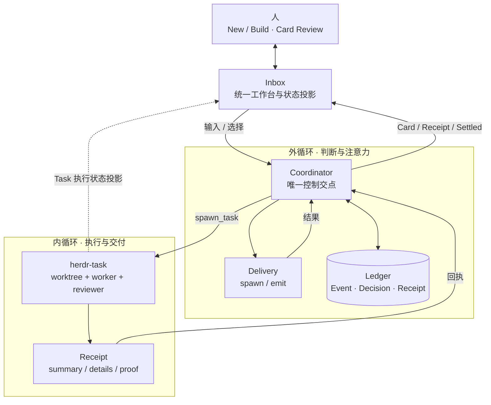

# collie

**herdr 的双循环插件：事件进，判断，行动出。**

```
外部事件或人的 New/Build → coordinator → herdr task → coordinator → (herdr task | 发外部命令)
```

装法、升级、自检与 [shepherdr](https://github.com/eliasstravik/shepherdr) 一致：`./install.sh` → `doctor` → `Ctrl+Shift+L`。

> 状态：M0–M7 为既有协议与执行基础；**v2.1 独立 Inbox layout 与 New / Build 交互修订待 review**。目标设计以 [`docs/DESIGN.md`](docs/DESIGN.md) 和 [`docs/FLOW.md`](docs/FLOW.md) 为准。

## 为什么

现在的做法是「外部事件 → 把一段提示词注入 agent 的对话」，由此有四个病：

1. **打断**——机器事件被当成了用户发言；
2. **语义混淆**——`ack`（读过了）被当成 `settle`（处理过了），队列永远清不空；
3. **无全局**——同一件事被派两次；
4. **判断散落**——有的在规则里，有的在提示词里，有的在人脑里。

## 怎么做

- **一个判断者**：coordinator 读全局、拆任务、定优先级、可委派。路由表是它的缓存，护栏是人留的否决权。
- **一个出口**：机器到人的唯一形态是**一张卡**；人可以主动 New / Build，也可以对卡片做一次选择，二者都回到同一 coordinator。
- **一个独立界面**：Inbox layout 不拼接 shepherdr 的 Assistant、Tasks、Files、Changes、Artifacts；执行能力复用，交互流程不复用。
- **一本台账**：只记三样——Event、Decision、Task。Card 不是新对象，是 `Decision.state = waiting`。
- **四道缝**：`source`（进）/ `agent`（干）/ `channel`（问人）/ `delivery`（出），每个都能换。

## 结构



## 域扩展

双循环是骨架，domain 只填三样：**事件词汇 / 决定词汇 / brief 模板**。v1 做开发流程；加一个域 = 加一个 `templates/<domain>/`，不改代码。

## 文档

- [`docs/DESIGN.md`](docs/DESIGN.md) — 双循环、四道缝、三个对象、状态机、包形态
- [`docs/FLOW.md`](docs/FLOW.md) — 事件与双循环流转图、代码入口对照
- [`protocol/README.md`](protocol/README.md) — schema 索引、不变量与开放问题
- `docs/RUNBOOK.md` — 安装、排障、回滚（M6）

## 依赖

herdr-app 0.1.12+ / herdr-core 0.1.17+、`herdr-task`（来自 shepherdr）、bun、git、至少一个已登录的 CLI agent。
