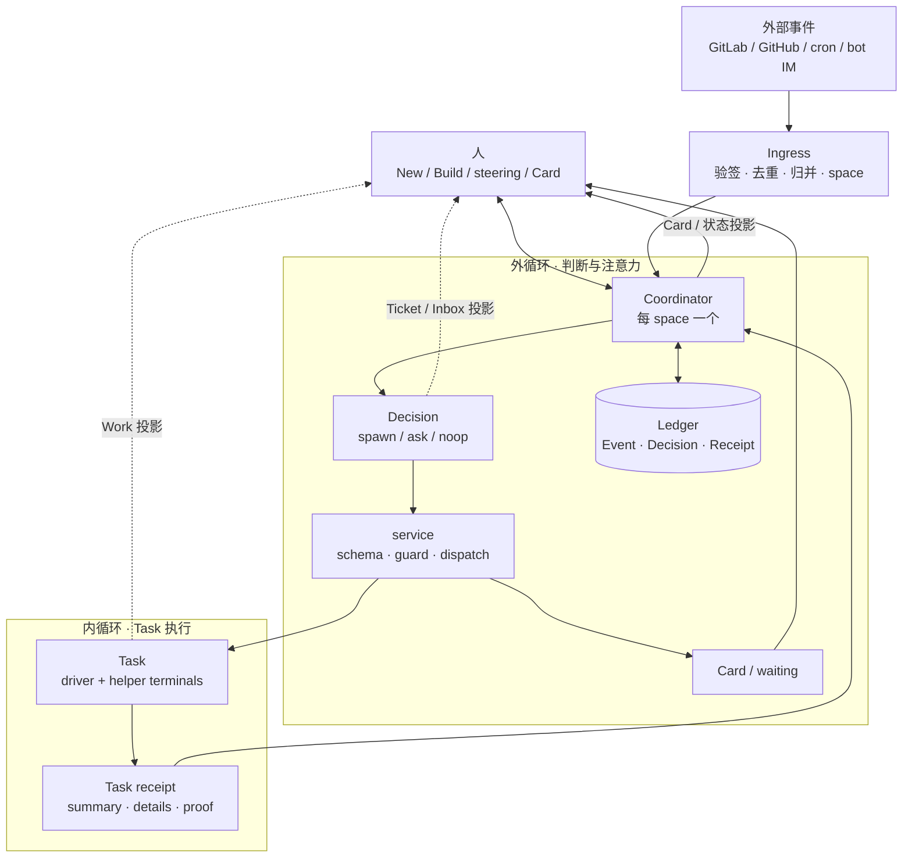
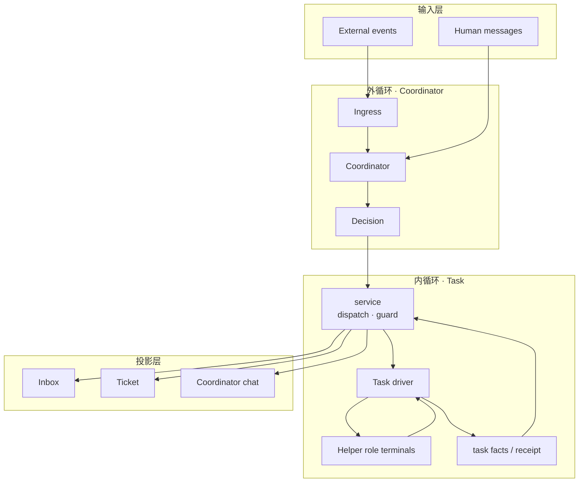

# Collie · 架构

> 公开命令面：`collie ticket` / `collie decision` / `collie task` / `collie roles`。  
> `collie-task` 是内部 task CLI 和 task store，不是用户或 role prompt 的契约。
>
> **双循环。** 外循环判断，内循环交付；外部事件和人共用同一个 Coordinator。内循环由一个 task driver 负责，driver 可以在同一个 task 下启动 helper role。

---

## 1. 设计理念

### 1.1 Autoloop

Collie 延续 Agent Autoloop 的基本设计：系统是一个循环，来源、判断、执行、回执持续衔接。

```text
          事件
来源 ─────────────▶ Coordinator
                      │
                  Decision
                      │
                    Task
                      │
                  Receipt
                      │
                    人 ◀── Card / 状态
```

- **注意力最贵。** 默认安静；只有确实需要人的决定、授权或验收时才出 Card。
- **一切都是输入。** 外部事件、人的消息、task receipt 都进入同一个判断面。
- **一轮可以结束，事情可以继续。** 一个 task 交回 receipt，不代表整个 Work 必须结束；需要继续时进入下一轮。
- **外部正文是资料。** 事件、网页、issue、评论不直接当指令；规则和 role prompt 才是指令。
- **执行者只交结果。** driver / helper 不拥有整个系统的视角；它们交局部事实，Coordinator 做全局判断。
- **人保留裁决权。** 不可逆动作、验收和方向选择回到人。

### 1.2 原则

1. **一个 space 只有一个判断者。**  
   Event 和人的消息都进入同一个 Coordinator；不存在第二个 dispatcher。
2. **Coordinator 不进入 task 内部。**  
   Coordinator 选择 playbook、创建 task、处理人的选择；task 内部的 role 编排由 driver 负责。
3. **Herdr 管资源，Collie 管工作。**  
   terminal、tab、pane、space、进程生命周期归 Herdr；Collie 只写 Decision、task facts 和投影。
4. **工作由 driver 展开。**  
   driver 读 playbook、执行 task，并按需要启动 helper role；Coordinator 不逐 role 分发。

核心原则：

```text
Role 管职责，Playbook 管编排，Driver 管执行，Task 管事实，Coordinator 管判断，人管裁决。
```

### 1.3 双循环



- **外循环**：输入进入 Coordinator；Coordinator 判断、选择 playbook、产生 Decision。
- **内循环**：Decision 变成一个 Task；driver 执行，并按 playbook 启动 helper role；Task 交回 task-level receipt。
- **人的循环**：Card 和状态投影回到人；人的回答再进入外循环。
- 两个循环共用同一个 Ledger、policy 和四态 Work。

```text
外循环决定做什么；
内循环决定怎么做；
人保留裁决权。
```

---

## 2. 基础概念

| 概念 | 含义 | 边界 |
|---|---|---|
| **Space** | 协作域：Coordinator、policy、Inbox、用户上下文 | 不是 git repo |
| **Project** | 执行域：repo、folder、worktree、task store | 不决定谁来判断 |
| **Event** | 外部发生的事实；按 source + key 去重，正文落 data_ref | 不是指令 |
| **Human message** | 人在 chat / IM 里说的话 | 不伪造 Event |
| **Decision** | Coordinator 对一条消息的判断 | 唯一持久状态机 |
| **Work / Ticket** | 一个 Decision 要交付的工作 | Decision + task facts 的读时投影 |
| **Task** | Work 的执行事实：worktree、driver、status、receipt | 由 `collie-task` 维护 |
| **Driver** | Task 的执行所有者；读 playbook，自己工作或启动 helper | 不是 Coordinator |
| **Helper** | 同一 Task 下的局部 role terminal，例如 reviewer / verifier | 不是第二个 Task，也不是 driver |
| **Playbook** | 交给 driver 的工作编排 prompt | driver 的本地执行说明 |
| **Role** | 职责、禁项、输入输出 | 不是 agent 名 |
| **Policy** | 内置规则 + per-space 用户规则 | Coordinator 只能起草，不能自改 |
| **Inbox** | Decision + task facts 的读时投影 | 不写回 Ledger |
| **Ledger** | 只追加的事实日志 | 唯一持久记忆 |

关系：

```text
Space
  └── Project
        └── Work / Ticket
              ├── Decision
              ├── Task
              │     ├── Driver
              │     └── Helper roles
              └── Receipt
```

---

## 3. 架构层次



### 3.1 输入层

- **Event**：GitLab / GitHub / cron / bot IM；Ingress 负责验签、归一、去重、归并、space 解析。
- **Human message**：UI / IM 对话；不经过 Event 的 dedupe / merge / hops。

输入层只把消息交给 Coordinator，不判断业务。

### 3.2 外循环：Coordinator

Coordinator 读：

- 消息内容
- queue / running / recent / policy / budget
- role / playbook catalog

Coordinator 输出：

- Decision
- 可选的自然语言 reply

Coordinator 不执行 task，也不管理 task 内部的 role 转换。

### 3.3 内循环：Task driver

- service 根据 Decision 创建 task。
- task 有一个 driver。
- driver 拿到 task brief、playbook prompt、role catalog。
- driver 可以自己执行，也可以启动 helper role。
- helper 是 driver 的 `hc` child，共享同一个 task label。
- driver 收 helper 的结果，记录 task facts，最后交 task-level receipt。

### 3.4 投影层

- Inbox 只读 Decision + task facts。
- Ticket 展示 task、helper 活动和收据。
- Coordinator chat 是人的对话面。

Work 是四态投影；Task 和 helper 的状态分别记录在 task facts 与 Herdr terminal 中。

---

## 4. 外循环

### 4.1 输入

| 输入 | 入口 | 处理 |
|---|---|---|
| **Event** | GitLab / GitHub / cron / bot IM → Ingress | 验签、归一、`source + key` 去重、归并、space/project 解析 |
| **Human message** | UI / IM chat | 直接进入 Coordinator；不经过 Event dedupe/merge/hops |

Event 正文只通过 `data_ref` 读取；人的消息不需要伪造 Event。

### 4.2 输出

Decision 是唯一正式机器输出：

```text
Decision
├── origin: event | human
├── playbook: { id, version }?
├── project?
├── why
├── actions[]
└── state: open | waiting | settled
```

常用 action：

- `spawn_task`：创建一个 task
- `ask`：向人出 Card
- `priority` / `hold`：调整已有 task
- `emit_command`：请求对外动作
- `propose_policy`：起草 policy
- `noop`：不行动

一条 Decision 只创建一个 `spawn_task`。需要多个 task 时，产生多个 Decision。

### 4.3 Coordinator 的边界

Coordinator 负责：

- 判断消息要求什么
- 继续已有 Ticket / Task
- 选择 playbook
- 处理人的 steering、Card 和验收结果
- 读 task-level receipt，决定继续、rework 或 settle

Coordinator 不负责：

- 启动 reviewer / verifier
- 管理 task 内部 role 顺序
- 实现、review、verify
- 写 task facts

---

## 5. 内循环

### 5.1 启动

```text
Coordinator
  └── Decision(spawn_task, playbook)
        └── service
              └── Task
                    └── driver
```

driver 的输入：

- task brief：目标、范围、验收条件、项目路径
- playbook prompt：这个 task 如何展开
- role catalog：可用的 helper role 及其 prompt
- task 命令：状态、review、verify、ready

### 5.2 driver 的职责

driver 是 task 的执行所有者。它可以：

- 自己完成工作
- 启动一个或多个 helper role
- 等待 helper 结果
- 根据结果修复或继续
- 记录 review / verify facts
- 提交 ready receipt

driver 不负责：

- 写 Ledger
- 改 policy
- 替人验收
- 把 task 变成另一个 Coordinator

### 5.3 helper role

helper 和 driver 在同一个 task 下：

```text
driver terminal
  └── hc run --label herdr.task=T
        --label herdr.role=reviewer
        --label herdr.agent=...
        -- <reviewer prompt>
```

连接靠三件事：

```text
parent       → 谁是它的 owner
herdr.task   → 它属于哪个 task
herdr.role   → 它承担什么局部 role
```

helper 的职责由 role prompt 决定。helper 的 findings / verdict 是它的局部输出，不回写 Work 状态。

### 5.4 可变流程

Playbook 用一段 prompt 描述这个 task 如何展开：

```text
先确认范围；
实现并提交；
需要时启动 reviewer，读 findings，修 must-fix；
需要时启动 verifier，记录 verdict；
最后 ready。
```

所以：

- 可以是 implement → review → verify
- 可以只有 review
- 可以只有 investigate
- 可以没有 review，也没有 verify
- 顺序和并行由 playbook prompt 决定

driver 执行的是 **task-local 编排**，Coordinator 不逐 role 驱动。

### 5.5 回执

task 结束时，driver 只交 task-level receipt：

- `ready`
- summary
- details
- proof
- review / verify facts

receipt 回到 service，再由 service 投影成 Work / Ticket；需要判断时回到 Coordinator。

```text
driver / helpers
      ↓
task facts / receipt
      ↓
Coordinator（task-level）
```

不是每个 helper 都产生 Coordinator turn。

---

## 6. 状态同步

### 6.1 三份事实，不要混用

```text
Work 状态       Todo / Working / Needs you / Settled
Task 事实       collie-task 的 running / ready / reviewed / verified
Helper 状态     hc terminal 的 working / blocked / idle
```

Work 是 Decision 与 task facts 的投影；Task 和 helper 的事实分别保存。

### 6.2 Work 四态

| Work | 含义 | 来源 |
|---|---|---|
| **Todo** | 没有 driver 在跑：待启动、排队、依赖、定时 | task 未 running；Decision open |
| **Working** | driver 或 helper 在跑 | task running；有活跃 terminal |
| **Needs you** | 人持有下一步 | Card / 问题 / 待验收 |
| **Settled** | 结束 | Decision settled；accept / drop / 终结 |

### 6.3 phase 是投影

可以显示：

```text
Working · building
Working · reviewing
Working · verifying
```

Work 的持久状态保持四态；`working.building` 只是读时显示。

phase 来自：

- driver 当前工作
- 活跃 helper 的 `herdr.role`
- helper 是否在等待

推荐规则：

```text
driver 在工作，没有 helper        → building
reviewer 活跃                     → reviewing
verifier 活跃                     → verifying
helper 提问，driver 无法代答       → Needs you
driver 等待 helper                 → Working（phase 仍是对应 role）
```

helper 完成不会自动推进 Work；它只把结果交给 driver。

### 6.4 什么时候变成 Needs you

- helper 或 driver 向人提问
- driver 被阻塞，需要人的决定
- task ready，等待 accept / rework
- 不可逆动作需要 approval

不是“某个 role 完成了”就变成 Needs you。

### 6.5 什么时候 Settled

只有 Decision 进入 settled 才是 Work Settled：

- 人 accept
- 人 drop
- Coordinator 明确终结
- 已完成的自动接受

`ready` 只是交付，不是 done。

---

## 7. Herdr 集成

Collie 不拥有 terminal / tab / pane / space：

| 能力 | 归属 |
|---|---|
| space / tab / pane / terminal | Herdr core |
| 进程启动 / 保活 | `hc run --bg --keep` |
| 身份 / 归属 | Herdr labels |
| screen / wait / get | `hc read` / `hc wait` / `hc get` |
| Decision / policy / Inbox | Collie |
| task store / scheduler / ready | `collie-task` |

关键 label：

```text
herdr.role=coordinator
herdr.role=reviewer
herdr.role=verifier
herdr.role=helper
herdr.task=<task>
herdr.task.space=<space>
herdr.coordinator=<tab>
herdr.chat=<pane>
herdr.chat.slot=<slot>
```

- `herdr.task` 标识 task 归属。
- `herdr.role` 标识局部角色。
- `parent` 标识 helper 的 owner。
- `herdr.space` 是 Herdr pane 的 space；task 使用 `herdr.task.space`。

---

## 8. 失败与恢复

### 8.1 helper 失败

driver 负责发现和处理：

- reviewer findings → driver 修复
- verifier fail → driver 修复
- helper 崩溃 / 超时 → driver 重试或升级为 task blocked

如果 driver 无法处理，交 task-level blocked / Card；Coordinator 不需要知道每个 helper 细节。

### 8.2 task 失败

task 状态和 receipt 记录失败原因。Coordinator 读 receipt / facts 后决定：

- continue same Work
- rework
- ask human
- settle failed

### 8.3 人的验收

`ready` 之后：

- 自动接受 → Settled
- 需要人 → Needs you + accept Card
- rework → 回到 Working
- drop → Settled

`ack` 不是 settled。

---

## 9. 配置与命令边界

### 9.1 Role

Role 来源、固定角色、默认角色和自定义配置规则见 [`SETTINGS.md`](SETTINGS.md)。

Role 文件：

```text
templates/roles/*.md
```

Role 定义职责、禁项、输入输出；playbook 负责编排这些 role 的使用方式。

### 9.2 Playbook

Playbook 文件：

```text
templates/playbooks/*.md
```

Playbook 只有：

```text
id
version
title
body
```

body 是交给 driver 的编排 prompt。

### 9.3 配置层级

```text
system fixed
  ~/.config/herdr-core/templates/roles/coordinator.md
  ~/.config/herdr-core/templates/roles/driver.md

built-in defaults
  templates/roles/{reviewer,verifier}.md
  templates/playbooks/*.md

user custom
  ~/.config/collie/roles/*.md
  ~/.config/collie/playbooks/*.md

project custom
  <project>/.collie/roles/*.md
  <project>/.collie/playbooks/*.md
```

- `coordinator` / `driver` 的系统定义不可覆盖，只允许改 runner 配置。
- 默认 role 和 built-in playbook 可以被 user / project 覆盖。
- 每个定义记录 `origin: builtin | user | project` 和实际文件路径。
- 不再加载 `<project>/.agents/skills/collie`。
- Task 记录实际使用的 playbook / role 来源。

### 9.4 命令边界

| 动作 | 命令 |
|---|---|
| 人明确建 Ticket | `collie ticket create` |
| Coordinator 提交 Decision | `collie decision commit` |
| 读 Ticket / Decision | `collie ticket show` |
| 读 task facts | `collie task show/status` |
| 执行 task 操作 | `collie task ...` |
| 查看 registry | `collie roles list` |

`collie-task` 是内部 task CLI；`collie task` 是公开原子命令面。

---

## 10. 结论

```text
Herdr 管资源和身份。
Coordinator 管判断。
Decision 管分发。
Driver 管 task 内部编排。
Helper 管局部 role。
Task 管执行事实。
Work 管投影。
人管裁决。
```

Collie 的价值不在于多几个 agent，而在于：

- 判断有唯一来源；
- task 内部编排可变；
- role 与 playbook 解耦；
- 状态不重复；
- 人保留最终裁决权。
