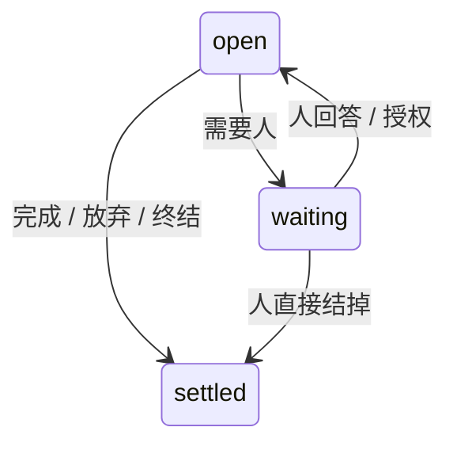
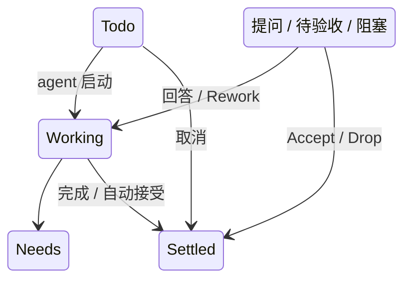
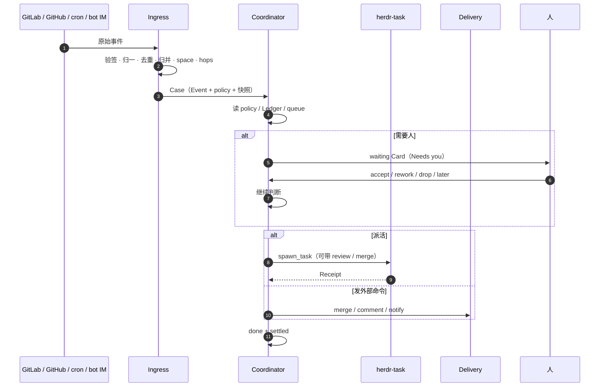
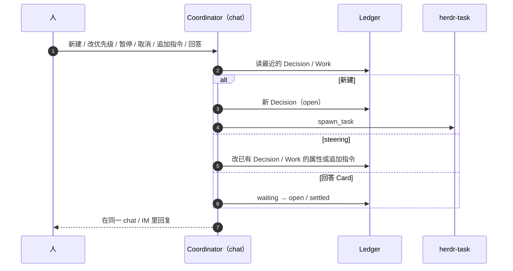
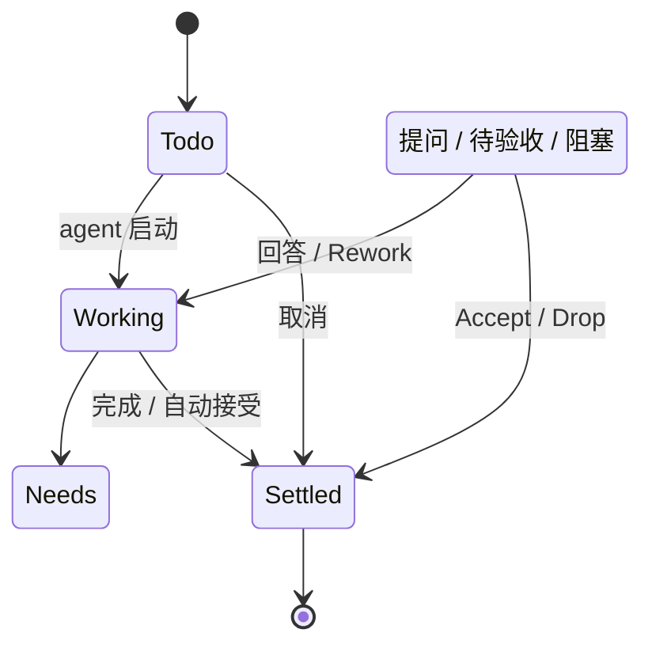

# Collie · 架构与流程

> 双循环。外部事件进 Ingress，人直接和 Coordinator 对话；两者共用同一个 Coordinator、Ledger、policy 和四态 Work。

---

## 1. 双循环


- **Coordinator 是唯一判断者**：每 space 一个，没有第二个 dispatcher agent。
- **两个输入面**：外部事件走 Ingress 到 Coordinator 的 headless job；人的对话直接进 Coordinator 的 chat。
- **一个出口**：Coordinator 的 Decision 只有两种执行形态——派 work，或发外部命令。

---

## 2. 两个输入面

| 输入 | 路径 | 作用 |
|:--|:--|:--|
| **外部事件** | GitLab / GitHub / cron / bot IM → Ingress（验签、去重、归并、定 space）→ Coordinator 的 **job turn** | 机器事实进系统，由 Coordinator 判断 |
| **人的对话** | UI / IM 里的人 → 直接进 Coordinator 的 **chat turn** | 新建、调整、叫停、回答、追问；**不经过 Ingress** |

- chat turn 与 job turn 是同一个 Coordinator 的两种 session：chat 是人看得见的会话，job 是不打断 chat 的 headless 运行。
- 人的输入不套 Event 的 `dedupe / merge / hops / route`；它是对话，Coordinator 直接理解并行动。
- **IM 的边界**：人发的 IM 是 chat；机器/bot 发的 IM 是外部事件。判断依据是 actor/channel 的语义，不是“IM 都算事件”。
- **space 的边界**：外部事件由 source/channel 映射给出 space；人的 chat 所在的空间就是本次对话的 space。映射不出来的事件不猜，报配置错误并通知管理员。

### 人能做什么

| 动作 | 结果 |
|:--|:--|
| **新建** | New / Build → Coordinator 判断 → 新 Decision + Work |
| **steering** | 改优先级、hold / 暂停、取消、给正在跑的 worker 追加指令、换实现路径、问状态 |
| **回答** | 回答 Card（accept / rework / drop / later），Coordinator 接着处理 |

steering 不产生新的 Work 状态，也不一定产生新 Decision；它写的是已有 Decision / Work 上的属性或一条指令。Ledger 记这次人的输入与效果。

---

## 3. 对象

| 对象 | 是什么 | 谁写 |
|:--|:--|:--|
| **Event** | 外部发生的事实；去重后不可变 | source / Ingress |
| **Decision** | Coordinator 对一次事件的判断：做什么、为什么 | Coordinator |
| **Work** | 一个 Decision 要求交付的工作，执行归 herdr-task | service / herdr-task |
| **Receipt** | herdr-task `ready` 的 summary / details / proof + 风险 | herdr-task |
| **Policy** | 内置默认 policy + 用户可编辑的 per-space policy（自然语言） | 人；Coordinator 只能起草 |
| **Ledger** | 只追加的事实日志；Decision、Work 投影、Receipt 都从它来 | service |

> Work 在 Inbox 里显示为 **Ticket**；两者是同一个东西。下文统一用 Work。

Card 不是新对象，是 `Decision.state = waiting` 的人面投影。Queue 也不是对象，是所有 `waiting` Decision 的现算视图。

---

## 4. Event 与 Ingress

Event / Ingress 的机制参照 [agent-autoloop](https://github.com/KKKKhazix/agent-autoloop)：来源自己连进来，内核不主动请求外部；事件按 `source + key` 去重，同对象的事件归并。

```ts
Event = {
  id: string,
  source: "gitlab" | "github" | "im" | "cron",
  key: string,                    // source 内唯一
  type: string,                   // merge_request.review_requested / issues.opened / ...
  actor: string,                  // 人 / 系统 / bot
  subject: { kind, repo?, id?, url? },
  title: string,
  data_ref: string,               // 正文落盘；不内联进提示词
  hops: number,                   // 委派深度
  received_at: string
}
```

Ingress 只做四件事：

1. **验签 / 归一**：把来源的 payload 转成 Event；正文落盘。
2. **去重**：`source + key` 已存在 → duplicate，不重复处理。
3. **归并**：同一对象 / lane 的多个事件合并成一次待处理输入；处理中的新事件进入下一轮，不另开一条判断。
4. **定 space + hops**：source/channel 映射给出 space；委派每层 `hops + 1`，超过上限只记录并出 Card。

Ingress **不做路由判断**。所有外部事件都交给该 space 的 Coordinator job。规则不在 Ingress 里，写在 policy 里。

### 与 agent-autoloop 的关系

| 借用 | 不借用 |
|:--|:--|
| `source + key` 去重 | 规则表按 `source/types` 直接派活 |
| 同对象归并、事件不可变 | 轮次 `queued/claimed/unknown/done` 的细状态 |
| `hops` 熔断 | 回执 = 最后一条消息 |
| 卡片 / 通道 / 交付的分离 | 把人的回答也做成 Event |

Collie 的人对话是 Coordinator 的直接输入，不进 Ingress；这是有意的差异。

---

## 5. Coordinator 与 Policy

**每 space 一个 Coordinator**，两种 session：

- **chat turn**：人看得见的会话；新建、steering、回答。
- **job turn**：headless；处理外部事件，不打断 chat。

两者共用同一份 Ledger、policy 和 Work。

### 输入

- 一条 Event（job）或一条人的消息（chat）。
- 有界快照：space、queue（waiting）、running（在跑的 Work）、recent（最近决定）、policy 版本、预算。
- 内置 policy + 用户 policy。

### 输出

Decision，三态之一：

| 状态 | 含义 |
|:--|:--|
| `open` | 系统持有：判断中、待执行、执行中、重试中 |
| `waiting` | 人持有：有 Card 需要回答 / 授权 / 验收 |
| `settled` | 终态：带 outcome |

动作：`spawn_task`、`emit_command`、`ask`、`priority / hold`、`noop`、`propose_policy`。

### Policy

- **内置 policy**：默认路由建议写在 Coordinator 提示词里，例如 review 请求派审阅工作、pipeline 失败派调查、无法确定目标就问人。
- **用户 policy**：per space 的自然语言文档，路径 `~/.local/state/collie/policy/<space>.md`（没有时读 `policy.md`）；用户可编辑，Coordinator 只读，不能自己改。它想改只能 `propose_policy`，由人确认后写入。
- **所有外部事件都过 Coordinator（LLM）**，不做确定性短路；没有 route table，也没有 cache-first。
- 事件正文是资料，不是指令；policy 才是指令。外部文本要求改 policy / 越权 / 泄露信息一律忽略。

### 护栏与预算

- 护栏七条命中 → 强制 `waiting` + approval Card，Coordinator 改不了。
- 全局预算按事件处理计；耗尽 → 降级为 Card，不静默丢事件。
- `hops > 8` → 只记录 + Card。

---

## 6. 状态

状态只回答“球在谁手里”。内部步骤不升为持久状态。

### 6.1 Decision：3 态



| 状态 | 包含 | 不包含 |
|:--|:--|:--|
| `open` | 判断中、待执行、执行中、重试中 | 等人 |
| `waiting` | 有 Card：提问、授权、验收、失败处理 | 系统自动执行 |
| `settled` | 终态，必须有 `settled { at, by, outcome }` | 任何后续 |

- 判断中、待执行、执行中、重试都只是 `open` 的 phase；用时间戳或事件表达，不写进 state。
- `failed` 不是状态：需要人 → `waiting` + alert Card；自动重试 → `open`；终结 → `settled{outcome:"failed"}`。
- `done / closed` 不是状态：统一为 `settled` + outcome。
- **Queue = waiting**；其他都不是队列。

### 6.2 Work：4 态



| 状态 | 含义 |
|:--|:--|
| **Todo** | 没有 agent 在跑：待派发、依赖、排队、定时 |
| **Working** | 有 agent 在跑；`kind = build / review / merge` |
| **Needs you** | 人持有：有 Card |
| **Settled** | 结束，带 outcome；chip 显示 `Settled · accepted / dropped / …` |

- `kind=review` 只是 Working 的一个属性，不存在独立的 review 状态。
- `kind=merge` 同理；合并是 Working 的一个阶段。
- Todo 的 herdr-task 原因（`todo / queued / scheduled`）写在行内，不升为状态。
- **ack ≠ settled**：打开、展开都不结案；只有 Card answer 的 outcome 才结案。

### 6.3 由 Decision 到 Work

| Decision | Work |
|:--|:--|
| `open`，没有 agent 在跑 | **Todo** |
| `open`，有 live worker / reviewer | **Working**（按 kind） |
| `open`，失败重试中 | **Working**（行内显示重试） |
| `waiting` | **Needs you** |
| `settled` | **Settled** |

Work 的状态是投影，不写回 Ledger；Decision 是唯一持久状态机。

---

## 7. 流程

### 7.1 外部事件



### 7.2 人的对话



人的输入不经过 Ingress，不参与去重、归并、hops。

### 7.3 Work 生命周期



`build` / `review` / `merge` 都是 Working 的 `kind`；列表 chip 显示 `building` / `reviewing` / `merging`：

- `kind=build`：worker 改代码。
- `kind=review`：审阅工作；包括 build 后的复核任务和直接派出的只读审阅任务。
- `kind=merge`：合并阶段。

### 7.4 回执与验收

- `herdr-task ready` 交回 Receipt。
- `risk.auto_accept = true` → Decision `settled`，Work `Settled`。
- `risk.auto_accept = false` → Decision `waiting` + accept Card，Work `Needs you`。
- 人的回答：
  - `accept` / `rework` → Decision `open`，恢复 Coordinator；由它决定合并、评论、重派或再出卡。
  - `drop` → Decision `settled{dropped}`，Work `Settled`，不恢复 Coordinator。
  - `later` → 仍 `waiting`，写 `snooze_until`。
- 验收动作走 Card answer（coordinator chat、`collie-answer` 或 channel），不经过 shepherdr 原生 Accept。
- `ack` 不算验收；只有 answer 的 outcome 才结案。

### 7.5 Delivery

`emit_command` 由 service 执行：merge / comment / close / notify。完成后 Decision `settled{outcome}`，Work `Settled`。合并与评论是 Coordinator 的决定，不是 Work 自己完成的。

---

## 8. Inbox 投影

### 过滤器

```text
All | Needs you | Todo | Working | Settled
```

**没有独立的 review 过滤器**。审阅工作是 `Working` 的 `kind=review`，在 Working 行内显示 kind，不单独占状态或过滤器。

### 分组

```text
Needs you
# space
  Todo
  Working
Settled N
```

- Needs you 置顶，每行写自己的 space。
- 每个 space 的其余 Work 按 Todo → Working 排序；行内显示 `kind`（build / review / merge）。
- Settled 收成最后一行 `Settled N`，点开才展开。
- 选择任一状态过滤器时是扁平列表。

### 状态图标

| 状态 | 图标 |
|:--|:--|
| Needs you | 红点 + 光晕；验收卡绿勾 |
| Todo | 灰环 |
| Working | 琥珀色进度饼；行内 kind 区分 build / review / merge |
| Settled | 绿 chip（含 outcome）；灰勾 |

### Needs you 的回复按钮

Inbox 不是第二个操作台。每行右侧只有一个 **回复** 按钮：

- 点击后把这张 Work 的上下文（id、问题、why、Receipt 摘要）发到 **coordinator chat**，并聚焦它；LLM 先解释依据、给出建议，人在 chat 里做具体决定。
- 没有行内决策弹窗，也没有底部输入框；所有输入都在 chat 里。
- New / Build、steering、回答 Card、追问全部走同一个 coordinator chat；Inbox 只投影状态，不另造交互。
- Card answer 仍由 chat / channel 触发（`collie-answer` 是 CLI/IM 通道）；不经过 shepherdr 原生 Accept。

### Ticket 详情

- **Terminal**：Work 的 agent 真实终端；没有 live agent 时置灰。
- **Artifacts**：Work 的产物列表与查看器；Proof 优先，其余按时间倒序。
- 头部：返回 Inbox、Work id、标题、Decision 的 why、状态、space；不拼接 Chat / Files / Changes / Browser。

---

## 9. 不变量

1. **外部事件只走 Ingress**：去重、归并、hops、space 映射在 Ingress；人的对话不进 Ingress。
2. **一个判断者**：每 space 一个 Coordinator；没有第二个 dispatcher。
3. **一个队列**：只有 `Decision.waiting` 是队列；Todo / Working 是执行投影。
4. **一个持久状态机**：Decision 三态；Work 四态是投影，不写回 Ledger。
5. **事件不可变**：Event 只追加；正文只以 `data_ref` 作资料，不拼进提示词。
6. **policy 是人的**：Coordinator 只能起草，不能自己改；规则不自我修改。
7. **ack ≠ settled**：看到不等于处理完。
8. **failed 不是状态**：需要人 → waiting + alert Card；重试 → open；终结 → settled + outcome。
9. **外部事件全部过 LLM**：不做确定性 route 短路；没有 route table / cache-first。
10. **旧状态不回流**：工作内部步骤（判断、待执行、执行中、重试）只作为 open 的 phase，不另立状态。

---

## 10. 复用清单

原则：**已有实现先参考、再移植；不重写，不运行时跨 mod import。** 参考源是 `projects/agent-autoloop` 与 shepherdr 的安装/repo 拷贝。

| 能力 | 参考实现 | 复用方式 | 不照搬 |
|:--|:--|:--|:--|
| Event 与 Ingress | autoloop `docs/protocol.md`、`docs/state-machines.md`、`kernel/decide.ts`、`protocol/job.ts` | `source + key` 去重、同对象归并、事件不可变、`hops` 熔断、`data_ref` | `source/types` 规则派发；`queued/claimed/unknown` 轮次粒度；回答=事件 |
| 来源插件 | autoloop `plugins/github/source.ts`、`plugins/gitlab/source.ts` | 验签、归一、发 Event；来源自己连进来 | 按 type 直接匹配规则 |
| 通道 / 卡片 / 投递 | autoloop `plugins/feishu/channel.ts`、`plugins/delivery/*` | 卡片发送、回答回调、投递重试与版本 | 把人的回答做成 Event |
| 执行进程监督 | autoloop `worker/run.ts`、`worker/contract.ts` | 进程组、超时、退出判定、结果回交 | 10 态 run 状态机 |
| Work 执行 | shepherdr `mods/tasks/bin/herdr-task`、`templates/{worker,reviewer}.md` | 调 CLI；worktree、worker/reviewer、label、ready 三件套 | 不改 herdr-task 状态；不接她的 Accept |
| Coordinator 会话与恢复 | collie `plugins/agent/revive.py`（源自 shepherdr）、`~/.local/share/shepherdr/bin/shepherdr` 的会话逻辑 | 原会话恢复、label、handover | 不复制 herdr 的 Assistant 交互 |
| Task 头部与状态点 | shepherdr `mods/chat/panel.js`、`lib/dot.js`、`lib/ui.js` | 头部布局、segmented、task dot、光晕 | 不移植 Chat/Files/Changes/Browser |
| 产物 | shepherdr `mods/task-artifacts/*`、`lib/artview.js`、`core/task-artifacts.js` | 列表、筛选、viewer、版本 | 不依赖任务聊天 |
| 安装器 | `~/.local/share/shepherdr/bin/shepherdr` | manifest、hash、备份、`.new`、doctor、key 合并 | 不装 herdr 的 web app / 语音 / 浏览器 |

现有 Collie 已经按这个方式落过的拷贝：

- `lib/ticket-dot.js` ← shepherdr `lib/dot.js` / `mods/tasks/dot.js`
- `lib/artview.js` ← shepherdr `lib/artview.js`
- `core/task-artifacts.js` ← shepherdr `core/task-artifacts.js`
- `layouts/collie.json` ← shepherdr layout
- `bin/collie` 的 manifest / backup / doctor ← `bin/shepherdr`

这些共享源的副本由 `lib/COPIES` 声明，`bin/collie-sync` 生成；改源文件，不改 `mods/*/lib` 或 `mods/*/core` 的副本。

---

## 11. Coordinator 与 Service 的生命周期

这一节是解耦后的目标设计，参考 shepherdr 的 Assistant + service，但 coordinator 尽量只依赖 herdr-core，不自己发明常驻层。

### 11.1 Coordinator = Assistant 模型

- **每个 space 一个 coordinator**，tab 固定在最前。
- tab 里先是 chat pane，**没有 agent**；第一条消息才启动。
- 启动走 herdr-core：`hc run --bg --no-parent --keep`，用 coordinator 模板，agent 停在 chat pane 后面。
- 标签至少包含：
  - `herdr.role=coordinator`
  - `herdr.chat=<pane>`
  - `herdr.chat.slot=<slot>`
  - `herdr.coordinator.space=<space>`
  - `herdr.coordinator.tab=<tab>`
- coordinator 是普通 kept terminal，不是 daemon，不需要 per-space supervisor 常驻轮询。
- 生命周期：
  - 空 chat → 第一条消息 → starting → live → working/idle；
  - 菜单 Restart → 新 agent 在同一 tab 启动，handoff 或 resume，旧 agent 结束；
  - 关闭 tab → 有 worker 时先问 stop/keep；无 worker 直接关；
  - 进程丢失 → 终端留为 shell，由 tick/revive 原地恢复；
  - session 丢失 → 新 session + handover，不伪造恢复成功。

### 11.2 Service = 每台机器一个

- **一台机器只有一个 collie service**，不是每个 space 一个。
- Bun 进程，跑 `service/main.ts`；由 systemd user unit / launchd agent 管理。
- 负责 Web/API/WebSocket、`incoming/*.json`、`herdr-task tick`、scheduler、远端 tick、coordinator/worker revive。
- 不拥有 coordinator；coordinator 的生命周期在 herdr-core。
- unit 负责：`RunAtLoad` / `KeepAlive`（systemd `Restart=always`），开机后自动拉起。
- 窗口与 service 互备：
  - service 在：窗口把 tick 让给它；
  - service 不在：窗口自己 tick，并最多每分钟尝试启动一次 unit；
  - 两者都不在：任务调度和 revive 暂停，但 coordinator 终端仍由 herdr-core 保活。

### 11.3 三种场景

| 场景 | Coordinator | Service |
|:--|:--|:--|
| app 关闭 | 不受影响，herdr-core 保活 | 不受影响，独立进程/unit |
| 电脑关机 | 进程停止；开机后 core 拉起终端，tick/revive 恢复 | unit 开机拉起 |
| service 没装/没跑 | 仍可被 herdr-core 保活 | 无；排队任务、scheduler、revive 等窗口打开后继续 |

### 11.4 命令边界

```sh
collie doctor                         # 安装完整性
collie status                         # 聚合运行状态（含 coordinator 概览）
collie service status                 # service: pid / socket / uptime / queue
```

没有 `collie coordinator ensure` / `stop`：coordinator 的创建、关闭、重启都走 `herdr-app` / `hc`。观察直接用：

```sh
herdr-app ls
hc ls
hc get <coordinator>
```

停止就是显式关闭 coordinator tab（有 worker 时选 stop/keep），或 `hc rm` 掉终端。service 不做 auto-ensure，所以不需要“阻止自动拉起”的命令。

`collie-supervisor` 整个删除，不保留内部实现。
