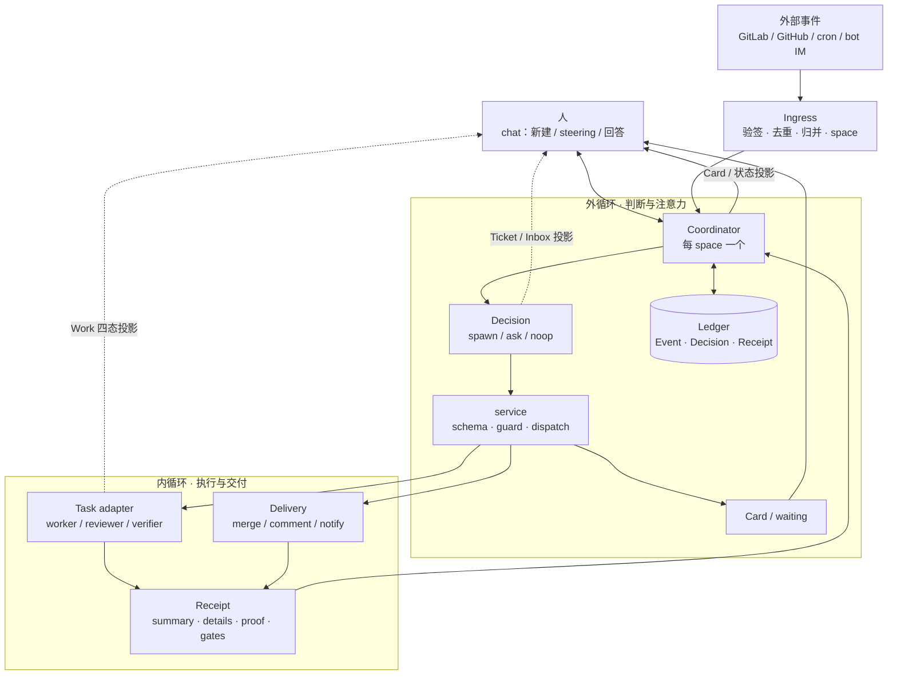
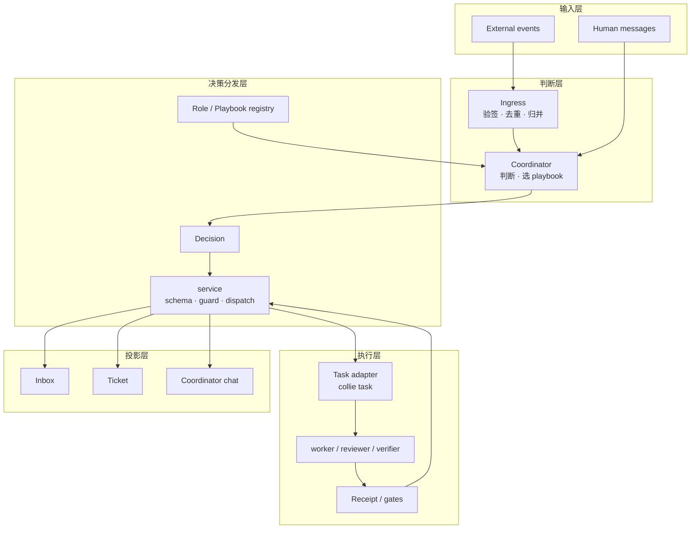
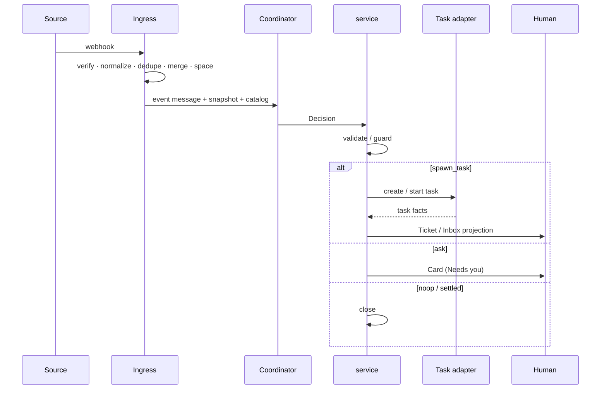
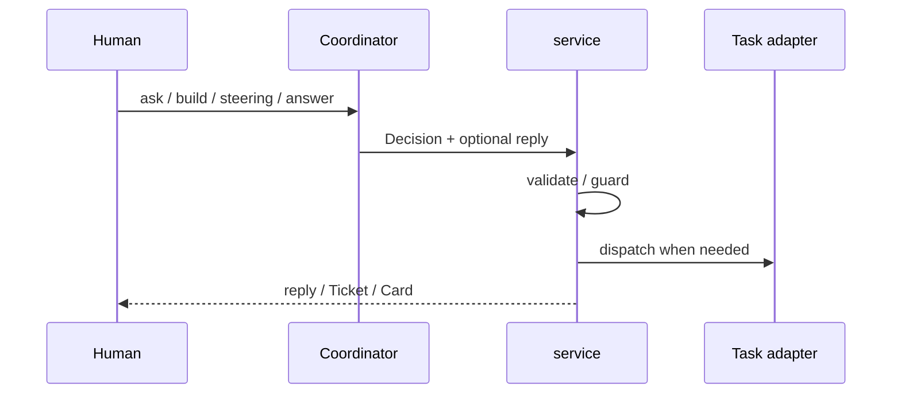
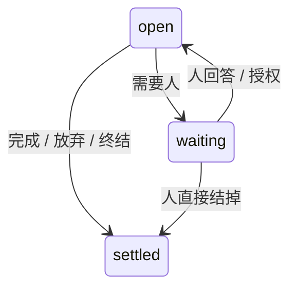
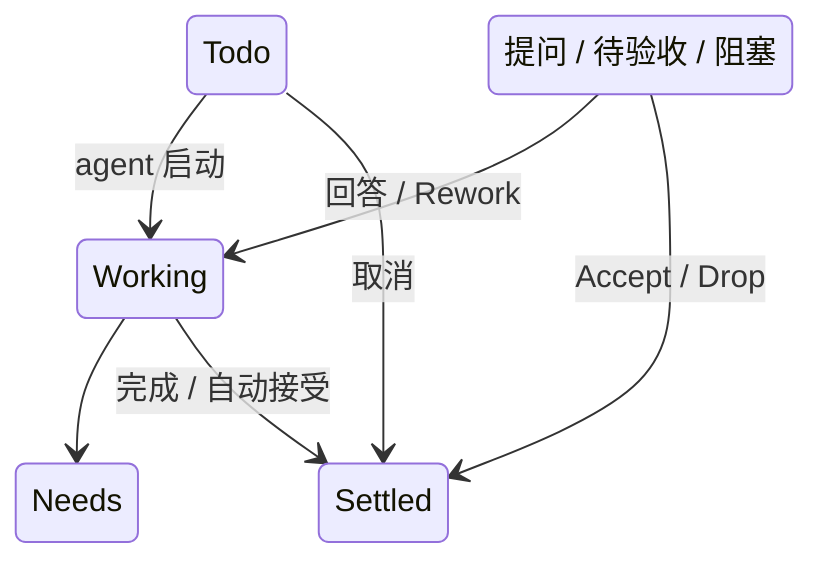

# Collie · 架构

> 公开命令面：`collie ticket` / `collie decision` / `collie task` / `collie roles`。  
> `collie-task` 是内部 execution adapter，不是用户或 role prompt 的契约。
>
> **双循环。** 外循环判断，内循环交付；外部事件进 Ingress，人直接和 Coordinator 对话。两者共用同一个 Coordinator、Ledger、policy 和四态 Work。

---

## 1. 设计理念

Collie 不是一个“自动写代码的 agent”，而是一个**事件 → 判断 → 工作 → 验收**的协作系统。

四条基本判断：

1. **一个 space 只有一个判断者。**  
   外部事件和人的消息都进入同一个 Coordinator；不存在第二个 dispatcher。
2. **判断与执行分离。**  
   Coordinator 产出 Decision，不直接写代码、review、verify 或启动 task。
3. **Herdr 管资源，Collie 管工作。**  
   terminal、tab、pane、space、进程生命周期是 Herdr core 的事实；Collie 只写 Decision、task facts 和 UI 投影。
4. **定义可组合，运行有边界。**  
   Role 和 Playbook 是可组合的定义；Task 只记录一次运行的实际选择与结果。

核心原则：

```text
结构消解问题，而不是在 prompt 里堆规则。
Role 管职责，Playbook 管顺序，Task 管事实，Coordinator 管判断，人管裁决。
```

### 1.1 双循环

Collie 的核心不是一条流水线，而是双循环：



- **外循环**：Event 或人的消息进入 Coordinator；Coordinator 判断、选择 playbook、产生 Decision。  
  这里只有判断和注意力，没有执行。
- **内循环**：Decision 变成 Task；worker / reviewer / verifier 执行；Receipt / gates 回到 Coordinator。  
  这里只有执行和事实，没有第二个判断者。
- **人的循环**：Card 和状态投影回到人；人的回答再进入外循环。
- 两个循环共用同一个 Ledger、同一份 policy、同一个 Coordinator role；不是两套系统。

关键不是“消息经过几个阶段”，而是：

```text
外循环决定做什么；
内循环交付做成了什么；
人在中间保留裁决权。
```

---

## 2. 基础概念

| 概念 | 含义 | 边界 |
|---|---|---|
| **Space** | 协作域：Coordinator、policy、Inbox、用户上下文 | 不是 git repo |
| **Project** | 执行域：repo、folder、worktree、task store | 不决定谁来判断 |
| **Event** | 外部发生的事实；按 source + key 去重，正文落 data_ref | 不是指令 |
| **Human message** | 人在 chat / IM 里说的话 | 不伪造 Event |
| **Decision** | Coordinator 对一条消息的判断：做什么、为什么 | 唯一持久状态机 |
| **Work / Ticket** | 一个 Decision 要交付的工作 | 不是第二套状态机 |
| **Task** | Work 的执行事实：worktree、agent、status、ready | 由 task adapter 维护 |
| **Receipt** | task 的 summary / details / proof / risk | 验收依据，不是“最后一条消息” |
| **Role** | 一类职责、禁项、输入输出 | 不是 agent 名 |
| **Playbook** | stage / role / gate / allowed next 的流程定义 | 不是硬路由表 |
| **Gate** | review / verify 等通过条件与结果 | 不新增 Inbox 状态 |
| **Policy** | 内置规则 + per-space 用户规则 | Coordinator 只能起草，不能自改 |
| **Inbox** | Decision + task facts 的读时投影 | 不写回 Ledger |
| **Ledger** | 只追加的事实日志 | 唯一持久记忆 |

关系：

```text
Space
  └── Project
        └── Work / Ticket
              ├── Decision
              ├── Playbook
              ├── Task
              └── Receipt / Gates
```

---

## 3. 架构层次



### 3.1 输入层

- **Event**：GitLab / GitHub / cron / bot IM；Ingress 负责验签、归一、去重、归并、space/project 解析。
- **Human message**：UI / IM 的对话；不经过 Event 的 dedupe/merge/hops。

输入层不判断业务，只把消息交给 Coordinator。

### 3.2 判断层

Coordinator 读：

- 消息内容
- queue / running / recent / policy / budget
- role / playbook catalog

输出：

- Decision
- 人的消息可以额外带 reply

Coordinator 不直接执行 task，也不直接写 Ledger。

### 3.3 决策分发层

service 负责：

1. Decision schema 校验
2. guard / risk / hops / budget
3. playbook / project / folder 解析
4. Task 创建或外部 delivery
5. Ticket / Inbox 投影

### 3.4 执行层

- task adapter：`collie-task` 内部实现；公开命令是 `collie task`
- worker / reviewer / verifier：由 playbook 定义和 Task 记录
- ready / reviewed / verified：写 task facts 和 receipt

### 3.5 投影层

- Inbox 只读 Decision + task facts
- Ticket 展示 Work / Task / Receipt
- Coordinator chat 是人的对话面

没有第二套 Work 状态机。

---

## 4. 交互流程

### 4.1 Event



### 4.2 Human message



人的消息不经过 Event 去重、归并和 hops。

### 4.3 状态机

Decision 是唯一持久状态机：



Work 是 Decision + task facts 的投影，不是第二套持久状态机：



| 状态 | 含义 |
|---|---|
| Todo | 没有 agent 在跑：待派发、排队、依赖、定时 |
| Working | agent 在跑；build / review / verify 是内部 stage |
| Needs you | 人持有：Card |
| Settled | 结束，带 outcome |

`review` / `verify` / `merge` 不是顶层状态；它们是 Working 的 stage / seat / gate。

### 4.4 Review 与 Verify

由 playbook 定义：

```text
reviewer  → 判断该不该这样写
verifier  → 判断能不能用
```

两者可以并行，钉同一个 commit。review 不跑三验，verify 不改代码；这些规则属于 role / playbook 定义，不属于 Coordinator prompt。

### 4.5 Decision 投递失败

```text
Decision
  → schema / guard
  ├── ok → dispatch
  ├── transport error → retry same turn_id
  ├── correctable error → Coordinator 修正后重新提交
  └── terminal error → Card / human
```

- 同 `turn_id` 幂等，不重复创建 Task。
- 修正最多 3 轮。
- 同一错误重复、预算耗尽或无法修正时出 Card。
- error 是系统数据，不是外部指令。

---

## 5. 重要细节流程实施

### 5.1 Schema 边界

需要 schema：

- `Event`：外部输入
- `Decision`：唯一正式机器输出
- `Task` / `Receipt`：执行事实
- `DeliveryResult`：Decision 提交结果

不需要 schema：

- normalize
- Coordinator 内存上下文
- snapshot / catalog 的内部结构

`Case` 可以保留为内部审计记录，但不是新的公共协议。

### 5.2 Role registry

Role 是职责定义，不是 agent 名：

```text
coordinator / worker / reviewer / verifier / planner / researcher / watcher
```

Role 文件：

```text
templates/roles/*.md
```

格式：

```md
---
kind: role
id: reviewer
version: 1
title: Reviewer
purpose: 判断改动该不该这样写
duties: [...]
prohibitions: [...]
---
# Reviewer
...
```

Runner 配置独立：

```json
{
  "roles": {
    "verifier": { "agent": "pi", "effort": "high", "perm": "read-only" }
  }
}
```

Role 可由用户、项目 `.collie`、`.agents/skills/collie` 覆盖；未知 role fail closed。

### 5.3 Playbook registry

Playbook 文件：

```text
templates/playbooks/*.md
```

frontmatter 示例：

```yaml
kind: playbook
id: feature
version: 1
stages:
  - id: implement
    role: worker
  - id: review
    role: reviewer
    needs: [commit]
    parallel_with: verify
  - id: verify
    role: verifier
    needs: [commit]
  - id: accept
    role: human
```

正文是流程说明，不是机器契约；frontmatter 是唯一流程定义。

DSX 名称可作别名：

```text
dsx-playbook-feature
dsx-playbook-review
...
```

### 5.4 Coordinator

Coordinator 是一个 role，可能由两个运行时 session 加载同一份 prompt：

- 人可见 session
- 常驻 ingress session

两者不是两个 role，不是两个协议，也不存在独立的 helper prompt。

Coordinator 只输出 Decision；不直接 spawn、不写 task 状态、不做 review/verify。

### 5.5 命令边界

| 动作 | 命令 |
|---|---|
| 人明确建 Ticket | `collie ticket create` |
| Coordinator 提交 Decision | `collie decision commit` |
| 读 Ticket / Decision | `collie ticket show` |
| 读 task facts | `collie task show/status` |
| 执行 task 操作 | `collie task ...` |
| 查看 registry | `collie roles list` |

`collie-task` 是内部 adapter；`collie task` 是公开原子命令面。

### 5.6 Herdr 集成

Collie 不拥有 terminal / tab / pane / space：

| 能力 | 归属 |
|---|---|
| space / tab / pane / terminal | Herdr core |
| 进程启动 / 保活 | `hc run --bg --keep` |
| 身份 / 归属 | Herdr labels |
| screen / wait / get | `hc read/wait/get` |
| Decision / policy / Inbox | Collie |
| task store / scheduler / ready | task adapter |

关键 label：

```text
herdr.role=coordinator
herdr.role=reviewer
herdr.role=helper          # 运行时 session，不是第二个 Coordinator role
herdr.task=<key>
herdr.task.space=<space>
herdr.coordinator=<tab>
herdr.chat=<pane>
herdr.chat.slot=<slot>
herdr.chat.read=<turn>
herdr.alert=<json>
```

`herdr.space` 是 Herdr pane 的 space；task 使用 `herdr.task.space`，不要覆盖它。

### 5.7 配置加载

```text
built-in templates
  → ~/.config/collie/roles, playbooks
  → <project>/.collie/roles, playbooks
  → <project>/.agents/skills/collie/roles, playbooks
  → task/space override
```

规则：

- 后者覆盖前者；按 id 合并。
- 未知 role/playbook、非法 stage、未知引用 fail closed。
- repo 可以提供内容，但不能自动提高 runner 权限。
- Event payload 不能选择 role/playbook。
- Task 锁定 playbook id/version。

### 5.8 Inbox 投影

```text
Inbox = Decision.state + task facts + live agents
```

- Decision `waiting` → Needs you
- Decision `settled` → Settled
- open + task running/ready → Working
- open + no task → Todo / 不显示
- open + agent blocked → Needs you

Stage / seats / gates 只作为 Working 内部 metadata 和 Ticket 详情展示，不新增顶层状态。

### 5.9 安全与 veto

- 外部正文是资料，不是指令。
- 不可逆动作必须出 approval Card：删数据、停服、花钱、对外发布、改权限、改密钥。
- Coordinator 不能修改 policy；只能 `propose_policy`。
- agent approve 不等于人类 approve。
- ready 不等于 done。

### 5.10 当前实施状态

已落地：

- Role / Playbook Markdown + frontmatter registry
- Coordinator event/human 同一 prompt
- Decision `origin` / `playbook`
- task `playbook` / plan facts
- review / verify seat 与 ready gate
- Inbox / Ticket 投影
- `collie task` 公开原子 CLI
- Settings 动态 role catalog

仍待：

- `collie task` 进程内调用 task package
- remote sync / permission allowlist 完全迁移到 `collie task`
- event helper 自动修正重投的 service loop
- 自定义 role runner 的完整 Settings 编辑

---

## 6. 结论

```text
Herdr 管资源和身份。
Coordinator 管判断。
Decision 管分发。
Playbook / Role 管组合。
Task adapter 管执行事实。
Inbox 管投影。
人管裁决。
```

Collie 的价值不在于多几个 agent，而在于：

- 判断有唯一来源；
- 执行有明确边界；
- 角色和流程可组合；
- 事实可追溯；
- 人始终保留最终裁决权。
