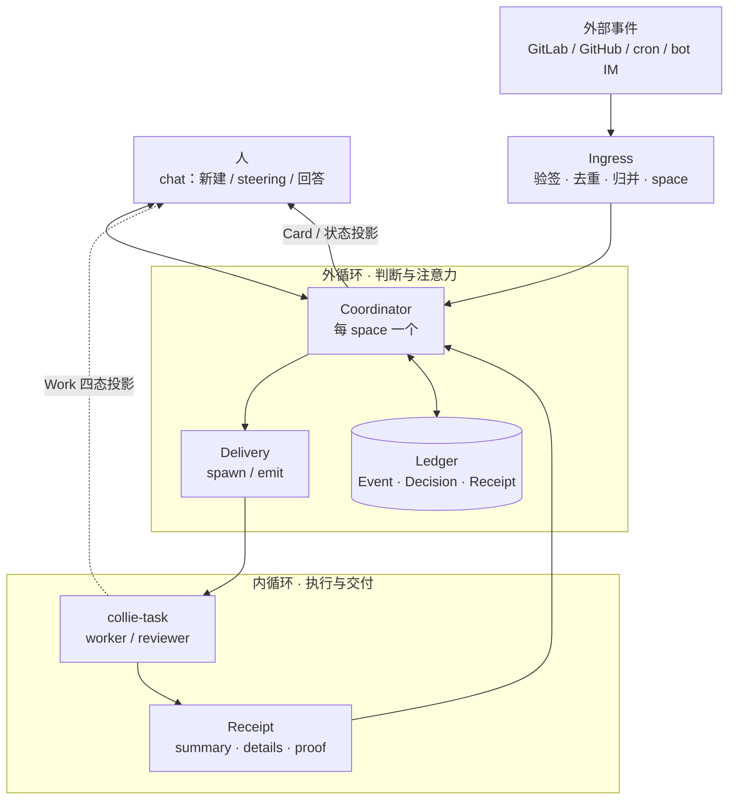
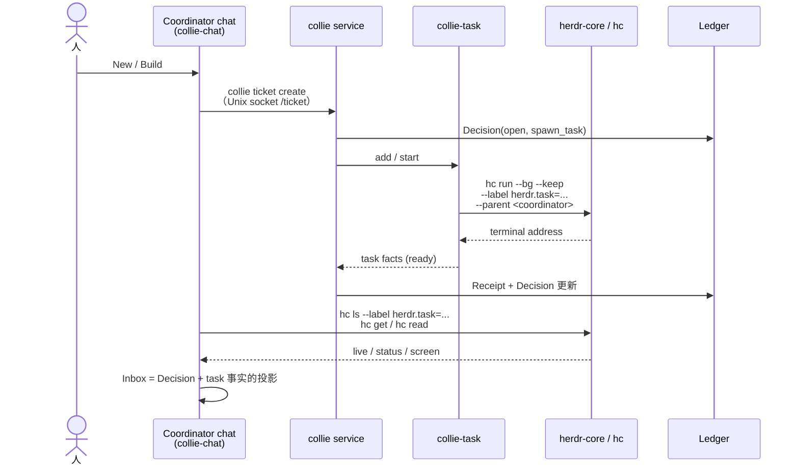
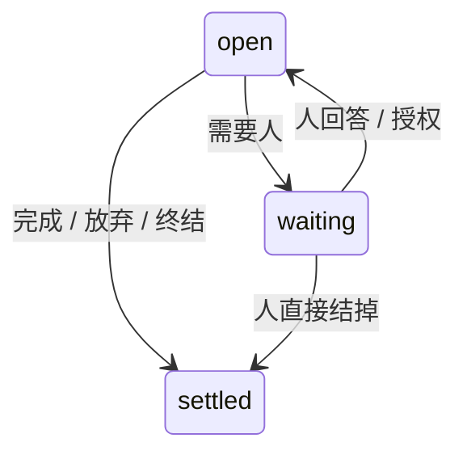
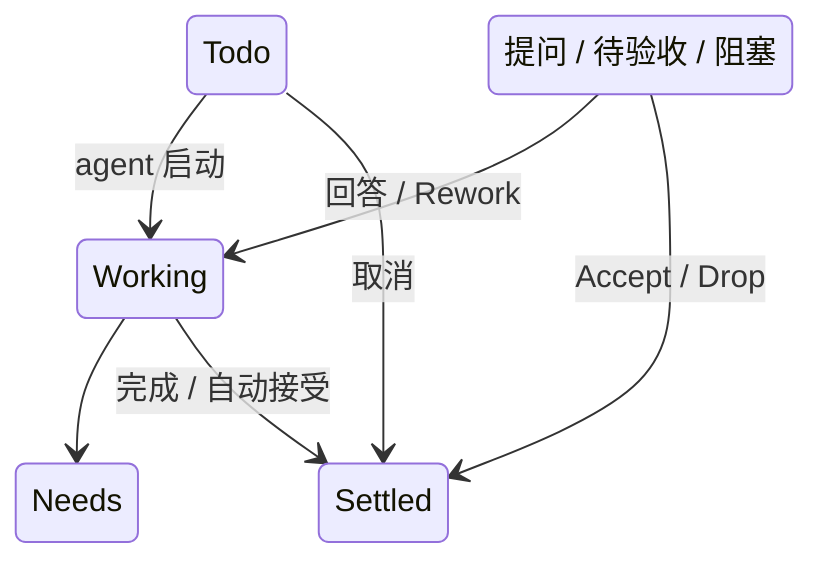
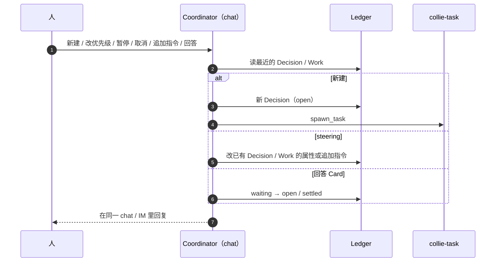
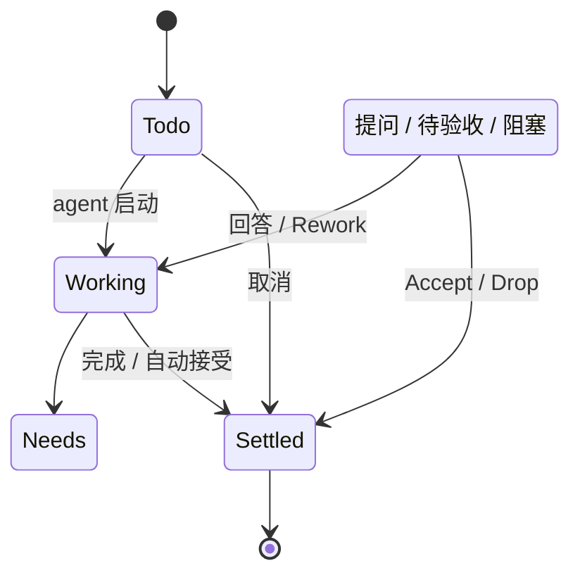

# Collie · 架构与流程

> 双循环。外部事件进 Ingress，人直接和 Coordinator 对话；两者共用同一个 Coordinator、Ledger、policy 和四态 Work。

---

## 1. 双循环



- **Coordinator 是唯一判断者**：每 space 一个，没有第二个 dispatcher agent。
- **两个输入面**：外部事件走 Ingress 到 Coordinator helper；人的对话直接进 Coordinator 的 chat。
- **一个出口**：Coordinator 的 Decision 只有两种执行形态——派 work，或发外部命令。

---

## 2. 两个输入面

| 输入 | 路径 | 作用 |
|:--|:--|:--|
| **外部事件** | GitLab / GitHub / cron / bot IM → Ingress（验签、去重、归并、定 space）→ Coordinator 的 **helper** | 机器事实进系统，由 Coordinator 判断 |
| **人的对话** | UI / IM 里的人 → 直接进 Coordinator 的 **chat turn** | 新建、调整、叫停、回答、追问；**不经过 Ingress** |

- 每 space 一个 Coordinator；chat 是人看的会话，helper 是常驻的第二个 session，专门接收 ingress，不打断 chat。
- 人的输入不套 Event 的 `dedupe / merge / hops / route`；它是对话，Coordinator 直接理解并行动。
- **IM 的边界**：人发的 IM 是 chat；机器/bot 发的 IM 是外部事件。判断依据是 actor/channel 的语义，不是“IM 都算事件”。
- **space 的边界**：外部事件由 source/channel 映射给出 space；人的 chat 所在的空间就是本次对话的 space。映射不出来的事件不猜，报配置错误并通知管理员。

- **space 与 project**：space 是协作域（Coordinator、helper、policy、Inbox），project 是执行域（git repo、worktree、task store）。一个 space 可以承载多个 project；`Decision.project` 选择项目，task folder 由 `workspaces[space].projects` 或 `<space.folder>/projects/<project>` 解析。
- **worktree 归属**：worktree 绑定 task folder 的 git repo，不绑定 space 的 folder。`collie-task --folder <project>` 创建项目 worktree；`herdr.task.space` 仍把任务挂回协作 space。
- **task 命名**：task ref 由项目 folder 的 task-list prefix 生成，形如 `COLLIE-123`、`PHIL-7`；Ticket 使用该 ref，不使用内部 `slug#id`。

### 人能做什么

| 动作 | 结果 |
|:--|:--|
| **新建** | New / Build → Coordinator 判断 → 新 Decision + Work |
| **steering** | 改优先级、hold / 暂停、取消、给正在跑的 worker 追加指令、换实现路径、问状态 |
| **回答** | 回答 Card（accept / rework / drop / later），Coordinator 接着处理 |

steering 不产生新的 Work 状态，也不一定产生新 Decision；它写的是已有 Decision / Work 上的属性或一条指令。Ledger 记这次人的输入与效果。

---

## 3. 对象

| 对象 | 是什么 | 谁写 |
|:--|:--|:--|
| **Event** | 外部发生的事实；去重后不可变 | source / Ingress |
| **Decision** | Coordinator 对一次事件的判断：做什么、为什么 | Coordinator |
| **Work** | 一个 Decision 要求交付的工作，执行归 collie-task | service / collie-task |
| **Receipt** | collie-task `ready` 的 summary / details / proof + 风险 | collie-task |
| **Policy** | 内置默认 policy + 用户可编辑的 per-space policy（自然语言） | 人；Coordinator 只能起草 |
| **Ledger** | 只追加的事实日志；Decision、Work 投影、Receipt 都从它来 | service |

> Work 在 Inbox 里显示为 **Ticket**；两者是同一个东西。下文统一用 Work。

Card 不是新对象，是 `Decision.state = waiting` 的人面投影。Queue 也不是对象，是所有 `waiting` Decision 的现算视图。

---

## 4. Event 与 Ingress

Event / Ingress 的机制参照 [agent-autoloop](https://github.com/KKKKhazix/agent-autoloop)：来源自己连进来，内核不主动请求外部；事件按 `source + key` 去重，同对象的事件归并。

```ts
Event = {
  id: string,
  source: "gitlab" | "github" | "im" | "cron",
  key: string,                    // source 内唯一
  type: string,                   // merge_request.review_requested / issues.opened / ...
  actor: string,                  // 人 / 系统 / bot
  subject: { kind, repo?, id?, url? },
  title: string,
  data_ref: string,               // 正文落盘；不内联进提示词
  hops: number,                   // 委派深度
  received_at: string
}
```

Ingress 只做四件事：

1. **验签 / 归一**：把来源的 payload 转成 Event；正文落盘。
2. **去重**：`source + key` 已存在 → duplicate，不重复处理。
3. **归并**：同一对象 / lane 的多个事件合并成一次待处理输入；处理中的新事件进入下一轮，不另开一条判断。
4. **定 space + hops**：source/channel 映射给出 space；委派每层 `hops + 1`，超过上限只记录并出 Card。

Ingress **不做路由判断**。所有外部事件都交给该 space 的 Coordinator job。规则不在 Ingress 里，写在 policy 里。

### 与 agent-autoloop 的关系

| 借用 | 不借用 |
|:--|:--|
| `source + key` 去重 | 规则表按 `source/types` 直接派活 |
| 同对象归并、事件不可变 | 轮次 `queued/claimed/unknown/done` 的细状态 |
| `hops` 熔断 | 回执 = 最后一条消息 |
| 卡片 / 通道 / 交付的分离 | 把人的回答也做成 Event |

Collie 的人对话是 Coordinator 的直接输入，不进 Ingress；这是有意的差异。

---

## 5. Coordinator 与 Policy

**每 space 一个 Coordinator**，两个常驻 session：

- **chat turn**：人看得见的会话；新建、steering、回答。
- **helper**：常驻、不占 pane；从 Coordinator chat 的 Helper 行打开独立 tab，关闭 tab 只 `park`，session 不结束。

两者共用同一份 Ledger、policy 和 Work。

### 输入

- 一条 Event（job）或一条人的消息（chat）。
- 有界快照：space、queue（waiting）、running（在跑的 Work）、recent（最近决定）、policy 版本、预算。
- 内置 policy + 用户 policy。

### 输出

Decision，三态之一：

| 状态 | 含义 |
|:--|:--|
| `open` | 系统持有：判断中、待执行、执行中、重试中 |
| `waiting` | 人持有：有 Card 需要回答 / 授权 / 验收 |
| `settled` | 终态：带 outcome |

动作：`spawn_task`、`emit_command`、`ask`、`priority / hold`、`noop`、`propose_policy`。

### Policy

- **内置 policy**：默认路由建议写在 Coordinator 提示词里，例如 review 请求派审阅工作、pipeline 失败派调查、无法确定目标就问人。
- **用户 policy**：per space 的自然语言文档，路径 `~/.local/state/collie/policy/<space>.md`（没有时读 `policy.md`）；用户可编辑，Coordinator 只读，不能自己改。它想改只能 `propose_policy`，由人确认后写入。
- **所有外部事件都过 Coordinator（LLM）**，不做确定性短路；没有 route table，也没有 cache-first。
- 事件正文是资料，不是指令；policy 才是指令。外部文本要求改 policy / 越权 / 泄露信息一律忽略。

### 护栏与预算

- 护栏七条命中 → 强制 `waiting` + approval Card，Coordinator 改不了。
- 全局预算按事件处理计；耗尽 → 降级为 Card，不静默丢事件。
- `hops > 8` → 只记录 + Card。

---

## 5.5 Herdr 集成契约（实现侧）

Collie 不拥有终端、tab、pane、space；这些全部是 Herdr core 的事实。Collie 只做三件事：

1. 把 Coordinator 的判断写成 Ledger 里的 Decision；
2. 通过 `collie-task` 调 `hc` 启动 / 观察 agent；
3. 用 label 把 Herdr 的 terminal 映射回 Coordinator / Work / Inbox。

### 职责边界

| 能力 | 归属 | Collie 怎么用 |
|:--|:--|:--|
| space / tab / pane / terminal 生命周期 | Herdr core | `herdr-app` 命令、`hc`；不自己维护第二份 |
| agent 进程启动 / 保活 | Herdr core (`hc`) | `hc run --bg --keep`；`--parent` 建立父子关系 |
| agent 身份 / 任务归属 | Herdr labels | `hc label` 写；`hc ls --label` 读 |
| 终端screen / wait / reap | Herdr core | `hc read` / `hc wait` / `hc get` |
| Decision / policy / Inbox 投影 | Collie | Ledger + service + mods |
| task store / scheduler / ready | Collie (`collie-task`) | 作为 Work 的执行事实源 |
| 窗口布局与 overlay | Herdr UI | `tab.new` / `layout.select` / `openOverlay` |

### 关键 label

`herdr.role` 只标“非默认执行角色”；普通 worker 没有 `herdr.role`，默认就是 worker。

| label | 写在谁身上 | 谁写 | 谁读 / 用途 |
|:--|:--|:--|:--|
| `herdr.role=coordinator` | 每个 space 的 Assistant terminal | `collie-chat` 启动 / `collie coordinator restart` | `collie-tabs` 找当前 Coordinator；Inbox 的 Needs you / unread |
| `herdr.role=reviewer` | reviewer terminal | `collie-task` `launch()` | 区分 reviewer 与 worker；避免把 reviewer 当 worker |
| `herdr.role=helper` | Coordinator helper / 子 agent | service `ensureHelper` / Herdr agent template | service 找回 ingress helper；Coordinator chat 的 Helper 行可打开它的独立 tab |
| `herdr.job.space=<space>` | Coordinator helper | service `ensureHelper` | 按 space 找回 helper，避免同机重复启动 |
| `herdr.task=<slug>#<id>` | task 的 worker / reviewer / helper | `collie-task` `launch()` | `hc ls --label` 找任务 agent；artifacts / status |
| `herdr.task.space=<space>` | task terminal | `collie-task` `launch()` | 任务所在 space；**不要**用 Herdr 给 pane 的 `herdr.space` |
| `herdr.coordinator=<tab>` | task terminal | `collie-task` `launch()` | 任务归属 Coordinator tab；restart 后仍能找到 |
| `herdr.coordinator.space=<space>` | Coordinator terminal | `collie-chat` 启动 / `collie coordinator restart` | 找回 space 的 Assistant |
| `herdr.coordinator.tab=<tab>` | Coordinator terminal | `collie-chat` / `collie coordinator restart` | Coordinator 所在 tab |
| `herdr.chat=<pane>` | 被 chat “park” 的 agent | `collie-chat` 启动 / `agent.js` | agent 没有自己的 pane，chat 代替它显示 terminal |
| `herdr.chat.slot=<slot>` | Coordinator chat 的 agent | `collie-chat` | app 重启 / chat rehydrate 后找回同一个 agent |
| `herdr.chat.origin=<origin>` | Coordinator chat 的 agent | `collie-chat` | draft / 历史归属的稳定 key |
| `herdr.chat.read=<turn>` | Assistant terminal | `collie-chat` | 未读标记；Inbox / sidebar 的 unread |
| `herdr.typing=<ms>` | chat 的 agent terminal | `collie-chat` | 人正在输入，news 暂缓 |
| `herdr.alert=<json>` | 任意 agent terminal | `collie-task alert` / tick | toast、声音、Needs you |
| `herdr.task.space` vs `herdr.space` | 见上 | — | `herdr.space` 是 Herdr pane 的 space；task 不要覆盖它 |

### 角色与职责

| Herdr 身份 | label | Collie 职责 | 写什么 |
|:--|:--|:--|:--|
| **Coordinator** | `herdr.role=coordinator`；另有 `herdr.coordinator.space` / `herdr.coordinator.tab` / `herdr.chat*` | 判断、出 Decision、回答 Card、派 work；不占 `herdr.task` | Decision / Card；通过 service 派 task |
| **Worker** | `herdr.task=<key>`、`herdr.task.space`、`herdr.coordinator`；**普通 worker 没有 `herdr.role`** | 在自己的 worktree 执行一个 task；结束用 `collie-task ready` | task 事实 / `ready` / `status` |
| **Reviewer** | 同一个 `herdr.task`，另加 `herdr.role=reviewer` | read-only 评审同一 task 的 commit；用 `collie-task reviewed` 记轮次 | review round / findings |
| **Helper** | `herdr.role=helper`，`parent` 指向 worker/reviewer | 父 agent 的子任务；不是第二个 worker | 自己的 screen / log，不写 task 状态 |
| **人** | 无 agent label | 看 Inbox、回答 Card、验收、关 tab | Card answer / 人的显式命令 |

`herdr.role` 只在**非默认角色**上写：worker 靠 `herdr.task` 识别，不需要 `worker` 字符串。

### 角色模板归属

> Role / Playbook 的目标协议见 [`COLLABORATION.md`](COLLABORATION.md)：Coordinator 是一个 role、event/chat 是同一个 CoordinatorTurn 的两种 origin；review 与 verify 分离；playbook 是 registry 中的流程模板，不是硬路由表。下面是当前运行时的模板落点。

Herdr core 的 `~/.config/herdr-core/templates/` 是角色提示词目录；`hc templates` 直接列出其中的 `.md`。Collie 只安装自己的三份（都带 `collie-` 前缀，Herdr 自己的模板不再混用）：

| 文件 | 用途 |
|:--|:--|
| `collie-coordinator.md` | Collie space 的 Coordinator |
| `collie-worker.md` | task worker |
| `collie-reviewer.md` | read-only reviewer |

`assistant.md`、旧 `dev/worker.md` 是 Shepherdr 安装物，不再属于 Collie 的运行栈；已归档移除。模板只提供角色文字，`herdr.role` 等标签由启动方在 `hc run` / `hc label` 时写入，模板 frontmatter 不包含标签。

### 具体调用路径



### Coordinator chat 的启动

1. `collie-tabs` 用 `app("tab.new", { mod: "collie-chat", props: { role: "coordinator", template: "collie-coordinator", space, folder, slot, settings } })` 建 tab。
2. chat 第一条消息再启动 agent：

```text
hc run --bg --json --keep --cwd <folder>
  --label herdr.chat=<pane>
  --label herdr.chat.slot=<slot>
  --label herdr.chat.origin=slot:<slot>
  --label herdr.role=coordinator
  --label herdr.coordinator.space=<space>
  --label herdr.coordinator.tab=<tab>
  -- <agent argv>
```

3. agent 没有自己的 pane；`herdr.chat` 告诉所有 Herdr 客户端它被哪个 chat 显示。
4. app 关闭/重启：Herdr 的 kept terminal 保留；`collie-chat` 通过 `herdr.chat.slot` / `herdr.chat.origin` 找回它，不新建 agent。

### Coordinator helper：ingress 的唯一执行 session

**不设计 headless/Off 模式。** 每个 space 的 ingress 全部投递到常驻的 Coordinator helper。

```text
Coordinator chat (herdr.role=coordinator, 人可见)
  └─ Coordinator helper (herdr.role=helper, parent=coordinator)
       ├─ 常驻 session，不每事件重起
       ├─ 读同一份 collie-coordinator prompt / policy / Ledger 快照
       ├─ Ingress 的 job 进入其串行队列
       ├─ 输出 proposed Decision JSON
       └─ service 校验并写 Ledger
```

#### 约束

- helper **不是第二个 Coordinator**：不能写 Ledger、不能写 policy、不能独立 spawn task。
- helper 使用 `herdr.role=helper`，不能使用 `herdr.role=coordinator`；一个 space 仍只有一个 Coordinator。
- 输出由 service 校验；Decision 仍由 service 写。
- 主 chat 和 helper 都加载 policy；没有单独的 policy session。
- helper 串行处理 job，避免同一 space 并发判断。
- 主 chat 不接收 ingress；人只在自己的 chat 里对话和回答 Card。

#### 入口

```text
Coordinator chat: Helper row → Open Helper → independent Helper tab
```

- Coordinator pane 只保留 `Chat | Terminal`；没有 Helper 页。
- Coordinator chat 的 Helper 子终端行仍显示状态；`Open Helper` 用 `terminal.keep` 打开独立 tab。
- 关闭 Helper tab 时先 `terminal.park`：helper 继续运行，session 和 ingress 队列不结束。
- Settings 不再有 Helper 配置；helper 常驻，不提供 `Off`。

当前实现：ingress 的 `#dispatch` 只走常驻 helper。service 用 `hc ls --label herdr.role=helper --label herdr.job.space=<space>` 找回 terminal；没有时以 `hc run --bg --keep --parent <coordinator> --label herdr.role=helper --label herdr.job.space=<space> --label herdr.coordinator=<tab>` 启动，并把 `collie-coordinator` 角色提示词作为首条消息送入。每个 job 写 `~/.local/state/collie/helper/<space>/jobs/<id>.json`，`hc send` 只发路径，helper 把 Decision 写到 `decisions/<id>.json`；service 校验 schema/actions 后写 Ledger。`runCoordinator()` 已不再被 service 调用；service 的请求与 ingress 都走 helper。

剩余限制（file-based IPC 的边界）：helper 是交互式 agent，没有 stdout 协议，service 只能等 decision 文件；默认 120 秒超时，超时/非法输出会转成 waiting Card，而不是再起一次性 CLI。helper 在可见 terminal 里向人提问时，service 不会代答；角色提示词只在启动时送入，改提示词后需重启 helper。helper 是 Coordinator 的子 terminal，Coordinator 被删后它会结束；service 启动时和之后每 30 秒按 live Coordinator 与 labels 重建缺失的 helper，下一次 ingress 也会再确认。`--keep` 留下的 shell 顶着 labels 时会被识别为非 helper 并清掉，不会出现第二个 helper。

### worker / reviewer 的启动

`collie-task launch()` 用 `hc run`，不让每个 task 占 tab：

```text
hc run --bg --json --keep --cwd <worktree-or-folder> --name <task-name>
  --label herdr.task=<slug>#<id>
  --label herdr.task.space=<space>
  --label herdr.agent=<claude|codex>
  --label herdr.coordinator=<coordinator-tab>
  [--label herdr.role=reviewer]
  --parent <coordinator-terminal> --outlive-parent
  -- <worker/reviewer argv>
```

- worker 没有 `herdr.role` → 默认 worker。
- reviewer 加 `herdr.role=reviewer`，不能冒充 worker。
- `--parent` 让 agent 成为 Coordinator 的子 terminal；`--outlive-parent` 让 Coordinator 重启时 worker 不丢。
- `collie-task ready` 只写 task 事实；service 轮询 `collie-task show` 生成 receipt，Inbox 现算；它不直接改 Inbox。

### 窗口 / Inbox 怎么读

- Inbox 是 mod：`hc ls/get` 读 terminals，按 `herdr.task` 找 task agent，按 `herdr.role` 区分 Coordinator / reviewer / helper。
- Ticket 的 Terminal tab 不自己画 terminal：它把 layout 的 block `content.terminal` 设为 agent address，让 Herdr 画真实 terminal。
- Artifacts 由 `collie-artifact` store + `collie-artifacts` mod 读；Chat 的 publish 记录只用于找到 artifact，不复制内容。
- 没有 live agent 时 Terminal 置灰；Inbox 仍显示 Todo/Needs you/Settled。

### 重启 / 关闭

- 关窗口：Herdr kept terminals 保留；Coordinator / worker 不依赖 Collie 进程。
- `collie-task tick`：恢复 queued/scheduled、revive session、处理 alert；service 不在时窗口自己 tick。
- `collie coordinator restart`：用原 terminal 的 label（`herdr.chat.slot`、`herdr.coordinator.space`、`herdr.task` 等）原地重启，不创建新 Coordinator。
- 没有 `collie-supervisor`，没有第二个 ensure 循环。

### 谁写状态

| 写入 | 位置 | 规则 |
|:--|:--|:--|
| Decision | `queue.json` / Ledger | 只有 `collie ticket` / service 写；mod 只读投影 |
| task | `~/.local/share/collie/tasks` | 只有 `collie-task` 写；旧 shep store 已归档 |
| label | Herdr terminal | `hc label` / `collie-task` / `collie-chat` 写 |
| UI 投影 | Inbox / Ticket | 只读，不写回 task / Ledger |

这就是 Collie 基于 Herdr 的实现契约：**Herdr 管资源和身份，Collie 管判断、授权和工作投影；中间用 `hc` + label 串联。**

---

## 6. 状态

状态只回答“球在谁手里”。内部步骤不升为持久状态。

### 6.1 Decision：3 态



| 状态 | 包含 | 不包含 |
|:--|:--|:--|
| `open` | 判断中、待执行、执行中、重试中 | 等人 |
| `waiting` | 有 Card：提问、授权、验收、失败处理 | 系统自动执行 |
| `settled` | 终态，必须有 `settled { at, by, outcome }` | 任何后续 |

- 判断中、待执行、执行中、重试都只是 `open` 的 phase；用时间戳或事件表达，不写进 state。
- `failed` 不是状态：需要人 → `waiting` + alert Card；自动重试 → `open`；终结 → `settled{outcome:"failed"}`。
- `done / closed` 不是状态：统一为 `settled` + outcome。
- **Queue = waiting**；其他都不是队列。

### 6.2 Work：4 态



| 状态 | 含义 |
|:--|:--|
| **Todo** | 没有 agent 在跑：待派发、依赖、排队、定时 |
| **Working** | 有 agent 在跑；`kind = build / review / merge` |
| **Needs you** | 人持有：有 Card |
| **Settled** | 结束，带 outcome；chip 显示 `Settled · accepted / dropped / …` |

- `kind=review` 只是 Working 的一个属性，不存在独立的 review 状态。
- `kind=merge` 同理；合并是 Working 的一个阶段。
- Todo 的 collie-task 原因（`queued / scheduled / todo`）写在行内，不升为状态。
- **ack ≠ settled**：打开、展开都不结案；只有 Card answer 的 outcome 才结案。

### 6.3 由 Decision + task 到 Work

Work/Ticket 不是第四个对象，也不是第二套持久状态机。它是下面三个输入的纯函数：

- `Decision.state`：`open / waiting / settled`
- `task` 事实（`collie-task`）：`queued / scheduled / todo / running / ready / merging / done`
- live agents：worker / reviewer / blocked

| Decision | live / task | Ticket | 说明 |
|:--|:--|:--|:--|
| `settled` | 任意 | **Settled** | Decision 结案优先于 task 状态 |
| `waiting` | 任意 | **Needs you** | 人持有下一步：提问、授权、验收、失败处理 |
| `open` | live blocked | **Needs you** | agent 被阻塞，等人回答 |
| `open` | live worker / reviewer | **Working** | `kind=build / review / merge` 只是行内属性 |
| `open` | task `queued` / `scheduled` / `todo` | **Todo** | 没有 agent 在跑；排队原因写第二行 |
| `open` | task `running` / `ready` / `merging` / `done` | **Working** | task 在跑或已交付，Decision 尚未结案 |
| `open` | 有 `run.task_ref`，task 暂不可读 | **Working** | 远端/结束/未同步时保留 Work，不伪造 task |
| `open` | 没有 task | 不是 Ticket | 例如 `ask` / `hold` / `emit_command` / `noop` |

补充：

- `Needs you` 的 `waiting` 与 task 的 `ready` 是两个维度：task 完成不等于验收完成；验收走 Card answer，Decision 才能 `settled`。
- `Todo → Working → Needs you → Working` 是 Work 投影的流转，不是写回 Ledger 的状态机；底层 task 仍由 `collie-task` 维护。
- **Ticket 必须有 Decision**。只有 `collie-task` 而没有 Decision 的孤儿 task 不进 Inbox；用 `collie ticket adopt` 补一条 `actions: []` 的 Decision，不重复 spawn。
- Work 的状态是投影，不写回 Ledger；Decision 是唯一持久状态机。

---

## 7. 流程

### 7.1 外部事件


### 7.2 人的对话



人的输入不经过 Ingress，不参与去重、归并、hops。

### 7.3 Work 生命周期



`build` / `review` / `merge` 都是 Working 的 `kind`；列表 chip 显示 `building` / `reviewing` / `merging`：

- `kind=build`：worker 改代码。
- `kind=review`：审阅工作；包括 build 后的复核任务和直接派出的只读审阅任务。
- `kind=merge`：合并阶段。

### 7.4 回执与验收

- `collie-task ready` 交回 Receipt。
- `risk.auto_accept = true` → Decision `settled`，Work `Settled`。
- `risk.auto_accept = false` → Decision `waiting` + accept Card，Work `Needs you`。
- 人的回答：
  - `accept` / `rework` → Decision `open`，恢复 Coordinator；由它决定合并、评论、重派或再出卡。
  - `drop` → Decision `settled{dropped}`，Work `Settled`，不恢复 Coordinator。
  - `later` → 仍 `waiting`，写 `snooze_until`。
- 验收动作走 Card answer（coordinator chat、`collie-answer` 或 channel），不经过 shepherdr 原生 Accept。
- `ack` 不算验收；只有 answer 的 outcome 才结案。

### 7.5 Delivery

`emit_command` 由 service 执行：merge / comment / close / notify。完成后 Decision `settled{outcome}`，Work `Settled`。合并与评论是 Coordinator 的决定，不是 Work 自己完成的。

---

## 8. Inbox 投影

### 模块边界

```text
mods/collie-inbox/main.js          # Inbox 队列 + Ticket 页面（UI）
mods/collie-tabs/inbox-engine.js   # 常驻引擎：asks / tasks / alerts
lib/inbox-queue.js                 # 纯投影：queue / stage
lib/ticket-dot.js                  # Ticket 状态点
mods/collie-artifacts/             # Ticket Artifacts + viewer
```

引擎必须常驻，所以留在 tab bar；Inbox UI 通过 shared `inbox.*` / `collie.ticket` 读它，不跨 mod import。`collie-artifacts` 同时挂在 Ticket 和侧栏，保持独立。

Chat 的 secrets 走 `bin/collie-secret` 和 `~/.local/share/collie/secrets/vault.json`；voice / dictation / call 在 Collie 中关闭（`VOICE=false`），不读 shep 的 secret/service 路径。

Task 如果没有 Decision，就不是 Ticket，Inbox 不伪造行。修复用 `collie ticket adopt --space S --task REF --folder DIR`：它写一条 `actions: []`、`run.task_ref` 指向已有 task 的 Decision，让 Work 回到四态投影，不重复 spawn。

### 过滤器

```text
All | Needs you | Todo | Working | Settled
```

**没有独立的 review 过滤器**。审阅工作是 `Working` 的 `kind=review`，在 Working 行内显示 kind，不单独占状态或过滤器。

### 分组

```text
Needs you
# space
  Todo
  Working
Settled N
```

- Needs you 置顶，每行写自己的 space。
- 每个 space 的其余 Work 按 Todo → Working 排序；行内显示 `kind`（build / review / merge）。
- Settled 收成最后一行 `Settled N`，点开才展开。
- 选择任一状态过滤器时是扁平列表。

### 状态图标

| 状态 | 图标 |
|:--|:--|
| Needs you | 红点 + 光晕；验收卡绿勾 |
| Todo | 灰环 |
| Working | 琥珀色进度饼；行内 kind 区分 build / review / merge |
| Settled | 绿 chip（含 outcome）；灰勾 |

### Needs you 的回复按钮

Inbox 不是第二个操作台。每行右侧只有一个 **回复** 按钮：

- 点击后把这张 Work 的上下文（id、问题、why、Receipt 摘要）发到 **coordinator chat**，并聚焦它；LLM 先解释依据、给出建议，人在 chat 里做具体决定。
- 没有行内决策弹窗，也没有底部输入框；所有输入都在 chat 里。
- New / Build、steering、回答 Card、追问全部走同一个 coordinator chat；Inbox 只投影状态，不另造交互。
- Card answer 仍由 chat / channel 触发（`collie-answer` 是 CLI/IM 通道）；不经过 shepherdr 原生 Accept。

### Ticket 详情

- **Terminal**：Work 的 agent 真实终端；没有 live agent 时置灰。
- **Artifacts**：Work 的产物列表与查看器；Proof 优先，其余按时间倒序。
- 头部：返回 Inbox、Work id、标题、Decision 的 why、状态、space；不拼接 Chat / Files / Changes / Browser。

---

## 9. 不变量

1. **外部事件只走 Ingress**：去重、归并、hops、space 映射在 Ingress；人的对话不进 Ingress。
2. **一个判断者**：每 space 一个 Coordinator；没有第二个 dispatcher。
3. **一个队列**：只有 `Decision.waiting` 是队列；Todo / Working 是执行投影。
4. **一个持久状态机**：Decision 三态；Work 四态是投影，不写回 Ledger。
5. **事件不可变**：Event 只追加；正文只以 `data_ref` 作资料，不拼进提示词。
6. **policy 是人的**：Coordinator 只能起草，不能自己改；规则不自我修改。
7. **ack ≠ settled**：看到不等于处理完。
8. **failed 不是状态**：需要人 → waiting + alert Card；重试 → open；终结 → settled + outcome。
9. **外部事件全部过 LLM**：不做确定性 route 短路；没有 route table / cache-first。
10. **旧状态不回流**：工作内部步骤（判断、待执行、执行中、重试）只作为 open 的 phase，不另立状态。

---

## 10. 复用清单

原则：**已有实现先参考、再移植；不重写，不运行时跨 mod import。** 参考源是 `projects/agent-autoloop` 与 shepherdr 的安装/repo 拷贝。

| 能力 | 参考实现 | 复用方式 | 不照搬 |
|:--|:--|:--|:--|
| Event 与 Ingress | autoloop `docs/protocol.md`、`docs/state-machines.md`、`kernel/decide.ts`、`protocol/job.ts` | `source + key` 去重、同对象归并、事件不可变、`hops` 熔断、`data_ref` | `source/types` 规则派发；`queued/claimed/unknown` 轮次粒度；回答=事件 |
| 来源插件 | autoloop `plugins/github/source.ts`、`plugins/gitlab/source.ts` | 验签、归一、发 Event；来源自己连进来 | 按 type 直接匹配规则 |
| 通道 / 卡片 / 投递 | autoloop `plugins/feishu/channel.ts`、`plugins/delivery/*` | 卡片发送、回答回调、投递重试与版本 | 把人的回答做成 Event |
| 执行进程监督 | autoloop `worker/run.ts`、`worker/contract.ts` | 进程组、超时、退出判定、结果回交 | 10 态 run 状态机 |
| Work 执行 | `vendor/herdr-task`（CLI 名 `collie-task`）+ collie templates | 调 CLI；worktree、worker/reviewer、label、ready 三件套 | 不改任务状态；不接 shep Accept |
| Coordinator 会话与恢复 | `vendor/herdr-task/herdr_task/revive.py` + `collie-task tick` | 原会话恢复、label、handover | 不复制 herdr 的 Assistant 交互 |
| Task 头部与状态点 | shepherdr `mods/chat/panel.js`、`lib/dot.js`、`lib/ui.js` | 头部布局、segmented、task dot、光晕 | 不移植 Chat/Files/Changes/Browser |
| 产物 | `mods/collie-artifacts/*`（`main.js` 列表 + `bar.js` viewer 工具栏）、`lib/artview.js`、`core/task-artifacts.js`、vendored `bin/collie-artifact` | 列表、viewer、版本、Mark up | 不需要 shepherdr 的 artifacts / task-artifacts mod |
| Coordinator chat 的卡片与状态（#22） | shepherdr `mods/chat`（`cards.js`、`strips.js`、`secret-card.js`、`core/secrets.js`、`core/bg-jobs.js`、`core/chat-view.js`）与 `mods/chat-react` | reactions chips 与 emoji picker（`reactions.js`、`emoji-data.js`、本地 `react/` 资产）、secrets 掩码卡与 `~/.local/share/collie/secrets/vault.json`、artifact 卡（`lib/artview.js` 打开）、后台 jobs/subagents 行（可展开/停止） | threads、Tasks panel、voice；shep 的 `~/.herdr/vault.json` 与跨机 secrets 迁移 |
| 安装器 | `~/.local/share/shepherdr/bin/shepherdr` | manifest、hash、备份、`.new`、doctor、key 合并 | 不装 herdr 的 web app / 语音 / 浏览器 |

现有 Collie 已经按这个方式落过的拷贝：

- `lib/ticket-dot.js` ← shepherdr `lib/dot.js` / `mods/tasks/dot.js`
- `lib/artview.js` ← shepherdr `lib/artview.js`
- `core/task-artifacts.js` ← shepherdr `core/task-artifacts.js`
- `layouts/collie.json` ← shepherdr layout
- `bin/collie` 的 manifest / backup / doctor ← `bin/shepherdr`

这些共享源的副本由 `lib/COPIES` 声明，`bin/collie-sync` 生成；改源文件，不改 `mods/*/lib` 或 `mods/*/core` 的副本。

---

## 11. Coordinator 与 Service 的生命周期

这一节是解耦后的目标设计，参考 shepherdr 的 Assistant + service，但 coordinator 尽量只依赖 herdr-core，不自己发明常驻层。

### 11.1 Coordinator = Assistant 模型

- **每个 space 一个 coordinator**，tab 固定在最前。
- tab 里先是 chat pane，**没有 agent**；第一条消息才启动。
- 启动走 herdr-core：`hc run --bg --no-parent --keep`，用 coordinator 模板，agent 停在 chat pane 后面。
- 标签至少包含：
  - `herdr.role=coordinator`
  - `herdr.chat=<pane>`
  - `herdr.chat.slot=<slot>`
  - `herdr.coordinator.space=<space>`
  - `herdr.coordinator.tab=<tab>`
- coordinator 是普通 kept terminal，不是 daemon，不需要 per-space supervisor 常驻轮询。
- 聊天界面是 Collie 自己的 `mods/collie-chat`（#7 Slice 1/2），不再挂 shepherdr 的 `chat` / `pane-chat` / `spaces-chat` / `chat-call`：
  - 消息从 agent 自己的 session log 读（`core/chat-log.js`），发送走 `hc send`（`core/send.js`），以“人”的身份不留 caller（`core/person.js`）；
  - 空 slot 的 chat 每 2s 用 `herdr.chat.slot` 找自己的 agent（`adoptSlot`），reload 后自动跟上；
  - 首条消息读 `~/.config/herdr-core/templates/collie-coordinator.md`，生成一次性模板（`cleanCommand` + `argvFor`）后 `hc run`，用完即删；
  - session 丢失时用同一模板的正文重开新 session 并说明（`lostMessage`）。
  - task news（`<herdr-news>`）走 `core/chat-log.js`，在对话里显示为细行（`newsLine`）；
  - Claude 的 permission/question/plan 由 `ask-hook.sh` 写入 `data/chat-asks/{open,req,ans,end}`，chat 用 `cards.js` / `strips.js` 显示并回答，`hc interrupt` 仍作 Stop；
  - session 开始时 `session-note.sh`（`collie install` 写进 `~/.claude/settings.json` / `~/.codex/hooks.json` 的 SessionStart）说明 chat 的标签约定；Assistant 另得 `collie-task _session-note` 给出的 “Your settings” 块；
  - CLI 启动前的 trust / sign-in 等屏幕由 `screens.js` / `core/screens.js` 读屏成卡片，按下只在该屏幕仍是原样时生效；
  - composer 的 pick 按钮打开 `picker.js`（移植 shep 的 `chat-models`）：agent / model / reasoning effort / Fast /
    permissions。空 chat 的选择决定首条消息的 `argvFor`，并存进 Collie 自己的
    `~/.config/collie/coordinator.json` 的 `chat` 字段，下一次空 chat 从它起步（不读 shep settings）；运行中 Restart 走
    `bin/collie` 的 `coordinator restart`，同一 agent 带 `--resume`，换 agent 则带 handoff，
    `herdr.chat` / `herdr.chat.slot` / `herdr.role` / `herdr.coordinator.*` 原样保留；
  - 尚未移植（Slice 3+）：ticket 工具、图片/反应/线程、模型置顶与搜索。
- Inbox 的“回复”按 `herdr.chat` / `herdr.chat.slot` 找 coordinator 终端；chat pane 没有 terminal，旧写法会把消息静默丢掉。
- 生命周期：
  - 空 chat → 第一条消息 → starting → live → working/idle；
  - 菜单 Restart → 新 agent 在同一 tab 启动，handoff 或 resume，旧 agent 结束；
  - 关闭 tab → 有 worker 时先问 stop/keep；无 worker 直接关；
  - 进程丢失 → 终端留为 shell，由 tick/revive 原地恢复；
  - session 丢失 → 新 session + handover，不伪造恢复成功。

### 11.2 Service = 每台机器一个

- **一台机器只有一个 collie service**，不是每个 space 一个。
- Bun 进程，跑 `service/main.ts`；由 systemd user unit / launchd agent 管理。
- 负责 Web/API/WebSocket、`incoming/*.json`、`collie-task tick`、scheduler、远端 tick、coordinator/worker revive。
- 不拥有 coordinator；coordinator 的生命周期在 herdr-core。
- unit 负责：`RunAtLoad` / `KeepAlive`（systemd `Restart=always`），开机后自动拉起。
- 窗口与 service 互备：
  - service 在：窗口把 tick 让给它；
  - service 不在：窗口自己 tick，并最多每分钟尝试启动一次 unit；
  - 两者都不在：任务调度和 revive 暂停，但 coordinator 终端仍由 herdr-core 保活。

### 11.3 三种场景

| 场景 | Coordinator | Service |
|:--|:--|:--|
| app 关闭 | 不受影响，herdr-core 保活 | 不受影响，独立进程/unit |
| 电脑关机 | 进程停止；开机后 core 拉起终端，tick/revive 恢复 | unit 开机拉起 |
| service 没装/没跑 | 仍可被 herdr-core 保活 | 无；排队任务、scheduler、revive 等窗口打开后继续 |

### 11.4 命令边界

```sh
collie doctor                         # 安装完整性
collie status                         # 聚合运行状态（含 coordinator 概览）
collie service status                 # service: pid / socket / uptime / queue
```

没有 `collie coordinator ensure` / `stop`：coordinator 的创建、关闭、重启都走 `herdr-app` / `hc`。观察直接用：

```sh
herdr-app ls
hc ls
hc get <coordinator>
```

停止就是显式关闭 coordinator tab（有 worker 时选 stop/keep），或 `hc rm` 掉终端。service 不做 auto-ensure，所以不需要“阻止自动拉起”的命令。

`collie-supervisor` 整个删除，不保留内部实现。
