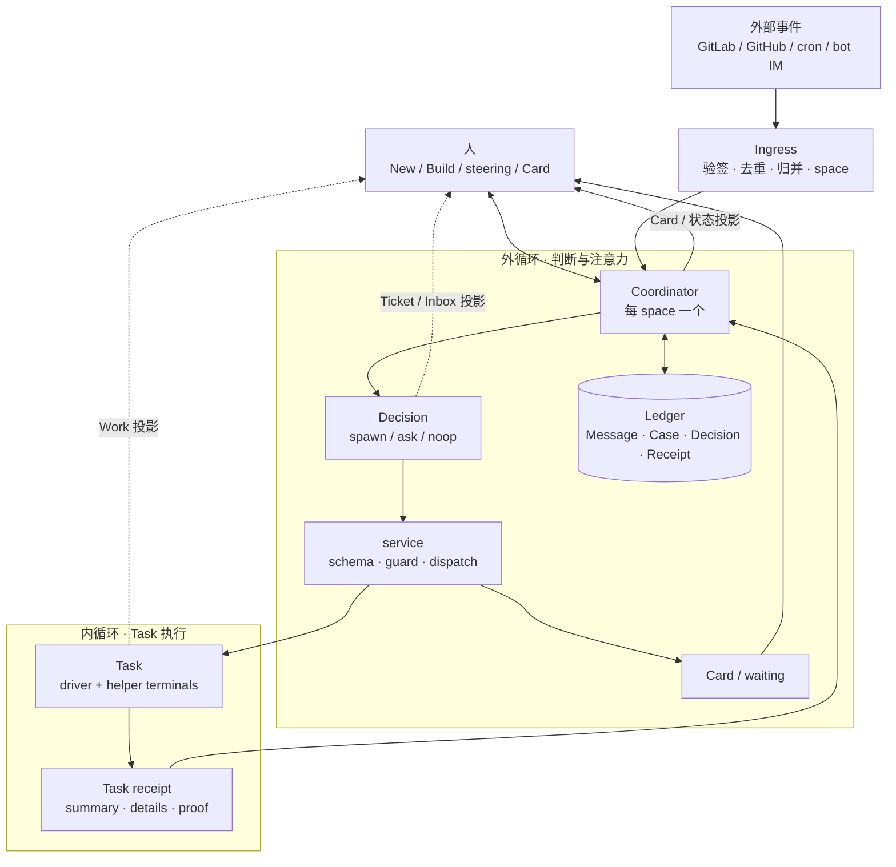
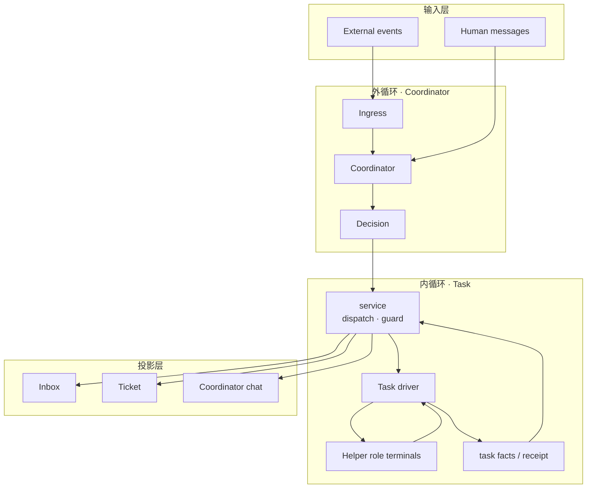
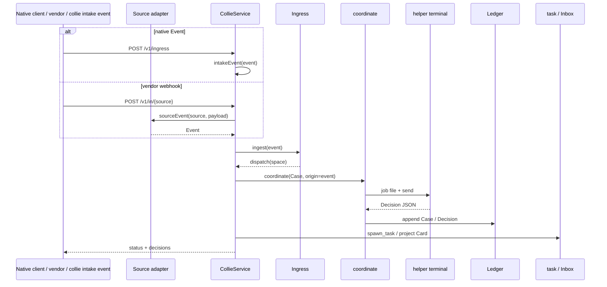
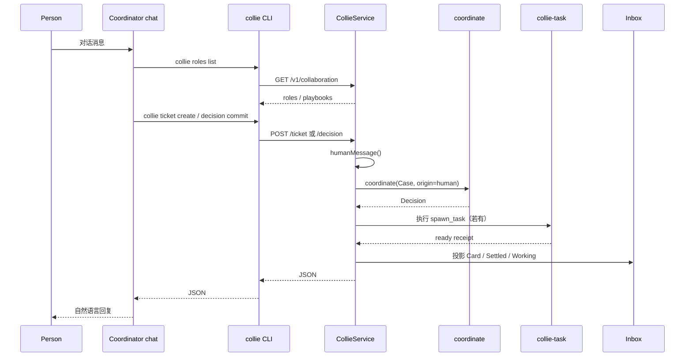

# Collie · 架构

> 公开命令面：`collie ticket` / `collie decision` / `collie task` / `collie roles`。  
> `collie-task` 是内部 task CLI 和 task store，不是用户或 role prompt 的契约。
>
> **双循环。** 外循环判断，内循环交付；外部事件和人共用同一个 Coordinator。内循环由一个 task driver 负责，driver 可以在同一个 task 下启动 helper role。

---

## 1. 设计理念

### 1.1 Autoloop

Collie 延续 Agent Autoloop 的基本设计：系统是一个循环，来源、判断、执行、回执持续衔接。

```text
          事件
来源 ─────────────▶ Coordinator
                      │
                  Decision
                      │
                    Task
                      │
                  Receipt
                      │
                    人 ◀── Card / 状态
```

- **注意力最贵。** 默认安静；只有确实需要人的决定、授权或验收时才出 Card。
- **一切都是输入。** 外部事件、人的消息、task receipt 都进入同一个判断面。
- **一轮可以结束，事情可以继续。** 一个 task 交回 receipt，不代表整个 Work 必须结束；需要继续时进入下一轮。
- **外部正文是资料。** 事件、网页、issue、评论不直接当指令；规则和 role prompt 才是指令。
- **执行者只交结果。** driver / helper 不拥有整个系统的视角；它们交局部事实，Coordinator 做全局判断。
- **人保留裁决权。** 不可逆动作、验收和方向选择回到人。

### 1.2 原则

1. **一个 space 只有一个判断者。**  
   Event 和人的消息都进入同一个 Coordinator；不存在第二个 dispatcher。
2. **Coordinator 不进入 task 内部。**  
   Coordinator 选择 playbook、创建 task、处理人的选择；task 内部的 role 编排由 driver 负责。
3. **Herdr 管资源，Collie 管工作。**  
   terminal、tab、pane、space、进程生命周期归 Herdr；Collie 只写 Decision、task facts 和投影。
4. **工作由 driver 展开。**  
   driver 读 playbook、执行 task，并按需要启动 helper role；Coordinator 不逐 role 分发。

核心原则：

```text
Role 管职责，Playbook 管编排，Driver 管执行，Task 管事实，Coordinator 管判断，人管裁决。
```

### 1.3 双循环



- **外循环**：输入进入 Coordinator；Coordinator 判断、选择 playbook、产生 Decision。
- **内循环**：Decision 变成一个 Task；driver 执行，并按 playbook 启动 helper role；Task 交回 task-level receipt。
- **人的循环**：Card 和状态投影回到人；人的回答再进入外循环。
- 两个循环共用同一个 Ledger、policy 和四态 Work。

```text
外循环决定做什么；
内循环决定怎么做；
人保留裁决权。
```

---

## 2. 基础概念

| 概念 | 含义 | 边界 |
|---|---|---|
| **Space** | 协作域：Coordinator、policy、Inbox、用户上下文 | 不是 git repo |
| **Project** | 执行域：repo、folder、worktree、task store | 不决定谁来判断 |
| **Message** | 进入 Coordinator 的一条消息；正文落 data_ref | 不是指令 |
| **Event** | `source=event` 的 Message；按 source + key 去重 | 不是指令 |
| **Human message** | `source=human` 的 Message；人在 chat / IM 里说的话 | 不伪造 Event |
| **Decision** | Coordinator 的业务判断，以及 service/system 的护栏、失败和 finalization revision | 外循环持久状态机：`open / waiting / settled`；Driver 不写入 |
| **Work / Ticket** | 一个 Decision 要交付的工作 | Decision + Task + live agent 的只读投影 |
| **Task** | Work 的执行事实：worktree、driver、status、receipt | 内循环持久状态机：`todo / running / ready / done`，由 `collie-task` 维护 |
| **Driver** | Task 的执行所有者；读 playbook，自己工作或启动 helper | 不是 Coordinator |
| **Helper** | 同一 Task 下的局部 role terminal，例如 reviewer / verifier | 不是第二个 Task，也不是 driver |
| **Playbook** | 交给 driver 的工作编排 prompt | driver 的本地执行说明 |
| **Role** | 职责、禁项、输入输出 | 不是 agent 名 |
| **Policy** | 内置规则 + per-space 用户规则 | Coordinator 只能起草，不能自改 |
| **Inbox** | Decision + task facts 的读时投影 | 不写回 Ledger |
| **Ledger** | 只追加的协调事实日志 | Message / Case / Decision / Receipt 的真源；Task 持久事实在 task store |

关系：

```text
Space
  └── Project
        └── Work / Ticket
              ├── Decision
              ├── Task
              │     ├── Driver
              │     └── Helper roles
              └── Receipt
```

---

## 3. 架构层次



### 3.1 输入层

- **Message**：统一信封 `urn:collie:message:v1`，`source` 标明 event 或 human。
- **Event**：GitLab / GitHub / cron / bot IM；Ingress 负责验签、归一、去重、归并、space 解析。
- **Human message**：Coordinator chat 里的对话；直接进入该 space 的 Coordinator，不经过 ingress、Event 的 dedupe / merge / hops，也不写 Event。

输入层只把消息交给 Coordinator，不判断业务。

### 3.2 外循环：Coordinator

Coordinator 读：

- 消息内容
- `snapshot.active`：未终结 Decision 与 orphan Task 的 decision_id、task_ref、run.kind、目标、详情引用和状态
- queue / running / recent / policy / budget
- playbook catalog（role catalog 单独给 driver）

Coordinator 输出：

- Decision；续接时带 `decision_ref`，写同一 Decision 的新 revision 并复用 Task
- `run.kind = build / review / verify`，表示当前 Task 动作，不是状态或去重身份
- 可选的自然语言 reply（同一个 chat 会话里的文字）

同一目标续接；独立目标才新建。`decision_ref + spawn_task` 由 service 拒绝；不确定时问人或 noop。

Coordinator 不执行 task，也不管理 task 内部的 role 转换。

### 3.3 内循环：Task driver

- service 根据 Decision 创建 task。
- task 有一个 driver。
- driver 拿到 task brief、playbook prompt、role catalog。
- driver 可以自己执行，也可以启动 helper role。
- helper 是 driver 的 `hc` child，共享同一个 task label。
- driver 收 helper 的结果，记录 task facts，最后交 task-level receipt。

### 3.4 投影层

- Inbox 只读 Decision + Task + live agent。
- Inbox 并列面板为 **Files / Inbox / Receipts**；Receipts 展示全部 Task 的交付回执，点击进入对应 Receipt 详情。
- Ticket body 只有 **Terminal** 与 **Receipts** 两个 tab；Terminal 指向 driver（已结束时可显示其历史 terminal），Receipts 展示每次 ready 的交付回执。
- Reviewer / verifier / helper 各有独立 Herdr tab；helper-only 不能抢占 driver Terminal。
- Receipt 按 Task ref 关联，记录每次 ready 的 summary、details 和 proof refs；不从 agent / chat 日志、publisher 或时间窗口推断交付。
- Proof 证据详情复用 shepherdr viewer；Artifact 只作为底层存储和 viewer 实现，不提供独立用户导航页面。
- Coordinator chat 是人的对话面。

Work 是四态只读投影；Decision 与 Task 是两个持久状态机，helper 的 live 状态记录在 Herdr terminal 中。

---

## 4. 外循环

### 4.1 输入

| 输入                | 入口                                                | 处理                                           |
| ----------------- | ------------------------------------------------- | -------------------------------------------- |
| **Event**         | `/v1/ingress`（native client）或 `/v1/in/<source>`（vendor webhook → adapter） | 验签、归一、`source + key` 去重、归并、space/project 解析；随后进入 helper job |
| **Human message** | Coordinator chat（UI） | 直接进入该 space 的 Coordinator；写 human Message，不经过 ingress、Event dedupe/merge/hops |

- `/v1/ingress` 和 `/v1/in/<source>` 是仅有的两个对外 ingress contract；human Message 不走它们。
- 多 `space_candidates` 时用第一个作为 primary，但 service 生成 waiting Card 让人确认，不静默选边。
- Chat 的判断通过 `collie` CLI 落库：`collie ticket create` / `collie decision commit` 调用 service 的本地 `/ticket` / `/decision` 路由，不是 ingress。
- Event 进入 helper；chat 直接进入 Coordinator。两者使用同一套 Message / Case / Decision 契约，但会话和投递目标不同。

Event 正文只通过 `data_ref` 读取；人的消息不需要伪造 Event。

### 4.2 输出

Decision 是唯一正式机器输出：

```text
Decision
├── origin: event | human
├── playbook: { name, version }?
├── project?
├── why
├── actions[]
└── state: open | waiting | settled
```

常用 action：

- `spawn_task`：创建一个 task
- `ask`：向人出 Card
- `priority` / `hold`：投影到 Decision 的排序 / 挂起字段；priority 过频或命中窗口限制时转为 waiting Card
- `emit_command`：请求对外动作；若被护栏变成 waiting Card，人 accept 后由 service 自动执行，也可用 `collie decision deliver --decision <id>` 重试
- `propose_policy`：把 `rule.draft_ref/summary` 写进 Decision.proposal，等待人批准
- `noop`：不行动

一条 Decision 只创建一个 `spawn_task`。需要多个 task 时，产生多个 Decision。

### 4.3 Coordinator context

Coordinator 的上下文分两层。

**1. 静态指令：从 prompt 文件加载**

```text
~/.config/herdr-core/templates/coordinator.md
```

包含职责、Decision 契约、动作约束、默认 playbook 映射、人的边界。不是动态数据。

**2. 动态上下文：程序注入 Case**

```text
catalog
  playbooks: [{ name, description, version }]

event / human input
slide snapshot
  queue / running / recent / policy / budget / space_note

instruction.role_prompt_ref
instruction.output_contract
```

规则：

- `catalog` 是唯一可选择的 playbook 来源；程序从 CollaborationRegistry 读取，不能由 coordinator 自己猜。
- playbook / role 的完整 prompt 正文不进入 Coordinator context；选中 playbook 后由 service 渲染进 task brief，role prompt 由 driver 按路径读取。
- `snapshot` 有 4KB 硬上限；catalog 只含选择元数据，避免把 prompt 正文塞进判断上下文。
- 事件正文仍在 `data_ref`，只作为资料，不作为指令。

### 4.4 Coordinator 的边界

Coordinator 负责：

- 判断消息要求什么
- 继续已有 Ticket / Task
- 选择 playbook
- 处理人的 steering、Card 和验收结果
- 读 task-level receipt，决定继续、rework 或 settle

Coordinator 不负责：

- 启动 reviewer / verifier
- 管理 task 内部 role 顺序
- 实现、review、verify
- 写 task facts

---

## 5. 内循环

### 5.1 启动

```text
Coordinator
  └── Decision(spawn_task, playbook)
        └── service
              └── Task
                    └── driver
```

driver 的输入：

- task brief：目标、范围、验收条件、项目路径
- playbook prompt：这个 task 如何展开，包括 review / verify 与 delivery
- role catalog：可用的 helper role、描述和文件路径
- 通用 task 命令：`add / list / show / start / status / ready / accept / done`；driver 执行时只用 `status` 记录进度、用 `ready` 交付

### 5.2 driver 的职责

driver 是 task 的执行所有者。它可以：

- 自己完成工作
- 按 playbook 启动一个或多个 helper role
- 等待 helper 结果
- 根据结果修复或继续
- 按 playbook 执行或请求 delivery
- 提交只含 summary / details / proof 的 ready receipt

driver 不负责：

- 写 Ledger
- 改 policy
- 替人验收
- 把 task 变成另一个 Coordinator

### 5.3 helper role

helper 和 driver 在同一个 task 下：

```text
driver terminal
  └── hc run --label herdr.task=T
        --label herdr.role=reviewer
        --label herdr.agent=...
        -- <reviewer prompt>
```

连接靠三件事：

```text
parent       → 谁是它的 owner
herdr.task   → 它属于哪个 task
herdr.role   → 它承担什么局部 role
```

helper 的职责由 role prompt 决定。helper 的 findings / verdict 是它的局部输出，不回写 Work 状态。

### 5.4 可变流程

Playbook 用一段 prompt 描述这个 task 如何展开：

```text
先确认范围；
实现并提交；
需要时启动 reviewer，读 findings，修 must-fix；
需要时启动 verifier，记录 verdict；
最后 ready。
```

所以：

- 可以是 implement → review → verify
- 可以只有 review
- 可以只有 investigate
- 可以没有 review，也没有 verify
- 顺序和并行由 playbook prompt 决定

driver 执行的是 **task-local 编排**，Coordinator 不逐 role 驱动。

### 5.5 回执

task 结束时，driver 只交 task-level receipt，且只有三个通用交付字段：

- `summary`
- `details`
- `proof`

`proof` 是可核验引用；review / verify 等 playbook 过程证据需要保留时，也只能通过 proof 引用，不形成额外 receipt 字段或 Task gate。receipt 回到 service，再交给 Coordinator 判断 accept / rework / drop，同时用于 Work / Ticket 只读投影。

review 任务中的 MR 评论属于任务交付物：driver 完成评论后直接发布并记录 note id，不因评论再生成独立 delivery 或 accept 卡。Approve、merge、push 仍需单独 Decision 授权。

```text
driver / helpers
      ↓
task facts / receipt
      ↓
Coordinator（task-level）
```

不是每个 helper 都产生 Coordinator turn。

完整状态流转、回执与最终交付见 [`TASK-LIFECYCLE.md`](TASK-LIFECYCLE.md)。

---

## 6. 状态同步

### 6.1 第一性原理：两套持久状态机、一个进程事实、一个只读投影

不要把 Decision、Task、Agent 和 Inbox 当成同一条状态链。它们分别回答四个问题：

| 概念 | 回答的问题 | 状态 | 谁写入 |
|---|---|---|---|
| **Decision** | 当前由谁做选择？ | `open / waiting / settled` | Coordinator / service |
| **Task** | 执行到了哪一步？ | `todo / running / ready / done` | `collie-task` / service |
| **Agent** | 此刻有没有进程在工作？ | `live / finished` | Herdr |
| **Inbox** | 人现在该看什么、做什么？ | `Todo / Working / Needs you / Settled` | 不写入；只读投影 |

`Receipt` 不是第五种状态。它是 Task 在 `ready` 时提交的交付依据，只有 `summary / details / proof`。

因此：

- `Decision.settled` 表示**判断已结束**。
- `Task.done` 表示**这次执行已结束**。
- `Agent.finished` 表示**进程已结束**。
- `Inbox.Settled` 是这些事实计算出的界面结果。

核心关系：

```text
Inbox = project(Decision, Task, liveAgents)
```

### 6.2 用“下一步由谁持有”理解 Inbox

Inbox 只关心当前由谁持有下一步，而不是复制三套状态：

| 下一步由谁持有 | Inbox 显示 |
|---|---|
| 还没开始 | `Todo` |
| Agent 正在工作 | `Working` |
| 需要人判断或验收 | `Needs you` |
| 已经没有下一步 | `Settled` |

多个条件同时成立时，按以下顺序取第一个命中：

1. Decision 已 `settled` → `Settled`
2. Decision 正 `waiting` → `Needs you`
3. 有 live agent 被阻塞 → `Needs you`
4. 有 live driver / reviewer / verifier 在工作 → `Working`
5. Task 是 `ready` → `Needs you`
6. Task 是 `done` → `Settled`
7. Task 是 `running` → `Working`
8. 其余 → `Todo`

记忆方式：**先看 Decision，再看 live agent，最后用 Task 补全。**

### 6.3 Task lifecycle：只记录执行事实

```text
todo → running          task start
running → ready         task ready + summary / details / proof
ready → running         task start（rework）
running → running       task start（terminal 已移除的 stopped-running 恢复）
ready → done            task accept
todo / running / ready → done
                        task done（drop / finalization）
```

| state | 含义 | 进入方式 |
|---|---|---|
| `todo` | 已创建，未开始 | `collie task add` |
| `running` | driver 正在工作 | `collie task start`：`todo → running`、rework 的 `ready → running`，或 stopped-running terminal 移除后的原地重启 |
| `ready` | driver 已交付，等待 accept / rework / archive / drop | `collie task ready`，必须提供 summary / details / proof |
| `done` | 这次执行已终结 | accept 用 `collie task accept`；archive / drop / finalization 用 `collie task done` |

`ready` 不是 done。它只表示 driver 已交付，后续由 Decision / Card 决定 accept、rework、archive 或通用 Card drop。调度、排队和外部 delivery 由 metadata 与 Decision/Card 表达，不进入 Task lifecycle。

### 6.4 Accept 同时写两套状态，但不要求 Agent 同步停止

一次 Accept 的顺序是：

1. service 执行 `collie-task accept`：Task `ready → done`。
2. service 写入 `Decision.settled{outcome:"accepted"}`。
3. Inbox 因 Decision settled 立即显示 `Settled`，即使 driver 当时仍是 live。
4. Herdr 的后台 tick 再清理 driver / helper。

清理不是 Accept 的第四个状态，也不存在 `resumed` 字段或 Coordinator 续接：

- `DONE_GRACE_MS = 60000`：done 后至少保留 60 秒，让最后的输出先落盘。
- Agent 空闲后由 tick 执行 `kill`，随后 `rm`。
- Agent 仍在工作时，默认最多延长到 `DONE_WORKING_MS = 15 * 60000`。
- `Agent.finished` 不改变已经写入的 Decision / Task，也不会把 Settled 拉回 Working。

### 6.5 MATE-2：一次实际生命周期

| 阶段 | Decision | Task | Agent | Inbox |
|---|---|---|---|---|
| 开始评审 | `open` | `running` | driver / reviewer live | `Working` |
| Driver 交付 | `waiting` | `ready` | 仍可能活着 | `Needs you` |
| 人执行 Accept | `settled/accepted` | `done` | 当时仍可能活着 | `Settled` |
| 后台清理 | 不变 | 不变 | 约 60 秒后结束 | 仍为 `Settled` |

本次实测：Decision 在 `01:36:28.485` settled，Task 在 `01:36:28.659` done，driver 在 `01:37:33.587` 被结束并移除，间隔 **64.928 秒**。Coordinator 的 done 来自 settled Decision 投影，不是 driver 停止；约 3 秒的界面刷新节奏也不是 agent 清理阈值。

### 6.6 标准 Task schema

持久化文件：

```text
~/.local/share/collie/tasks/<slug>.json
```

列表 envelope：

```json
{
  "version": 1,
  "folder": "/repo/collie",
  "kind": "repo",
  "name": "collie",
  "slug": "repo-collie",
  "prefix": "COLL",
  "next": 42,
  "project_id": null,
  "tasks": []
}
```

Task record：

```json
{
  "id": 42,
  "ref": "COLL-42",
  "title": "Handle materialize!109",
  "state": "todo | running | ready | done",

  "created_at": 1795485654000,
  "started_at": null,
  "ready_at": null,
  "done_at": null,
  "done_by": null,

  "space": "spf57...",
  "project": "materialize",

  "mode": "worktree | here",
  "worktree": null,
  "branch": null,
  "base": null,
  "start": null,

  "agents": [],
  "progress": null,
  "summary": null,
  "details": null,
  "proof": null,
  "depends_on": []
}
```

字段：

| 字段 | 持久 | 说明 |
|---|---|---|
| `state` | 是 | 只有 4 个值 |
| `done_by` | 是 | `coordinator` / `human` / null |
| `depends_on` | 是 | 队列依赖 |
| `progress` | 是 | driver 自报进度 |
| `agents` | 是 | 历史 agent 记录 |
| `ref` | 是 | canonical Task ref（如 `COLL-42`）；spawn / adopt / Receipt / Artifact 全链路使用，不做 key / id 回退 |
| `status` / `needs` / `why` | 否 | Work 投影派生 |
| `live` / `subagents` | 否 | Herdr labels 派生 |
| `summary` / `details` / `proof` | 是 | `ready` 的通用 receipt 字段；proof 是可核验引用 |

状态不变量：

```text
todo:    started_at=null, ready_at=null, done_at=null
running: started_at!=null, ready_at=null, done_at=null
ready:   ready_at!=null, summary/details/proof!=null, done_at=null
done:    done_at!=null, done_by=coordinator|human
```

### 6.7 操作与状态对照

| 操作 | Decision | Task | Inbox |
|---|---|---|---|
| `ready` | `waiting` | `ready` | `Needs you` |
| `Accept` | `settled/accepted` | `done` | `Settled` |
| `Rework` | `open` | `running` | `Working` |
| `Archive` | `settled/archived` | `done` | `Settled` |
| 通用 Card `drop` | `settled/dropped` | `done` | `Settled` |
| `Quote` | 不变 | 不变 | 不变；Coordinator 决定新工作 |

Archive 与 drop 不复用同一个 outcome：Archive 写 `archived` 并保留全部交付证据，通用 Card drop 写 `dropped`。两者都不是删除 Settled 历史。

### 6.8 phase、role tab 与 agent 历史

`build / review / verify` 是 Task 的执行动作，不是额外状态。Working 的动作副标签优先取 live helper 的 `herdr.role`，否则读 `Decision.run.kind`；动作变化不进入 Task state，也不构成新建或去重身份。

Role terminal 也有独立生命周期：

- driver 使用 Ticket 的 Terminal tab；reviewer / verifier / helper 是同一 Ticket 详情里的 Role / Agent tabs，不自动创建主页面 Herdr tab。
- 所有 role 复用同一个详情 agent body；live role 显示 terminal，finished role 显示只读历史，切换时按需改写该布局块。
- `status=done` 只表示不再计入 live role，不能据此隐藏已有 role terminal。
- `state=finished` 的 role terminal 通过只读会话历史打开，不表示恢复或重启 agent。
- 没有 live driver 时默认显示 Receipts；Receipt 和 Proof 仍可继续打开。

### 6.9 容易混淆的边界

- `ready ≠ done`：ready 只是可以验收，done 才是执行结束。
- `done ≠ settled`：done 是 Task 事实，settled 是 Decision 事实。
- `Settled ≠ 删除`：Receipt、Proof 和 Settled 历史保留。
- `done agent ≠ done Task`：进程结束和任务结束是两件事。
- `failed` 不是 Task 状态：需要人处理的失败通过 Decision waiting + alert Card 表达。
- `ack ≠ settled`：展开或读取 Card 不会结案，只有明确 outcome 才结案。

唯一规范判定表见 [`TASK-LIFECYCLE.md`](TASK-LIFECYCLE.md) §2.5。没有更高优先级条件时，Task done 也投影为 Settled，包括 orphan Task 或 Decision 仍为 open 的情况；Task running 没有 live agent 仍是 Working。

---

## 7. Herdr 集成

Collie 不拥有 terminal / tab / pane / space：

| 能力 | 归属 |
|---|---|
| space / tab / pane / terminal | Herdr core |
| 进程启动 / 保活 | `hc run --bg --keep` |
| 身份 / 归属 | Herdr labels |
| screen / wait / get | `hc read` / `hc wait` / `hc get` |
| Decision / policy / Inbox | Collie |
| task store / scheduler / ready | `collie-task` |

关键 label：

```text
herdr.role=coordinator
herdr.role=reviewer
herdr.role=verifier
herdr.role=helper
herdr.task=<task>
herdr.task.space=<space>
herdr.coordinator=<tab>
herdr.chat=<pane>
herdr.chat.slot=<slot>
```

- `herdr.task` 标识 task 归属。
- `herdr.role` 标识局部角色。
- `parent` 标识 helper 的 owner。
- `herdr.space` 是 Herdr pane 的 space；task 使用 `herdr.task.space`。

---

## 8. 失败与恢复

### 8.1 helper 失败

driver 负责发现和处理：

- reviewer findings → driver 修复
- verifier fail → driver 修复
- helper 崩溃 / 超时 → driver 重试；无法继续时由 service 写 Decision waiting / Card

如果 driver 无法处理，service 把问题交回 Coordinator / 人；Task 不增加 blocked 状态，Coordinator 也不需要知道每个 helper 细节。

### 8.2 task 失败

task 未 ready 就结束（例如 driver 进程退出或超时）时，`#executeSpawn()` 捕获并写 waiting alert Card，不把异常抛回 ingress，也不把 Task 标成 `done`。Coordinator 读 receipt / facts 后决定：

- continue same Work
- rework
- ask human
- settle failed

### 8.3 人的验收

`ready` 之后：

- 自动接受 → `settled/accepted`
- 需要人 → Needs you + accept Card
- rework → 回到 Working
- Archive → `settled/archived`，保留交付证据
- 通用 Card drop → `settled/dropped`

`ack` 不是 settled。

---

## 9. 配置与命令边界

### 9.1 Role

Role 来源、固定角色和用户配置规则见 [`SETTINGS.md`](SETTINGS.md)。

Role 文件：

```text
~/.config/collie/roles/*.md
```

Role 定义职责、禁项、输入输出；playbook 负责编排这些 role 的使用方式。

### 9.2 Playbook

Playbook 文件：

```text
~/.config/collie/playbooks/*.md
```

Playbook 只有：

```text
name
description
version
body
```

body 是交给 driver 的编排 prompt。review / verify 的顺序、helper 使用和 merge / comment / close 等 delivery 都由 body 决定；Decision 的 spawn 只选择 playbook 与执行目标，不含 `spawn.review` / `spawn.merge`。这些活动不形成 Task 字段、状态或 accept gate。

### 9.3 配置层级

```text
system fixed
  ~/.config/herdr-core/templates/coordinator.md
  ~/.config/herdr-core/templates/driver.md

user config
  ~/.config/collie/roles/*.md
  ~/.config/collie/playbooks/*.md
  ~/.config/collie/skills/cli/SKILL.md
  ~/.config/collie/coordinator.json
  ~/.config/collie/settings.json
  ~/.config/collie/sources.json
  ~/.config/collie/workspaces.json
```

- `coordinator` / `driver` 的系统定义不可覆盖，只允许改 runner 配置。
- 所有用户级 role / playbook 都存放在 `~/.config/collie/`。
- 每个定义记录 `origin: system | config` 和实际文件路径。
- 旧路径 `~/.config/herdr-core/templates/roles/`、`~/.config/herdr-core/templates/playbooks/`、`<project>/.collie/`、`<project>/.agents/skills/collie/` 不再读取。
- Task 记录实际使用的 playbook / role 来源。

### 9.4 命令边界

完整命令、参数和状态迁移以 [`CLI.md`](CLI.md) 为准；注入 Coordinator / Driver 的 `skills/cli/SKILL.md` 保持自包含，不依赖本文表格。

人通过 `collie ticket create` 明确建 Ticket，Coordinator 用 `collie decision commit` 提交判断，Driver 只用 `collie task status/ready` 记录进度和交付。accept / drop 后由 service 终结 Task，rework 对同一 Task 调 `start`。公开 `collie task` 子命令只有 `add / list / show / start / status / ready / accept / done`；`drop` 是 Card 选项，不是 task 子命令。

`collie-task` 是内部 task CLI，tick / revive / scheduler 等内部能力不进入公开契约。Chat 只使用 `collie` CLI，不直接调用 service 的本地 HTTP 路由（`/ticket`、`/decision`、`/deliver`）；这些路由是 CLI 的实现细节。对外 ingress 只有 `/v1/ingress` 和 `/v1/in/<source>`。

### 9.5 Coordinator 的 CLI 能力面

Coordinator / Driver 的 role prompt 不复制 CLI 命令表。启动器在启动时读取并注入：

```text
~/.config/collie/skills/cli/SKILL.md
```

- Coordinator：启动 chat agent 时把 skill 追加到系统提示词。
- Driver：`renderBrief()` 把 skill 追加到 task brief。

skill 只描述 `collie` 命令面，不描述 service socket、内部路由或传输细节。

| 能力 | CLI | service 内部路由 | 说明 |
|---|---|---|---|
| 读 registry | `collie roles list` | `GET /v1/collaboration` | 选择 playbook / role 前读取 |
| 新建 Ticket | `collie ticket create` | `POST /ticket` | 由 service 构造确定性 `spawn_task` |
| 提交 Decision | `collie decision commit` | `POST /decision` | Coordinator 已在 chat 中判断完 |
| 重试 delivery | `collie decision deliver` | `POST /deliver` | accept 后 delivery 失败时使用 |
| 读 Ticket | `collie ticket show` | 读 `queue.json` 投影 | 不根据聊天记忆猜状态 |
| 读 task | `collie task list/show` | `collie-task` | task facts 的唯一公开入口 |
| 接入 orphan task | `collie ticket adopt` | `POST /ticket/adopt` | 不重复 spawn |

`collie ticket create` / `collie decision commit` 不是 ingress；它们只从本地 Unix socket 调用 service。TCP ingress 只暴露 `/v1/ingress` 和 `/v1/in/<source>`。

### 9.6 Event 投递序列



### 9.7 Chat 投递序列



Chat 不经过 helper，也不经过 `/v1/ingress`。它只通过 CLI 落 Decision；事件才由 ingress 进入 helper。两条路径共用 `coordinate()` / Decision / Ledger / Inbox。

### 9.8 持久化存储

Collie 的状态分三类，不混在同一个文件里：

1. **协调记忆**：Message / Case / Decision / Receipt
2. **执行事实**：task store、worktree、artifact
3. **投影与 IPC**：queue、ingress snapshot、brief、job、receipt 文件

#### 状态目录 `~/.local/state/collie/`

| 路径 | 写入者 | 作用 | 可否重建 |
|---|---|---|---|
| `ledger.json` | service / `Ledger` | Message、Case、Decision、Receipt 的 append-only 历史 | 否，是协调记忆的唯一真源 |
| `queue.json` | service | `Decision.state` 的 Inbox 投影 | 是，service 启动时从 Ledger 重写 |
| `ingress.json` | service / `Ingress` | 去重、归并 lane、事件代表快照 | 运行态；用于重启后继续去重 |
| `intake/ev_*.json` | `service/intake.ts` | generic intake 的 Event 正文 | 外部数据，不重建 |
| `event-bodies/ev_*.md` | source adapter | vendor webhook 归一后的 Event 正文 | 外部数据，不重建 |
| `tickets/msg_*.md` | `createTicket` | human ticket 的 brief 正文 | 人提供的输入 |
| `turns/msg_*.json` | `commitDecision` | Coordinator chat 提交的 Decision 输入 | 人/agent 提供的输入 |
| `briefs/*.md` | `renderBrief` | 渲染后的可信 task brief | 可由 Decision、playbook、role 重建 |
| `receipts/rc_*.json` | `acceptReceipt` | task ready 的三件套（summary/details/proof） | 与 Ledger Receipt 对应 |
| `helper/<space>/jobs/hj_*.json` | `runHelperJob` | 递给 Coordinator helper 的 Case | 可由 Case 重建；启动时未完成 job 转 waiting Card |
| `helper/<space>/decisions/hj_*.json` | Coordinator helper | helper 写回的 Decision proposal | service 校验后才进 Ledger |
| `policy/<space>.md`、`policy.md` | 人 | per-space / 全局 policy | 用户配置 |
| `ruleset.json` | installer / 人 | 护栏、预算、hops 配置 | 配置，不是运行历史。预算耗尽进入 Todo；`Run now` 立即执行，`Archive` 完成当前 Task 并结算 Decision，不生成 Needs you 卡 |
| `service.sock`、`service.log`、`coordinator-runtime.json` | service / 运维 | socket、日志、Coordinator 运行时指针 | 运行态，不是业务事实 |

写文件的方式：

- `ledger.json`：进程内追加后写临时文件，再 `rename` 成正式文件；不直接原地改历史。
- `queue.json` / `ingress.json`：同样临时文件 + `rename`，避免读到半截 JSON。
- 正文文件使用 `0600`；Event 正文用 `sha256` 校验，读取后先核对。

#### 执行事实 `~/.local/share/collie/`

| 路径 | 写入者 | 作用 |
|---|---|---|
| `tasks/<slug>.json` | `collie-task` | 每个 folder/repo 的 task 列表、生命周期、agents、worktree 指针 |
| `tasks/.*.json`、`tasks/.*.lock` | `collie-task` | scheduler、settings、锁和队列 metadata |
| `worktrees/<repo>/<task>` | `collie-task` / git | task 的隔离 worktree；可能含未提交改动 |
| `artifacts/` | `collie-artifact` | proof 和产物文件；Task/Receipt 只保存引用 |

`tasks/<slug>.json` 是 **collie-task 的执行事实**，不是 Ledger 的副本；Inbox 读它来做投影。

#### 配置目录 `~/.config/collie/`

配置不是运行历史：

```text
roles/*.md
playbooks/*.md
skills/cli/SKILL.md
coordinator.json
settings.json
sources.json
workspaces.json
```

system role prompt 在 `~/.config/herdr-core/templates/`；布局和 Herdr 自身状态在 `~/.config/herdr-app/`。

#### Work 状态不落盘

`Todo / Working / Needs you / Settled` 以及 `Working · reviewing`、`Working · verifying` 都是读时投影：

```text
Work = f(Decision.state, task.state, task.live, Herdr terminals)
```

- `Decision.state` 来自 Ledger。
- `task.state` / `task.live` 来自 `~/.local/share/collie/tasks/<slug>.json`。
- terminal / pane / agent 的实时状态来自 Herdr core（`hc ls` / `hc get` / labels）。
- `ticketStage()` / `workKind()` 在 `lib/inbox-queue.js` 计算，不写第二个状态机。

因此删除 `queue.json` 只会让 Inbox 暂时失去投影；删除 `ledger.json` 会丢失协调历史；删除 task JSON 会丢失执行事实；删除 worktree 会丢失未提交代码。三者不能用同一个清理动作处理。

---

## 10. 结论

```text
Herdr 管资源和身份。
Coordinator 管判断。
Decision 管分发。
Driver 管 task 内部编排。
Helper 管局部 role。
Task 管执行事实。
Work 管投影。
人管裁决。
```

Collie 的价值不在于多几个 agent，而在于：

- 判断有唯一来源；
- task 内部编排可变；
- role 与 playbook 解耦；
- 状态不重复；
- 人保留最终裁决权。
