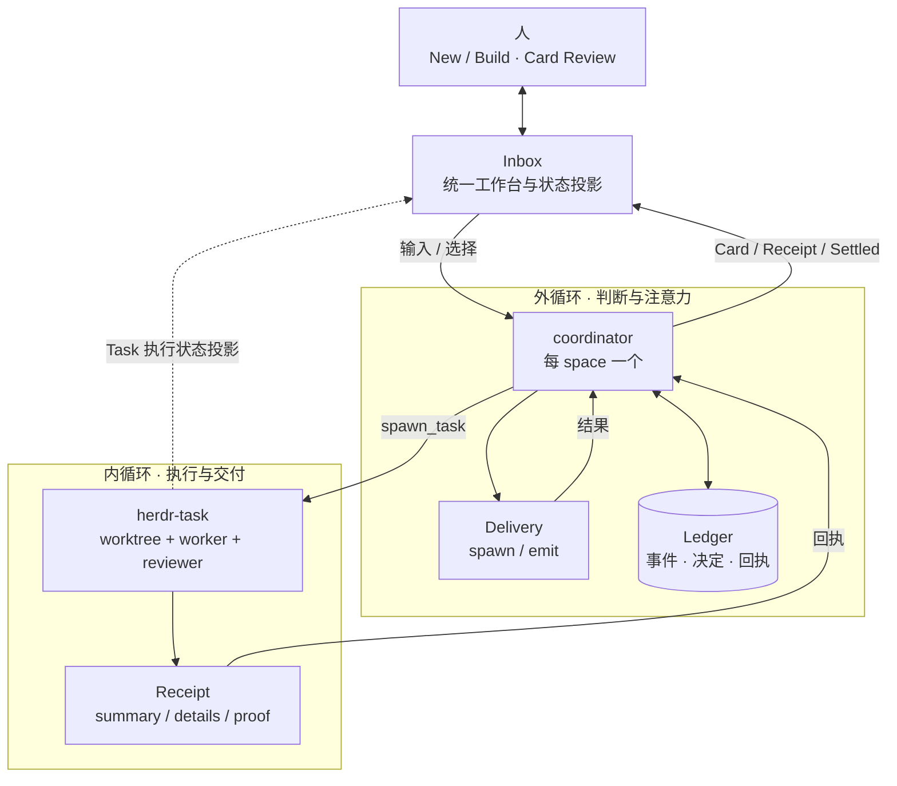
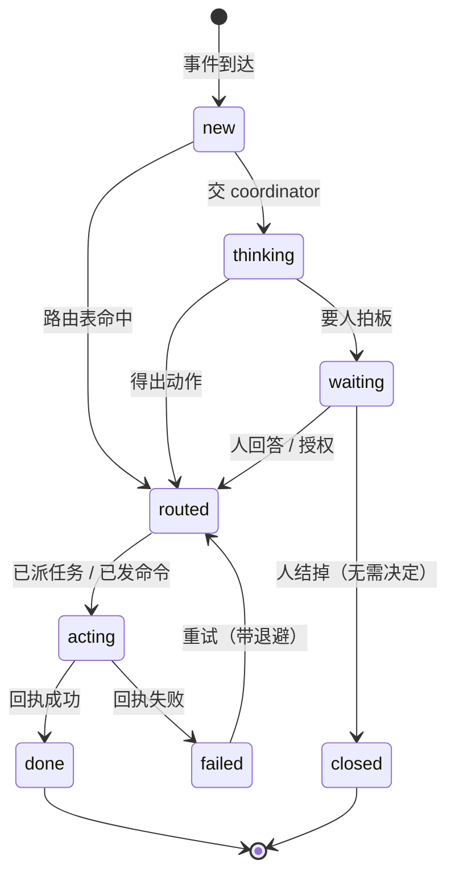
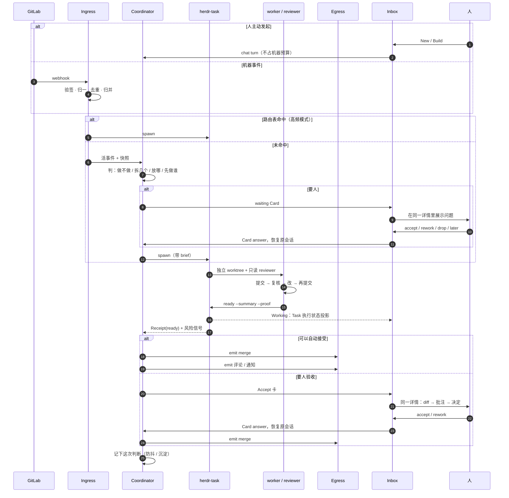

# collie · 设计文档

> v2.1（2026-11-16）· 状态：独立交互模式修订，待 review；M0–M7 为既有协议与执行基础
> 产出物：一个 **herdr 插件包**（layout + mods + 一个中台 + `install.sh`）。
> 一句话：**双循环。事件进，判断，行动出。**

---

## 0. 双循环

```
                         人
                         │ New / Build · Card Review
                         ▼
              Inbox · 统一工作台与状态投影
                         │ 输入 / 选择
                         ▼
            外循环 · 分钟–天 · 注意力              内循环 · 秒–小时 · 执行
   ┌───────────────────────────────────┐   ┌──────────────────────────────┐
   │                                   │   │                              │
   ▼                                   ▼   │                              │
 Inbox ─► Coordinator ─► Delivery      Task ─► worker+reviewer ─► Receipt
              ▲    │                  │                                  │
              │    └──────────────────┴──────────────────────────────────┘
              └────────────── Card / Receipt / Settled
```

**一句话版**：`外部事件或人的 New/Build → coordinator → herdr task → coordinator → (herdr task 或 发外部命令)`。

**交互边界**：collie 使用独立的 Inbox layout。UI 不嵌入 shepherdr 的 Assistant、Tasks、Files、Changes、Artifacts 页面；shepherdr 只提供执行层与可复用渲染能力，不提供另一套交互流程。

三个要点：

1. **循环在 coordinator 闭合**，不在任务闭合。任务只是行动的一种。
2. **出口有两种**：`spawn task`（要干活）和 `emit command`（评论 MR、合并、关 issue、发 IM）。两者对称，都叫 delivery。
3. **Inbox 横跨两个循环**：它统一展示外循环的 Decision 与内循环的 Task 执行投影；人在外循环做 New / Build 与 Card Review，在内循环只观察 Task / Diff / Proof，不直接指挥 worker。
4. **Coordinator 是唯一控制交点**：它接收 Inbox 输入、发起内循环、接收 Receipt，再决定下一步；没有第三条经过 shepherdr Tasks 的循环。

---

## 图索引

| 图 | 位置 | 回答什么 |
|:--|:--|:--|
| 双循环与四道缝 | §1.2 | 系统由哪几个可替换点构成 |
| 独立 Inbox layout 与人的两个入口 | FLOW §2–3 | New / Build、Card answer 与统一工作台 |
| 一次事件的全程 | §4.1 | 从 webhook 到 task、到外部命令的时序 |
| Decision 状态机 | §3.3 | 「inbox 状态管理」到底管什么 |
| Task 与 Card | §4.2 | 任务状态、卡片状态、两者的关系 |

---

## 1. 架构

### 1.1 三个关注点 → 三个模块

| 关注点 | 模块 | 干什么 | 不干什么 |
|:--|:--|:--|:--|
| **事件处理与路由** | Ingress | 验签、归一、去重、路由 | 不做业务判断 |
| **全局管理** | Coordinator | 判、拆、派、定优先级、要人要授权 | 不执行、不 ack |
| **状态台账** | Ledger | 记事件、记决定、记任务状态 | 不做判断 |
| （对称的出口） | Egress | 把行动发到外部：评论、合并、IM、命令 | 不做判断 |

### 1.2 四道缝（可替换点）

这四条既是架构分界，也是插件点——来自 agent-autoloop 的四个方向，逐条对上：

| 缝 | 方向 | 换成什么 | v1 用什么 |
|:--|:--|:--|:--|
| `source` | 进 | 别的事件源（IM、监控、邮件） | `gitlab` / `github` / `cron` |
| `agent` | 干 | 别的执行体（不是 herdr 的 CLI） | `herdr`（→ `herdr-task`） |
| `channel` | 问人 | 别的问人通道（飞书、钉钉、桌面） | `herdr` 卡片 + `im` |
| `delivery` | 出 | 别的行动出口（别的代码平台、别的通知） | `gitlab` / `github` / `im` |



**为什么只有一张表**：`source` 把世界变成事件，`delivery` 把决定变成动作，中间**判断者按 space 切、队列只有一份**。判断者多一个不算病（每个 space 一份上下文）；队列多一份才是病。

### 1.3 三个进程

| 进程 | 活多久 | 停掉会怎样 |
|:--|:--|:--|
| herdr-core | 一直 | agent 全停，worktree 里的活保住 |
| **中台**（Ingress + Ledger + Coordinator 宿主） | 一直 | 事件无人归并，窗口看不到新卡；**任务照跑** |
| herdr-app（窗口） | 按需 | 界面没了，双循环照转 |

> **验收标准**：关掉窗口 4 小时，回来发现活干完了、队列里只有真正需要你的东西。

---

## 2. 概念：三个领域对象 + 两个信封 + 一张表

砍到只剩三个**领域对象**；`Case` / `Receipt` 是它们在 Ledger 里的信封，`Rule` 是路由表的一条——信封与表不是新的领域对象，所以「三个」仍然成立。之前的「事项」「委派」「卡片」也不是对象，是这三个的视图。

| 对象 | 定义 | 谁写 |
|:--|:--|
| **Event** | 外部发生的一个事实，去重后不可变 | source 插件 |
| **Decision** | coordinator（或路由表）对一件事件做出的判断：干什么 | core |
| **Task** | 一个 Decision 要求交付的工作 | `herdr-task`（**不在本层**，只存 `receipt_ref`） |

| 信封 / 表 | 是什么 | 为什么不算对象 |
|:--|:--|:--|
| **Case** | 递给 coordinator 的一次 job turn：活事件 + ≤4KB 快照 | 只在 Ledger 里存在，是 Decision 的输入面 |
| **Receipt** | `herdr-task ready` 的 summary/details/proof 三件套 | 是 Task 的交回面，不带自己的状态机 |
| **Rule** | 路由表的一条（`when` → `to`） | 是 coordinator 判断的缓存，不是事实 |

> 为什么不选 B（把 §2 改写成「三个领域对象 + 两个信封 + 一张表」逐字保留字样）：A 已经把这句话的内容写进本表上方的标题了，B 只是换一种字体重复一遍，不会让任何人少错一次。

| 视图 | 是什么 | 例子 |
|:--|:--|:--|
| **Card** | 一个 `state=waiting` 的 Decision 的人面投影 | 「这个要合并吗？」 |
| **Queue** | 所有 `waiting` 的 Decision 按优先级排 | inbox 面板 |

**Card 不是新对象**，它就是 Decision 的一个状态。这一条决定了「inbox 状态管理」的全部内容（§3.3）。

### 2.1 与 agent-autoloop 的对应：哪些是新的

Ingress 与路由**就是 autoloop 的逻辑**，一点没改。这两个概念也可以直接借它的名字：

| 我们的说法 | autoloop 里的实体 | 在哪 |
|:--|:--|:--|
| 事件信封 | `Event`（`id/type/subject/summary/detail/link/hops`） | `protocol/` |
| 去重 | `source + key`，命中原样返回旧路由 | `kernel/decide.ts` → `ingest()` |
| **归并** | `lane = rule + subject`；排队中的 run 把后到的事件一起吃掉 | `heldRun()` / `enqueue()` |
| 路由表 | `rules[]`（`when{source,types}` → `to` / `cwd` / `group`） | `kernel/rules.ts` |
| 一条事件多条规则 | `matched` → 逐条 `enqueue`（fan-out） | `install()` 里 `for (const rule of taking)` |
| 护栏 | `rules.askFirst[]`（全局，七条） | `protocol/rules.ts` |
| 并发 | `parallel` / `maxActive` | `Rule` |
| **委派／递归** | 规则 `emits`（事件派生事件）+ `MAX_HOPS` | `install()` 里 `tooDeep` 直接拦 |
| 卡片 | 本设计的 Card（= `Decision{state:"waiting"}`） | `protocol/decision.schema.json#/$defs/card` |
| 暂停／补跑 | `pauseRule` / `replayRule`（不自动补，每条一次） | `kernel/decide.ts` |

所以真正**新增的只有两块**：

1. **coordinator**——一个 agent，但它的「产出」不是代码，是 `Decision` 里的 `actions[]` 和 `why`。**委派 = 一条 `spawn_task` 动作**（= `herdr-task add` + `start`），不需要新协议、新对象。
2. **`plugins/agent/herdr.ts`**——把一条 `spawn_task` 变成 `herdr-task add + start`，`ready` 时把 `summary/details/proof` 当 `Receipt` 交回去。

**回执只有一种**：`herdr-task ready --summary/--details/--proof` 三件套（`protocol/receipt.schema.json`，`origin` 与 `last_message_used` 都被 `const` 冻死）。autoloop 那个「回执块里的 `ask / notice / resolve / later`」在本设计里**不存在**：问人一律走 `Decision.actions[].kind="ask"` + Card。

> 为什么不选 B（保留两种回执并存）：同一件事有两个表达，卡片的来源就不确定——读到一条 `ask` 时无法判定它来自任务回执还是 coordinator 判断，而这恰好是「谁在问、该谁答」的依据。

### 2.2 照抄会坏的三个地方

| autoloop 的假设 | 我们的事实 | 改法 |
|:--|:--|:--|
| 一轮 = 一次 agent turn，结束后进程退出 | 一个 task 可能跑一小时，还带 reviewer | run 保持 `claimed` 直到 task `ready`；`unknown` 在长任务期间是**正常态**，不是失败信号 |
| `cwd` 是一个干活的仓库目录 | coordinator 的「活」是判断，没有仓库 | 允许 `cwd` 是非 git 的状态目录（`~/.local/state/collie`） |
| 回执 = agent 最后一条消息 | 最后一句可能被截断，且不含验收凭据 | 回执取 `herdr-task ready --summary/details/proof` |

---

## 3. 三个关注点

### 3.1 Ingress：事件进来，先归并再路由

```ts
type Event = {
  source: "gitlab" | "github" | "cron" | "im";
  key: string;          // source 内唯一，如 mr!93@head_sha
  type: string;         // merge_request.updated
  object: { kind: "mr" | "issue" | "pipeline" | "none"; id: string; url: string };
  data_ref: string;     // 正文落盘路径，不内联
  hops: number;         // 委派深度，来源不可设置
};
```

三步，缺一不可：

| 步 | 做什么 | 为什么 |
|:--|:--|:--|
| **去重** | `(source, key)` 已存在 → 丢弃 | 重投、webhook 重试 |
| **归并** | 同一 `object` 的多个事件 → 一条「活事件」 | 一个 MR 推 4 个 commit 是 4 个事件、1 件事 |
| **路由** | 查路由表 → 先定 **space**，再定动作；表里没有 → 交那个 space 的 coordinator | 高频模式不烧模型 |

**指令数据分离**（硬约束）：外部正文只以 `data_ref` 引用，**绝不拼进提示词**；事件里带 `cwd` / `agent` / `access` 一律拒收。

两个抄来的细节，别省：

| 细节 | 做法 | 为什么 |
|:--|:--|:--|
| **标题校验** | 标题只能是一段不含 `{}` 的纯文本（`agent-autoloop` 的 `isTitle`） | 它会被当命令行参数传进去，带 `-` 开头可能被当成 option，带 `{id}` 会被当模板 |
| **正文落盘** | `data_ref` 是一个文件路径，worker 去读 | 不内联就不存在「外部文字改变行为」 |

### 3.2 Coordinator：每 space 一个（照 shepherdr 的 Assistant）

**决定：不做一个全局 coordinator，而是一个 space 一个。** 这不是折中——shepherdr 已经这么跑，而且它顺手回答了那个看起来矛盾的问题：

> **N 个判断者，1 个队列。**

判断按 space 切（上下文是 space 的：哪个仓、什么约定、什么 base），队列不切（注意力是人的，只有一条）。独立 Inbox layout 汇总所有 space 的 waiting Decision；每个 space 有自己的 coordinator，但没有另一套 shepherdr Tasks 页面参与分流。

#### 与 Assistant 一致的部分（直接照抄）

| 机制 | shepherdr 的做法 | 我们照用 |
|:--|:--|:--|
| 身份 | 终端 label `herdr.role=coordinator`；藏在 chat 后面时用 `herdr.coordinator.space` / `.tab` | ✅ |
| 角色提示词 | `templates/assistant.md`（203 行），开头就写「你是一个 space 的 coordinator；在聊天里自称 assistant」 | ✅ 改成 `coordinator.md`，加一个事件入口 |
| 不写代码 | 明确禁止；只允许读文件、跑只读命令 | ✅ `access` 固定为 `read` |
| 不替人收尾 | 「只有人能 Done」；`ready` 后必须人 Accept | ✅ Accept 卡 |
| 启动 worker | 直接调 `herdr-task`；worker 是它的 hc 子进程，带 `herdr.task` / `herdr.task.space` / `herdr.coordinator` 三个 label | ✅ **这就是我们的「委派」** |
| 不绕队列 | 每 folder 最多 N 个同时跑（`--max-running`，默认 3），其余 Herdr 自己起 | ✅ |
| 只管自己的 | 「Watch only the workers you started」 | ✅ 跨 space 的不碰 |
| 设置按 space 解析 | 会话开头给一段 "Your settings"，按这个 space 解算 | ✅ |
| 被叫人 | `herdr-task tell-assistant <space 或终端地址> <text>` | ✅ 卡片回答也走这个 |

所以**委派不需要新协议**：委派 = `herdr-task add` + `start`。之前设计的 `emits` 降级为「机器到机器的链」（流水线事件触发另一次 intake），不是主路。

#### 我们多出来的：第二个入口

Assistant 只有一个人入口（chat）。我们有两个，但**只有一个能被人看见**：

| 入口 | 谁发起 | 可见性 | 产出 |
|:--|:--|:--|:--|
| **chat turn** | 人在 Inbox 的 New / Build 输入目标，或回答卡片 | Inbox 内可见；不占机器唤醒预算 | `Decision`：spawn / priority / hold / ask / propose_rule |
| **job turn** | 内核递一条机器 Case | **不可见**（headless，不进 chat 历史） | 同一套 `Decision` |

New / Build 是人主动发起新目标；Card answer 是继续已有 Decision。二者都写 Ledger、经过同一 coordinator 与护栏，但**不能和 job turn 合成一个入口**：机器事件一旦进入人的对话，就又退化成 flume。两个入口、两套会话，但只有**一套记忆**。

#### 记忆外置到 Ledger

Assistant 的记忆在它的 chat 会话里。我们不能这么做，因为 job turn 不写 chat。所以：

- 持久记忆是 **Ledger 里的决定日志**（最近 10 条 + `why`），不是会话。
- 人问「为什么这么派」→ 它读 Ledger 回答。
- 换会话、重启、换模型，记忆不丢。

顺手满足「挂起零消耗」：等回答时没有进程，只有台账。

#### 输入与输出

**输入**：一条已归并、已归属本 space 的事件 + 有界快照（≤ 4KB）：

```
space:    这个 space 的 folder / base / 约定摘要
queue:    未结 3 条（每条一行 key + 40 字理由）
running:  在跑 5 个（id · state · status 行 · 时长）
recent:   自己最近 10 条决定（防抖）
rules:    版本号
budget:   全局剩余（不是本 space 的）
```

快照由内核拼，**它不许自己 `git`/`gh` 去扩大视野**——否则「全局」会变成「全局噪音」。可选的 `helper`（查资料、跑实验）由它主动派，不入任务库。

**输出**：五种动作，全部结构化，每条带 `why`（≤140 字）：

| 动作 | 效果 | 对应 shepherdr |
|:--|:--|:--|
| `spawn[]` | 建任务（title / brief_ref / base / review / merge / parallel） | `herdr-task add --set …` |
| `priority` / `hold` | 调序、压住，带复查时间 | `--after` / `herdr-task edit` |
| `ask` | 出卡片问人（**唯一碰人的方式**） | 问问题卡 |
| `propose_rule` | 提议沉淀成路由表 | — |

**预算必须是全局的**：每小时 6 次若按 space 算，10 个 space 就是 60 次。预算存 Ledger，每个 coordinator 只看到剩余。

**跳数**：`spawn` 出的任务交回新事件（`hops + 1`），再派给那个 space 的 coordinator；**hops > 8 只记录、不再派发**，并发一张卡。经过人的卡片也不清零。

这条在 protocol 里的落法：`Event.hops` / `Decision.occurrence.hops` **不设 `maximum`**（否则 9 跳事件根本存不进去，与「只记录」矛盾），上界冻结在 `constants.MAX_HOPS` 与 `Ruleset.max_hops`，由 `checkHops()` 返回 `record_only` 熔断。

> 为什么不选 B（schema 设 `maximum:8` + 另立 overflow 表）：那是为了一个本该由一行判断解决的约束，多引入一张表、一份状态和一条同步路径——而「能不能存下来」和「要不要派发」本来就是两件事。


**agent 的权限字段**（抄 `agent-autoloop` 的 rules）：

| 字段 | 取值 | 用在哪 |
|:--|:--|:--|
| `access` | `read` / `edit` / `full` | 决定 worker 的沙箱；reviewer 恒为 `read` |
| `tells` | `always` / `needed` / `never` | 这个任务出不出卡通知：`needed` = 只在与护栏冲突时 |

**默认的审批清单（护栏）**——命中就出 `approval` 卡，不管 coordinator 怎么判：

> 删数据 · 停服 · 花钱 · 对外发消息 · 改产品方向 · 新建或轮换密钥 · 修改权限

这七条是 `agent-autoloop` 的 `ASK_FIRST`，直接照搬。**理由不是它写得对，是它把「不可逆」和「有外部影响」穷举了一遍**，而这两类正是最不该让模型决定的。

**人的干预**：三种介入方式，不需要走事件链。

| 介入 | 怎么做 |
|:--|:--|
| 叫停 | `hold` 一个任务 / 关一张卡 / `herdr-task` 停一轮 |
| 改判 | 在卡片上选，或在**那个 space** 的 chat 里对它说一句 |
| 改规则 | 编辑路由表（`mods/collie-rules`），几秒生效 |

**跨 space 的冲突不自动协调**。shepherdr 的 Assistant 也不跨（"Other tasks in this folder are the person's"）。两个 space 抢同一分支、同一服务时，出卡片给人自己判——人只有一个。这是有意的：自动协调需要一个全局判断者，而它会把「判断按 space 切」这条破掉。

### 3.3 Ledger：状态管理就是这一张表

**「inbox task 的状态管理」= Decision 的状态机。** 没有第二个状态机。



| 状态 | 界面上是什么 |
|:--|:--|
| `new` / `thinking` | 看不见（还在判断，秒级） |
| `waiting` | **inbox 队列里的一行**（= Card） |
| `routed` / `acting` | `working N` 那个折叠计数 |
| `done` | `今天结掉 14` 里的一个数 |
| `failed` | 一张 `alert` 卡 |

四个字段就够管理：`key`（去重）、`state`、`why`（一行理由）、`occurrence`（绑定对象 + turn）。

**不做的事**：不存第二份任务状态。任务状态永远从 `herdr-task show` 读，Decision 只存「我派了什么、为什么」。

---

## 4. 流程

### 4.1 一次事件的全程



**图里没有一步是「往人的对话里注入一句话」。** 这是它与现状的全部区别。

### 4.2 Task 与 Card

任务状态归 `herdr-task`（`todo / queued / working / ready / merging / done`），本设计**一个字都不改**。我们只用它，并加两条约定：

| 约定 | 内容 |
|:--|:--|
| 复核在一轮内完成 | worker 提交 → 同一 worktree 起只读 reviewer → 改 → 再提交；`ready` 前必须已记录 `reviewed` |
| `ready` 分两档 | 低风险自动接受（不出卡）；高风险 / 护栏命中 → Accept 卡 |

Card 的状态是 `open → decided → closed`，**`done` 不在这里**：`done` 是 Decision 的终态（`state=done`），由回执推进。

| 谁来写 | 写什么 | 含义 |
|:--|:--|:--|
| 人（经 channel） | `Card.answer` | 表过态了 |
| 内核 | `Card.state: open→decided` | 已收下人的回答，还没执行 |
| 内核 | `Decision.state → routed/acting/done` | 真的执行了 |
| 人 / 到期 | `Card.state: closed` + `Decision.state: closed` | 结掉，不需要动作 |

> 为什么不选 B（照字面保留 `open → decided → done`）：那会让 `card.state` 与 `decision.state` 同名不同义，而协议层只有一个 `state` 字段能存——两者一旦混用，「这张卡算不算处理完」就变成要靠读上下文猜的事。

人工评审**不是新流程**，全部留在独立 Inbox layout：卡 → diff → 批注 → 决定，在同一个详情视图里完成，不跳转 shepherdr Tasks。批注是**下一轮 brief 的结构化输入**，不是聊天：

```json
"rework": [{ "file": "mods/collie/main.js", "line": 88, "note": "不能 await，会阻塞队列刷新" }]
```

---

## 5. 落地形态：shepherdr 的一个 add-on

**是，最终形态就是 shepherdr 的形态。** 但要精确一点：**collie 是 shepherdr 的一个 add-on，不是它的分支。**

shepherdr 提供安装形态、`herdr-task`、worker/reviewer 和 worktree 等执行能力。collie 复用这些能力，但**交互层独立**：不嵌入她的 Assistant、Tasks 或其他页面，不让她的 Accept/rework 闭合我们的外循环。

### 5.1 与 shepherdr 的逐项对照

| shepherdr 的东西 | 它是什么 | collie |
|:--|:--|:--|
| `lib/addons.json` | add-on 清单：mods / layout 块 / keys / helpers / templates / needs / switch | ✅ 照抄结构；执行依赖 `herdr-task`，不声明 shepherdr UI 依赖 |
| `layouts/shepherdr.json` | 整个窗口 | ✅ 仅参考安装格式；`layouts/collie.json` 是独立交互模式，不拼接她的页面 |
| 28 个 mods | 任务、对话、PR、文件、diff、菜单、toasts… | ⚠️ 不复用页面流程；只复用执行后端与无决策权的渲染原语 |
| `core/`（79 文件）+ `test/` | 纯 JS 规则，可在无 herdr 环境跑 | ✅ 只写我们自己的：`reason/occurrence/risk/time`，带单测 |
| `templates/assistant.md`（203 行） | 每个 space 的协调者提示词 | ✅ **直接改她这份**成 `coordinator.md`，只加"事件入口"一段 |
| `templates/{worker,reviewer}.md` | 干活与复核的角色提示词 | ✅ 原样复用 |
| `bin/shepherdr`（Python CLI） | 安装器：`install / update / uninstall`，带 `--dry-run --adopt --keys ask\|keep\|ours --no-hooks --guard` | ✅ **形态的关键就是这些开关**，不是拷贝文件 |
| `service/main.ts`（bun，常驻） | 窗口外的后台：web app、推送、巡检、跨机同步 | ✅ 同一个位置，但目的不同：Ingress + Ledger + Coordinator 宿主 |
| `settings.json` 两层模型 | **Everywhere + 每个 space 自己**，可继承/重置 | ✅ 必须照抄（§5.3） |
| `keys.json` 合并策略 | 空闲键直接加；占用的问；`--keys ours` 强行用她的 | ✅ 照抄 |
| `doctor` | 装完自检，不绿不算装好 | ✅ 照抄；额外检查 shepherdr 是否已装、版本是否匹配 |
| `installed.json` + 备份目录 | 每个文件的 sha256；替换的进 `.shepherdr-backup/<time>/` | ✅ 照抄 |
| `guard/`（`~/.local/bin/herdr-app`） | 防止用另一个 HOME 开窗口，覆盖所有机器 | ⚠️ 可选，默认不装（我们不改 herdr 行为） |
| web app + Tailscale | 手机上的第二个客户端 | ❌ **v1 不做**。手机走 IM，一张卡三个数字 |
| voice / dictation / artifacts / reactions / task-browser | 各自是一个可关的 add-on | ❌ **不做也不重写**，用户装了 shepherdr 就有 |

一句话：**形态相同，体积是它的三分之一**。因为 28 个 mod 里我们只需要 3 个，其余正好是它的 add-on，声明依赖就行。

### 5.2 仓库树

```
collie/
  install.sh                  # 8 行，调 bin/collie install（照 shepherdr）
  bin/collie             # Python CLI：install / update / uninstall / doctor
  addons.json                 # 照 lib/addons.json 的结构
  layouts/collie.json
  mods/collie/                 # 队列 + 卡片 + 三键 + diff
  mods/collie-rail/            # 侧栏计数（46px）
  mods/collie-rules/           # 路由表 / 预算 / 护栏
  lib/{reason,occurrence,risk,time}.js
  bin/{collie-sync}      # 共享模块同步（同 sync-shared）
  templates/collie-coordinator.md
  service/main.ts             # bun：Ingress + Ledger + Coordinator 宿主
  plugins/source/{gitlab,github,cron}.ts
  plugins/agent/herdr.ts      # ← 唯一的真活
  plugins/channel/herdr.ts
  plugins/delivery/{gitlab,github,im}.ts
  kernel/ host/ protocol/ worker/   # vendored agent-autoloop
  docs/{DESIGN.md,PROTOCOL.md,RUNBOOK.md}
  test/
```

安装目标：layout → `~/.config/herdr-app/layouts/`，mods → `mods/<name>/`，lib/bin → 同层，helpers → `~/.local/bin`，提示词 → `~/.config/herdr-core/templates/`，状态 → `~/.local/state/collie/`。

### 5.3 settings 必须两层

照 herdr 习惯：**Everywhere 是默认，space 可覆盖，能继承也能重置**。差别在哪些设置允许 per-space：

| 设置 | 层级 | 为什么 |
|:--|:--|:--|
| Coordinator（CLI / model / effort） | Everywhere **+ space** | 与 Assistant 一致：有的仓要更强的模型 |
| Worker / Reviewer | Everywhere **+ space** | 有的仓要更强的模型 |
| Review / Must-fix / Merge / Proof | Everywhere **+ space** | 有的仓需要更多把关 |
| 路由表 / 护栏 | Everywhere only | 全局规则，space 改 = 四个判断者 |
| 并发（tasks at once） | Everywhere **+ space** | 按仓的能力 |
| 通知通道 / 预算 | Everywhere only | 注意力是全局的 |

### 5.4 安装器：形态的核心是这些开关

```
collie install  [--root DIR] [--adopt] [--keys ask|keep|ours] [--dry-run] [--yes]
collie update   # 从安装来源的 checkout；不跟随 main，合并不可能改变正在跑的东西
collie doctor   # 自检，不绿不算装好
collie uninstall [--dry-run]
```

四条纪律，缺一条就不是这个形态：

1. **不覆盖你改过的文件**：改过的保留，新版本放旁边 `.new`；同名但不同的 mod 直接拒装（`--adopt` 才接管）。
2. **替换先进备份**：`~/.config/herdr-app/.collie-backup/<time>/`，同一路径。
3. **写 manifest**：`installed.json` 每个文件一个 sha256，更新只改变化的。
4. **依赖要检查**：没装 shepherdr（缺 `herdr-task`）→ 直接说缺什么、装哪个，不静默降级。

### 5.5 依赖铁律

1. `mods/*` 只 import `herdr` + `gpui-kit` + `lib/`，**不许 import 中台**。
2. `lib/` 只有一个源，mod 里的是拷贝；改源后跑 `bin/collie-sync`。
3. `kernel/` 不 import `herdr`。
4. `herdr-task` 不知道中台的存在。
5. 卡片数据只从中台来，**mod 不许自己推导队列内容**。
6. 依赖 shepherdr 执行层时**固定版本**（`herdr-task >= 3.1.x`），doctor 检查；UI 不依赖她的 mods 与 Accept 流程。

### 5.6 状态所有权

| 状态 | 唯一写者 | 只读者 |
|:--|:--|:--|
| Event | source 插件 → Ledger | core |
| Decision | coordinator / 路由表 | mod、IM |
| 路由表 | 人 | Ingress |
| Task | `herdr-task` | coordinator（经插件）、mod |
| worktree / pane | herdr-core | 所有人 |

---

## 6. 域扩展：换 skill，不换架构

双循环是骨架，**domain 是填进去的三样东西**：

| domain 提供 | 内容 | dev（v1） |
|:--|:--|:--|
| 事件词汇 | 哪些 `type` 有意义 | MR / issue / pipeline / commit |
| 决定词汇 | 哪些 action 合法 | spawn / merge / comment / review |
| brief 模板 | 怎么向 worker 描述任务 | worker.md + 仓库约定 |

换成运维域，只换这三样：事件变「告警、巡检失败」，决定变「重启、扩容、回滚、发通告」，brief 变 runbook。**coordinator 的提示词、states、ledger、layout 全都不变。**

所以 v1 只做开发流程，但目录结构上把 `templates/dev/` 留出来——第二个域应该是加一个目录，不是改一遍代码。

---

## 7. 不变量

1. **事件溯源**：状态从只追加日志算出来，日志与索引同事务落盘。
2. **指令数据分离**：外部文字只作资料，不拼提示词；事件不能指定 `cwd/agent/access`。
3. **跳数熔断**：委派层数累加，经过卡片也不清零，agent 改不了；> 8 只记录。
4. **挂起零消耗**：等人时进程退出、不烧 token；回答后接回原会话。
5. **单一判断者**：只有 coordinator 判断；路由表是它的缓存，护栏是人的否决权。
6. **单一写者**：每份状态只有一个写者。**两份真相比没有真相更糟。**

---

## 8. 里程碑

| # | 范围 | 验收（可证伪） |
|:--|:--|:--|
| **M0** | 本文件 + `protocol/` schema | `Event` / `Decision` 无待定字段 |
| **M1** | `plugins/agent/herdr.ts` | 一条 MR 事件换一个 `ready` 任务，**对话零注入** |
| **M2** | Ingress 归并 + 路由表 | 同一 MR 的 4 个 commit 只判一次 |
| **M3** | Coordinator + Ledger | 决定带 `why`；hops > 8 停止；预算生效 |
| **M4** | 独立 `mods/collie` 工作台 | Needs you / Working / Settled 完整可见；Task / Diff / Receipt 都在 Inbox 内 |
| **M5** | New / Build + `plugins/delivery` + 卡片回答 | 人可主动触发 coordinator spawn；卡片回答续接原会话；合并/评论真的发出 |
| **M6** | `layouts/collie.json` + `install.sh` + `doctor` | 关窗 4 小时活干完了；`doctor` 全绿 |
| **M7** | 路由沉淀 | 同类事件第二次不叫 coordinator 的比例 > 50% |

---

## 9. 风险

| 风险 | 缓解 |
|:--|:--|
| coordinator 成瓶颈 | 路由表吃高频；每小时 6 次预算；超出降级为卡 |
| 判断抖（来回改优先级） | 读最近 10 条决定；同一对象 24h 内 priority 最多改 2 次 |
| 上下文撑爆 | 快照 ≤ 4KB，由内核拼，它不能自己查 |
| 事件突发 | 归并；卡片「改原消息」不重发 |
| reviewer 看见脏树 / `.env` | 只给 `base...HEAD` 的 diff；只读由 CLI 沙箱强制 |
| 委派递归烧钱 | hops ≤ 8，卡片也不清零 |
| 多机 | v1 单机 |
| 命名冲突 | 所有 mod 以 `inbox` 起头，不碰 `tasks`/`chat` |

---

## 10. 开放问题

1. `spawn[].brief_ref` 由谁渲染——内核还是 coordinator？建议内核（保证指令数据分离）。
2. coordinator 的记忆放哪？建议 Ledger（可回放），不放它自己的会话。
3. `snooze` 与 `herdr-task` 的 `scheduled` 不同义，必须新增 `snooze_until`。
4. `propose_rule` 是否也走卡片？（建议走，它改的是以后所有判断。）
5. **一个事件影响两个 space**（同一 MR 同时属于两个仓）时归谁？建议按 folder→space 表定 primary，命中多个就出一次卡并记住答案。
6. agentinbox 的定位：v1 不引入；它的「一源多 agent 各自 ack」在单机单判断者下与 Ledger 重复。
