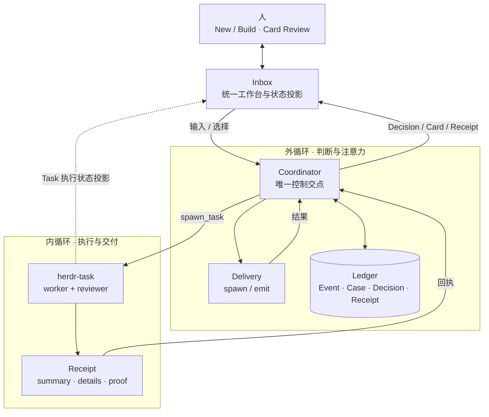
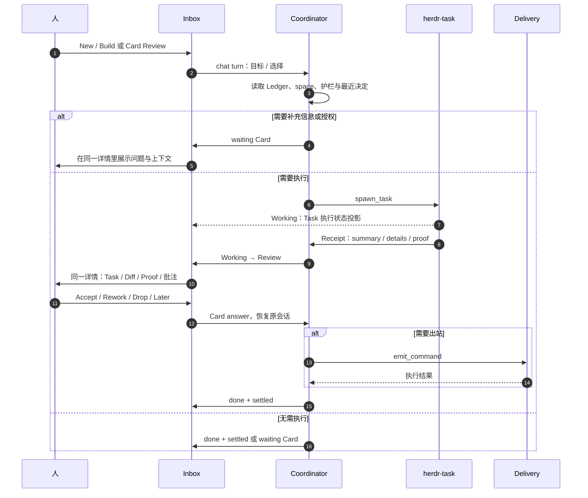

# collie · 双循环与统一交互

> v2.1 交互修订，**待 review**。核心定义：**Inbox 是横跨两个循环的统一工作台与状态投影；Coordinator 是两个循环的唯一控制交点；herdr-task 是内循环执行器。**设计约束见 [`DESIGN.md`](DESIGN.md)。

## 1. 双循环总图



两个闭环是：

- **外循环**：Inbox → Coordinator → Delivery / Card → Coordinator → Inbox。
- **内循环**：Coordinator → herdr-task → Receipt → Coordinator。

没有第三条经过 shepherdr Tasks 或原生 Accept 的循环。

### 交点与状态边界

| 角色 | 负责什么 | 不负责什么 |
|:--|:--|:--|
| **Inbox** | 统一呈现 Decision、Working、Receipt、Settled；承载人的 New / Build 与 Card Review | 不另建 Task 状态机，不直接指挥 worker |
| **Coordinator** | 接收输入、判断、spawn / emit、接收 Receipt、恢复原会话、闭合两个循环 | 不写代码，不绕过 Ledger 与护栏 |
| **herdr-task** | worktree、worker、reviewer、Task 执行状态、ready 三件套 | 不决定是否执行、不接受、不 delivery |
| **Ledger** | 两个循环共享的事实历史 | 不做判断，不复制第二份 Task 状态 |

## 2. 人与 Inbox 的交互图

人始终从同一个 Inbox 进入。New / Build 是主动发起，Card Review 是继续已有 Decision；机器事件只是另一种输入来源，后续没有第二套流程。



- **New / Build 与 Card answer** 属于 chat turn，不占机器 job turn 的唤醒预算。
- **机器 job turn** 由 Ingress 递入，消耗全局预算；它只在 Inbox 中成为 Decision / Card，不注入其他 chat。
- **Rework** 先回 coordinator，形成带结构化批注的新 brief，再进入内循环；人不直接在内循环里指挥 worker。
- **Accept 与 delivery** 由 coordinator 根据人的选择推进，不由 herdr-task 或 shepherdr UI 收尾。

## 3. 独立 Inbox layout

```text
Inbox
 ├─ New / Build
 ├─ Needs you / Working / Settled
 └─ 统一详情
    ├─ Decision / Task / Receipt / Proof
    ├─ Diff / Review 批注
    └─ Accept / Rework / Drop / Later
```

- Inbox 同时覆盖两个循环：外循环的 Decision 与 Card，内循环的 Task 执行投影与 Receipt。
- Task、Diff、Receipt、Proof 都留在 Inbox 详情，不跳转 shepherdr `tasks-thread`。
- `Decision.run.task_ref` 只保存任务标识，供 Working 和 Diff 导航，不复制任务状态。
- shepherdr 提供执行能力与渲染原语，不提供 Inbox 的页面、导航和验收流程。

## 4. 不变量

- 机器事件不注入人的其他 chat；它只在 Inbox 中成为 Decision / Card。
- `ack` 只表示看过；只有 `settled` 才表示处理完成。
- 卡片回答不清零 hops；`hops > 8` 只记录并出 alert 卡。
- Receipt 必须有 summary、details、proof 和已记录复核，不能用最后一条消息代替。
- 真人 accept 是 delivery 的必要条件；coordinator 自述或风险字段不能代替授权。
- 规则草稿必须经人批准才进入路由表。

## 5. 代码对照

| 阶段 | 实现入口 |
|:--|:--|
| 去重、归并、路由、lane 快照 | `kernel/ingress.ts` |
| 事件、Case、Decision、Receipt 落账 | `kernel/ledger.ts` |
| Case 快照、预算、护栏与决定 | `kernel/coordinator.ts` |
| 双循环编排、lane 关闭、队列投影 | `service/main.ts` |
| herdr-task 派发与 ready 回执 | `plugins/agent/herdr.ts` |
| 卡片回答与原会话恢复 | `plugins/channel/herdr.ts` |
| GitLab / GitHub / IM 出站 | `plugins/delivery/` |
| Inbox 工作台与 Task / Diff 导航 | `mods/collie/`、`lib/inbox-queue.js` |
| 规则草稿、人工批准与直派率 | `kernel/route-learning.ts` |
| 安装、更新、卸载与 doctor | `bin/collie` |
