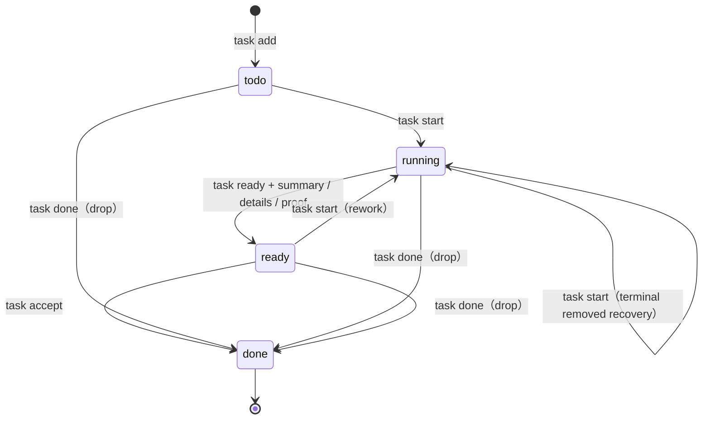
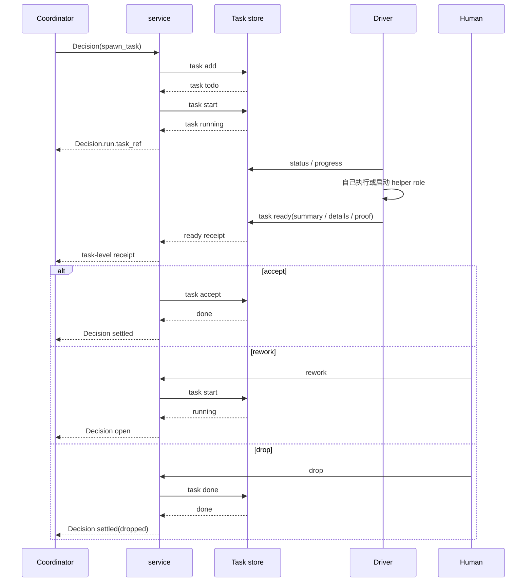

# Collie · Task 生命周期

> Task 只记录执行事实，Decision 记录判断，Work 是 Decision + Task + live agent 在 Inbox 的只读投影。
> 一个 task 的生命周期只有四个状态：`todo / running / ready / done`。

## 1. 谁改什么

| 对象 | 状态 | 谁写 | 说明 |
|---|---|---|---|
| Decision | `open / waiting / settled` | Coordinator / service / system | Coordinator 拥有业务判断；service/system 写 guard、answer、failure 与 finalization revision |
| Task | `todo / running / ready / done` | service / driver | service 创建和终结；driver 推进执行事实 |
| Work | `Todo / Working / Needs you / Settled` | 无人写入 | 读取 Decision + Task + live agent 后投影 |
| Helper | live terminal 状态 | Herdr | 不进入 Task state |

关键边界：

- Coordinator 不改 Task state；service/system 的 Decision 写入不是第二个判断者。
- Driver 不改 Decision，也不把 task 标成 `done`。
- Driver 的终点是 `ready`，交付 summary、details、proof。
- `done` 是验收或放弃后的终结状态，由 service 执行 task 命令落下。
- Work 不反写任何持久事实。

## 2. Decision 与 Task

Collie 有两个需要维护生命周期的持久状态机：Decision 和 Task。它们回答的不是同一个问题：

- **Decision**：这件事该不该做，做到哪一步，谁来做最终裁决。
- **Task**：这次执行实际发生了什么，交付了什么。

这两个问题不能合并成一个对象，否则判断和执行会互相污染。

### 2.1 Decision 是判断

Decision 写在 Ledger 里，是追加式的事实。Coordinator 拥有业务判断；service/system 也会写入 guard、Card answer、driver failure 和 accept / drop finalization 等生命周期 revision。这些写入执行系统边界，不引入第二个 dispatcher，Driver 不写 Decision。

```text
Decision
├── state: open / waiting / settled
├── actions: spawn_task / ask / noop / ...
├── run.task_ref
└── receipt_ref
```

Decision 可以没有 Task：

- `ask` 只产生一张 Card。
- `noop` 只记录“这轮不动”。
- `waiting` 可能只是在等人回答。

Decision 不拥有 worktree、driver、terminal。它只说明判断结果和执行指向。

### 2.2 Task 是执行事实

Task 由 service 创建，存在 task store 里，记录这次执行的真实状态。

```text
Task
├── state: todo / running / ready / done
├── worktree / branch / base
├── agents / progress
└── summary / details / proof
```

Task 可以没有 Decision：

- 直接 `collie task add` 创建的 task，可以之后被 adopt。
- 没有 Decision 时，它仍然有执行事实，只是暂时没有外循环判断。

canonical `Task.ref`（例如 `COLL-42`）贯穿 spawn、adopt、Receipt 与 Artifact 绑定；不使用 key 或 id 兼容回退。

Task 不拥有 Decision、Card 或 Work。它也不保存 review verdict；review 是 playbook 的过程，不是 Task 的状态。

### 2.3 为什么必须拆开

| 维度 | Decision | Task |
|---|---|---|
| 所属循环 | 外循环 | 内循环 |
| 写入者 | Coordinator / service / system | service / driver |
| 主要问题 | 该不该做、谁裁决 | 实际做了什么、交付了什么 |
| 生命周期 | 一次判断，可等待人 | 一次执行，可 rework |
| 存储 | Ledger，追加 | task store，更新 |
| 可以单独存在 | 可以 | 可以 |

拆开的直接原因：

1. **存在性不对称。** Decision 可以没有 Task，Task 也可以没有 Decision。合并后会逼着两边伪造对方。
2. **写权限不同。** Coordinator 不该改 worktree 和 task facts；driver 不该改 Decision 和 policy。
3. **事务边界不同。** Decision 是 Ledger 追加；Task 是可更新的执行记录。强行放进一个聚合，会让局部更新变成跨存储事务。
4. **生命周期不同。** 一次判断可能只产生一张 Card；一个 Task 可能经历多轮 rework 才 ready。
5. **失败归因不同。** Decision 失败是判断/授权问题；Task 失败是执行/交付问题。混在一起就无法区分。

所以两者是**引用关系**，不是父子对象：

```text
Decision.run.task_ref ─────▶ Task
Task.receipt ──────────────▶ service ─────▶ Coordinator
```

- 一条 Decision 最多创建一个 `spawn_task`。
- 一个 Task 只有一个 driver。
- Rework 复用同一个 Task，不创建第二个 Task。
- 新的工作才创建新的 Decision 和 Task。
- Coordinator 不写 Task；driver 不写 Decision。

### 2.4 Task 只是内循环，但事实会回到外循环

Task 产生于内循环，负责执行；但它的结果不是内循环私有：

```text
Coordinator
  → Decision
  → Task
  → Driver / Helper
  → Receipt
  → Coordinator
```

Task 的事实会通过 receipt 和 Work 投影回到外循环。
但 Task 仍然不承担外循环的判断、Card 和最终裁决。

### 2.5 Work 不是第三个状态机

Work / Ticket 是 Decision + Task + live agent 的读时投影：

```text
Work = Decision.state
     + Task.state
     + live agent / blocked
```

它没有自己的持久状态，也不反写 Decision 或 Task。Decision 和 Task 可以独立拆解，Work 负责把它们合成人看到的那一个状态。投影按以下顺序取第一个命中的条件：

| 优先级 | 条件 | Work |
|---|---|---|
| 1 | Decision `settled` | **Settled** |
| 2 | Decision `waiting` | **Needs you** |
| 3 | live agent blocked | **Needs you** |
| 4 | 有 live driver / helper role | **Working** |
| 5 | Task `ready` | **Needs you** |
| 6 | Task `done` | **Settled** |
| 7 | Task `running`（包括没有 live agent） | **Working** |
| 8 | 其他情况 | **Todo** |

没有 Decision 的 orphan Task 从 live / Task 条件开始投影，因此 orphan `done` 是 Settled，orphan `running` 没有 live agent 仍是 Working。`Decision.open + Task.done` 在没有更高优先级 live 条件时也是 Settled；Task ready 但 helper 仍活跃时是 Working。

## 3. 状态图



`ready` 不是 `done`。
`ready` 表示“driver 已交付，等待下一步”；`done` 表示“这次执行已被 accept 或 drop，记录已经终结”。

## 4. 端到端流程



## 5. 分阶段状态

| 阶段 | Task | Decision | Work | 触发 |
|---|---|---|---|---|
| 判断完成 | 尚无 task | `open` | Todo | Coordinator 提交 `spawn_task` |
| task 已创建 | `todo` | `open` | Todo | service 写入 task |
| task 已启动 | `running` | `open` | Working | service 启动 driver；即使没有 live agent 也相同 |
| driver 执行 | `running` | `open` | Working | driver / helper 活动 |
| driver 交付 | `ready`，无 live role | `open` | Needs you | `collie task ready` |
| helper 仍活动 | `ready` | `open` | Working | live role 的优先级高于 Task ready |
| 等待人验收 | `ready` | `waiting` | Needs you | accept Card；Decision waiting 优先于 live role |
| 验收通过 | `done` | `settled` | Settled | `collie task accept` |
| 要求返工 | `running` | `open` | Working | rework 后重新启动同一 task |
| 执行记录已终结 | `done`，无更高优先级条件 | `open` 或无 Decision | Settled | finalization 中间态或 orphan Task |
| 放弃 | `done` | `settled` | Settled | drop |

这些例子都服从 §2.5 的首个命中规则；不能把 Task ready 或 done 单独当作无视 Decision / live 条件的映射。

## 6. 构建

Coordinator 只提交判断：

```text
Decision
  state: open
  actions: [spawn_task]
  spawn:
    title
    brief_ref
    project?
    playbook?
  run:
    kind: build | review
```

service 收到 Decision 后做三件事：

1. 校验只有一个 `spawn_task`。
2. 生成 task brief，写入 `brief_ref`。
3. 调 task store 创建 task，并启动 driver。

创建后的初始事实：

```text
Task.state = todo
Decision.state = open
Decision.run.task_ref = <task ref>
Work = Todo
```

service 立即启动 task 后：

```text
Task.state = running
Task.started_at = <time>
Work = Working
```

`todo` 是创建到启动之间的短暂状态；运行中的 task 不应停留在 `todo`。

## 7. 执行

Driver 收到：

- task brief
- playbook prompt
- role catalog
- `collie task` 命令

执行期间：

- Driver 可以自己完成，也可以启动 reviewer / verifier 等 helper。
- Helper 共享 `herdr.task`，不创建新 task，不写 Decision。
- Driver 用 `collie task status` 记录进度；Task 仍是 `running`。
- Helper 的 live 状态只影响 Work 的 phase 和 Needs you 判断，不改变 Task state。

Driver 提交交付：

```sh
collie task ready <task> \
  --summary "一句话说明完成了什么" \
  --details "怎么做的、改了哪些面、有什么遗留" \
  --proof "验收凭据"
```

这一刻：

```text
Task.state = ready
Task.ready_at = <time>
Receipt = summary / details / proof
Decision.receipt_ref = <receipt id>
Work = Needs you
```

没有 receipt 的 `ready` 不算交付。`summary / details / proof` 都是必填通用字段，review verdict 不是额外要求。`proof` 必须有可核验的引用，不能只截一段最后消息。

Ticket 的 Artifacts 只接受两种显式绑定：

1. artifact 自身的 `artifact.task` 指向该 Task；
2. artifact 被 `Task.proof` 引用，此时 proof 排在列表首位。

Ticket 不扫描 agent / chat 日志，也不按 publisher 或时间窗口推断 artifact 归属。Ticket body 只有 Terminal 与 Artifacts 两个 tab：Terminal 指向 driver（已结束时可显示其历史 terminal），reviewer / verifier / helper 使用独立 Herdr tab，helper-only 不能抢占 driver Terminal。

## 8. 回执到 Coordinator

Service 把 task-level receipt 交给 Coordinator，而不是每个 helper 都触发一次判断。

Coordinator 读：

- receipt 的 summary / details / proof
- Decision 当前状态
- task facts
- policy / risk

然后只做三种判断：

```text
accept  交付成立，终结 task
rework  交付不成立，继续同一 task
drop    不再继续
```

Coordinator 不直接改 Task；它把判断写成 Decision 或 Card，由 service 执行对应的 task 命令。

需要人裁决时：

```text
Decision.state = waiting
Card.kind = accept
Work = Needs you
Task.state = ready
```

## 9. 最终完成

### Accept

Accept 表示接受这次交付：

```text
ready
  → 执行 accept
  → Task.done
  → Decision.settled
  → Work.Settled
```

`merge / comment / close` 是 playbook 定义的 delivery 动作，不是 Task state，也不是所有 task 的必经步骤。Task lifecycle 不规定 delivery 的执行顺序。

### Rework

Rework 不创建第二个 task：

```text
ready
  → Decision 记录 rework
  → Task.start
  → Task.running
  → Driver 继续同一 task
```

terminal 已移除的 stopped-running Task 也通过 `start` 原地恢复，保持 `running` 和同一个 canonical Task ref，不创建新 Task。新的交付仍然走 `running → ready → receipt`。

### Drop

Drop 表示不再继续，finalization 先终结 Task，再终结 Decision：

```text
todo / running / ready
  → service 执行 task done
  → Task.done
  → Decision.settled { outcome: dropped }
  → Work.Settled
```

Task 命令失败时 Decision 保持 waiting，重试成功后才写 settled，避免出现 Decision 已结案而 Task 未终结的分裂状态。

### 失败

Driver 没有交出 `ready` 就退出时：

- Task 不进入 `done`。
- Service 写 Decision waiting / Card，Work 进入 Needs you。
- 人可以 rework（重新启动 task）或 drop（终结 task）。
- 失败细节属于 Receipt / Card / task facts，不新增 Task state。

## 10. 最终交付边界

- Task `done` 的条件：交付被 accept，或工作被 drop / finalization。
- `merge / emit_command / 评论 / 关闭 issue` 属于 delivery，由 playbook / Decision 决定；它们不产生新的 Task state。
- delivery 失败由 Decision / Card / playbook 处理，不回退 Task lifecycle。
- `ready` 是 driver 已交付，`done` 是 accept / drop 后执行记录终结。
- 同一个 Work 继续下一轮时，复用同一 Task ref；新工作才创建新 Decision / Task。
- Coordinator 只处理 task-level 结果；helper 的 findings / verdict 不直接进入 Coordinator。

## 11. 不变量

1. Task 只有 `todo / running / ready / done`。
2. Driver 只交 `ready`；`done` 由验收或放弃终结。
3. `ready` 必须有 receipt：summary、details、proof。
4. 对有 Decision 的 Work，`done` 与 `Decision.settled` 同向发生；不能只完成一个。
5. Work 是投影，不写回 Ledger 或 task store。
6. 一个 task 只有一个 driver；helper 不是第二个 task。
7. Rework 复用同一 task，不重复派工。
8. delivery 动作不改变 Task state；是否 merge 由 playbook 决定。
